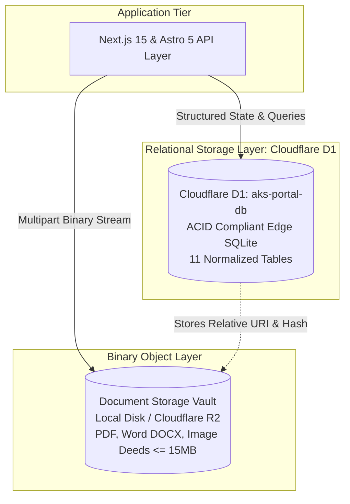
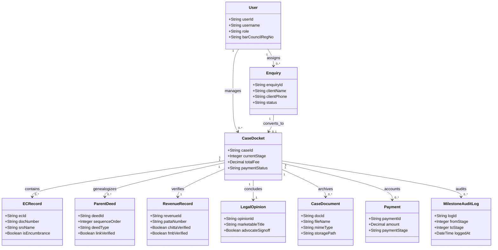
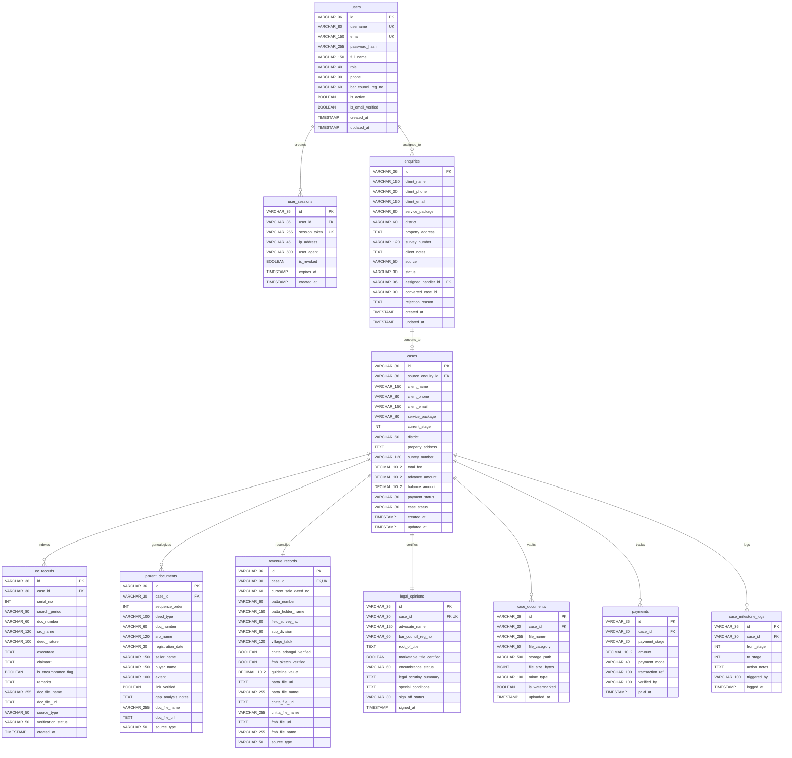
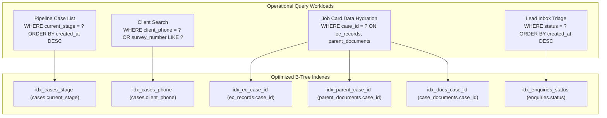

# Database Design Document (DDD)
## Relational Schema & Storage Architecture Specification
### AKS Property Checklist & Legal Operations Platform

**Document Version:** 1.0.0  
**Standard Compliance:** ISO/IEC 11179 / DAMA-DMBOK / IEEE 42010  
**Database Engine:** Cloudflare D1 Distributed Serverless SQLite (APAC)  
**Database Name:** `aks-portal-db`  
**Database UUID:** `c987d1f0-a579-4e4c-8482-36482bebfd7f`  
**Storage Engine:** Polyglot Architecture (Cloudflare D1 SQL + Local/R2 Document Vault)  
**Governing Advocate:** Advocate A.K. Saravanan (M.E. Energy, LLB) | Bar Council Reg: MS/1245/2005  
**Date of Release:** October 2026  

---

## 1. Executive Summary & Storage Philosophy

The **AKS Property Checklist & Legal Operations Platform** employs an edge-first, polyglot data architecture designed to balance transactional rigor with high-speed performance across Tamil Nadu.

### 1.1 Storage Architecture Philosophy: Polyglot Persistence
Legal diligence produces two fundamentally different data classes:
1. **Relational Metadata & Audit Logs (Lightweight, Transactional):**
   - Case dockets, client contacts, 30-year sub-registrar EC entries, parent deed links, revenue survey records, milestone state changes, and financial accounting.
   - **Target:** **Cloudflare D1 Distributed SQLite**, replicated across Asia-Pacific edge data centers (Singapore / Chennai / Mumbai colos).
2. **Unstructured Binary Documents (Heavy, Static Blobs up to 15 MB):**
   - Certified registered sale deeds, ancestral partition documents, e-Pattas, Chitta registers, FMB survey drawings, and Microsoft Word drafting files (`.docx`, `.doc`).
   - **Target:** **Document Vault (Local Disk / Cloudflare R2 Object Storage)**. The database stores only file paths, MIME types, file sizes, and verification checksums, ensuring relational tables remain ultra-fast ($< 15\text{ ms}$ query latency).



---

## 2. Conceptual Data Model

The conceptual model establishes the core domain entities and their business interactions within a property title scrutiny practice.



---

## 3. Logical Data Model & Normalization Analysis

### 3.1 Normalization (3NF & BCNF Compliance)
The relational schema adheres strictly to **Third Normal Form (3NF)** and **Boyce-Codd Normal Form (BCNF)**:
1. **First Normal Form (1NF):** All attributes are atomic (no repeating groups, comma-separated arrays, or composite nested columns). Array attributes (e.g. EC records, parent documents) are extracted into independent relation tables with foreign keys.
2. **Second Normal Form (2NF):** Every non-key attribute is fully functionally dependent on the entire primary key. In all tables with synthetic UUIDs or alphanumeric identifiers (`AK-2026-XXX`, `ENQ-2026-XXX`), full functional dependency is guaranteed.
3. **Third Normal Form (3NF):** No transitive dependencies exist. For example, revenue details (`patta_number`, `chitta_file_url`) are isolated in `revenue_records` rather than duplicated in `cases`.
4. **Boyce-Codd Normal Form (BCNF):** For every functional dependency $X \rightarrow Y$, $X$ is a superkey.

### 3.2 Cardinality & Relationship Matrix

| Parent Entity | Child Entity | Cardinality | Foreign Key | Cascade Behavior | Business Justification |
| :--- | :--- | :--- | :--- | :--- | :--- |
| `users` | `user_sessions` | $1 : N$ | `user_sessions.user_id` | `ON DELETE CASCADE` | When a user is deleted, all active tokens are revoked. |
| `users` | `enquiries` | $1 : N$ | `enquiries.assigned_handler_id` | `ON DELETE SET NULL` | Reassigning staff preserves lead audit logs. |
| `enquiries` | `cases` | $1 : 1$ | `cases.source_enquiry_id` | `ON DELETE RESTRICT` | A converted lead cannot be purged if an active docket exists. |
| `cases` | `ec_records` | $1 : N$ | `ec_records.case_id` | `ON DELETE CASCADE` | 30-year EC records belong exclusively to their case docket. |
| `cases` | `parent_documents`| $1 : N$ | `parent_documents.case_id`| `ON DELETE CASCADE` | Parent deed genealogy belongs exclusively to their case docket. |
| `cases` | `revenue_records` | $1 : 1$ | `revenue_records.case_id` | `ON DELETE CASCADE` | Every docket maintains exactly one revenue audit record. |
| `cases` | `legal_opinions` | $1 : 1$ | `legal_opinions.case_id` | `ON DELETE CASCADE` | Every docket maintains exactly one formal title certificate. |
| `cases` | `case_documents` | $1 : N$ | `case_documents.case_id` | `ON DELETE CASCADE` | Uploaded deeds and DOCX files belong exclusively to their case. |
| `cases` | `payments` | $1 : N$ | `payments.case_id` | `ON DELETE CASCADE` | Financial audit trail for 80% advance and 20% balance. |
| `cases` | `case_milestone_logs`|$1 : N$| `case_milestone_logs.case_id`| `ON DELETE CASCADE`| Comprehensive chronological stage audit log. |

---

## 4. Entity-Relationship Diagram (ERD)



---

## 5. Detailed Physical Data Dictionary

### Table 1: `users` (Identity & RBAC)
Stores internal staff and advocate credentials with OWASP-compliant security attributes.

| Column Name | Physical Type | Constraints | Default | Description |
| :--- | :--- | :--- | :--- | :--- |
| `id` | `VARCHAR(36)` | `PRIMARY KEY` | None | Synthetic ID (e.g. `usr_adv_001`). |
| `username` | `VARCHAR(80)` | `UNIQUE, NOT NULL` | None | Unique login handle (e.g. `advocate.saravanan`). |
| `email` | `VARCHAR(150)` | `UNIQUE, NOT NULL` | None | Authorized operational email. |
| `password_hash` | `VARCHAR(255)` | `NOT NULL` | None | Bcrypt hash (Cost factor 12). |
| `full_name` | `VARCHAR(150)` | `NOT NULL` | None | Full legal practitioner name. |
| `role` | `VARCHAR(40)` | `NOT NULL` | `'RESEARCH_STAFF'` | `SUPER_ADMIN`, `ADVOCATE_ADMIN`, `RESEARCH_STAFF`. |
| `phone` | `VARCHAR(30)` | Nullable | `NULL` | Operational contact number. |
| `bar_council_reg_no`| `VARCHAR(60)` | Nullable | `NULL` | Bar Council of Tamil Nadu Reg (e.g. `MS/1245/2005`). |
| `is_active` | `BOOLEAN` | `NOT NULL` | `1` | Soft-disable flag. |
| `is_email_verified`| `BOOLEAN` | `NOT NULL` | `0` | Email confirmation status. |
| `created_at` | `TIMESTAMP` | `NOT NULL` | `CURRENT_TIMESTAMP`| Audit record creation timestamp. |
| `updated_at` | `TIMESTAMP` | `NOT NULL` | `CURRENT_TIMESTAMP`| Record last modification timestamp. |

---

### Table 2: `enquiries` (Tier-1 Staged Inbound Buffer)
Isolates public leads from active cases to prevent spam contamination.

| Column Name | Physical Type | Constraints | Default | Description |
| :--- | :--- | :--- | :--- | :--- |
| `id` | `VARCHAR(36)` | `PRIMARY KEY` | None | Alphanumeric lead ID (e.g. `ENQ-2026-101`). |
| `client_name` | `VARCHAR(150)` | `NOT NULL` | None | Prospective client full name. |
| `client_phone` | `VARCHAR(30)` | `NOT NULL` | None | Client WhatsApp / Mobile contact. |
| `client_email` | `VARCHAR(150)` | Nullable | `NULL` | Client notification email. |
| `service_package` | `VARCHAR(80)` | `NOT NULL` | `'Legal Opinion (Standard)'`| Chosen service category from web checklist. |
| `district` | `VARCHAR(60)` | `NOT NULL` | None | Tamil Nadu revenue district (e.g. Coimbatore). |
| `property_address`| `TEXT` | Nullable | `NULL` | Village, taluk, door/plot details. |
| `survey_number` | `VARCHAR(120)` | Nullable | `NULL` | Field Survey No. / Sub-division. |
| `client_notes` | `TEXT` | Nullable | `NULL` | Specific user remarks or urgent deadlines. |
| `source` | `VARCHAR(50)` | `NOT NULL` | `'website'` | Ingestion channel: `website`, `whatsapp`, `phone`. |
| `status` | `VARCHAR(30)` | `NOT NULL` | `'new'` | `new`, `contacted`, `accepted`, `rejected`, `spam`. |
| `assigned_handler_id`| `VARCHAR(36)` | `REFERENCES users(id)` | `NULL` | Clerk assigned to conduct discovery call. |
| `converted_case_id`| `VARCHAR(30)` | Nullable | `NULL` | Points to `cases.id` when accepted. |
| `rejection_reason`| `TEXT` | Nullable | `NULL` | Notes explaining why lead was archived. |
| `created_at` | `TIMESTAMP` | `NOT NULL` | `CURRENT_TIMESTAMP`| Lead submission timestamp. |

---

### Table 3: `cases` (Tier-2 Active Legal Matters)
Master docket entity orchestrating the 8-Stage SOP verification lifecycle.

| Column Name | Physical Type | Constraints | Default | Description |
| :--- | :--- | :--- | :--- | :--- |
| `id` | `VARCHAR(30)` | `PRIMARY KEY` | None | Official Docket ID (e.g. `AK-2026-285`). |
| `source_enquiry_id`| `VARCHAR(36)` | `REFERENCES enquiries(id)`| `NULL` | Provenance link to original public enquiry. |
| `client_name` | `VARCHAR(150)` | `NOT NULL` | None | Client legal name. |
| `client_phone` | `VARCHAR(30)` | `NOT NULL` | None | Primary contact number. |
| `client_email` | `VARCHAR(150)` | Nullable | `NULL` | Document dispatch email. |
| `service_package` | `VARCHAR(80)` | `NOT NULL` | `'Legal Opinion (Standard)'`| Agreed scope of diligence. |
| `current_stage` | `INT` | `NOT NULL` | `1` | Active SOP milestone (1 to 8). |
| `district` | `VARCHAR(60)` | `NOT NULL` | None | Registration/Revenue district. |
| `property_address`| `TEXT` | Nullable | `NULL` | Legal schedule of property location. |
| `survey_number` | `VARCHAR(120)` | Nullable | `NULL` | Official S.F. No. / T.S. No. |
| `total_fee` | `DECIMAL(10,2)`| `NOT NULL` | `6500.00` | Agreed professional fee. |
| `advance_amount` | `DECIMAL(10,2)`| `NOT NULL` | `5200.00` | 80% statutory upfront advance fee. |
| `balance_amount` | `DECIMAL(10,2)`| `NOT NULL` | `1300.00` | 20% final balance fee. |
| `payment_status` | `VARCHAR(30)` | `NOT NULL` | `'advance_pending'` | `advance_pending`, `advance_paid`, `fully_paid`. |
| `case_status` | `VARCHAR(30)` | `NOT NULL` | `'active'` | `active`, `on_hold`, `completed`, `cancelled`. |
| `created_at` | `TIMESTAMP` | `NOT NULL` | `CURRENT_TIMESTAMP`| Docket opening timestamp. |
| `updated_at` | `TIMESTAMP` | `NOT NULL` | `CURRENT_TIMESTAMP`| State transition timestamp. |

---

### Table 4: `ec_records` (30-Year Encumbrance Certificate Matrix)
Stores indexed transactions from Book 1 registers extracted from TNREGINET.

| Column Name | Physical Type | Constraints | Default | Description |
| :--- | :--- | :--- | :--- | :--- |
| `id` | `VARCHAR(36)` | `PRIMARY KEY` | None | Unique EC entry UUID. |
| `case_id` | `VARCHAR(30)` | `NOT NULL, REFERENCES cases(id) ON DELETE CASCADE` | None | Parent case docket reference. |
| `serial_no` | `INT` | `NOT NULL` | None | Sequential chronological order. |
| `search_period` | `VARCHAR(80)` | Nullable | None | Period of search (e.g. `1994 - 2026`). |
| `doc_number` | `VARCHAR(60)` | `NOT NULL` | None | Registered Deed No & Year (e.g. `1428/2012`). |
| `sro_name` | `VARCHAR(120)` | `NOT NULL` | None | Sub-Registrar Office jurisdiction. |
| `deed_nature` | `VARCHAR(100)` | `NOT NULL` | None | Nature: `Sale Deed`, `Mortgage`, `Partition`. |
| `executant` | `TEXT` | Nullable | None | Transferor / Mortgagor name(s). |
| `claimant` | `TEXT` | Nullable | None | Transferee / Mortgagee name(s). |
| `is_encumbrance_flag`| `BOOLEAN`| `NOT NULL` | `0` | `1` if transaction is an adverse charge. |
| `remarks` | `TEXT` | Nullable | `NULL` | Discharge details, court stay, or notes. |
| `doc_file_name` | `VARCHAR(255)` | Nullable | `NULL` | File name of certified copy. |
| `doc_file_url` | `TEXT` | Nullable | `NULL` | Vault path to certified copy deed. |
| `source_type` | `VARCHAR(50)` | `NOT NULL` | `'MANUAL_UPLOAD'` | `MANUAL_UPLOAD` or `TNREGINET_AUTO_FETCH`. |
| `verification_status`|`VARCHAR(50)`| `NOT NULL` | `'VERIFIED'` | `VERIFIED`, `FLAGGED`, `PENDING_VALIDATION`. |

---

### Table 5: `parent_documents` (Chain of Title Genealogy)
Traces the unbroken devolution of title across 30+ years from root vendor to current owner.

| Column Name | Physical Type | Constraints | Default | Description |
| :--- | :--- | :--- | :--- | :--- |
| `id` | `VARCHAR(36)` | `PRIMARY KEY` | None | Unique parent deed UUID. |
| `case_id` | `VARCHAR(30)` | `NOT NULL, REFERENCES cases(id) ON DELETE CASCADE` | None | Parent case docket reference. |
| `sequence_order` | `INT` | `NOT NULL` | `1` | Devolution order (1 = Root title deed). |
| `deed_type` | `VARCHAR(100)` | `NOT NULL` | None | `Sale Deed`, `Partition Deed`, `Settlement`. |
| `doc_number` | `VARCHAR(60)` | `NOT NULL` | None | Registered document number and year. |
| `sro_name` | `VARCHAR(120)` | Nullable | None | Sub-Registrar Office. |
| `registration_date`| `VARCHAR(30)` | Nullable | None | Exact registration date (DD/MM/YYYY). |
| `seller_name` | `VARCHAR(150)` | Nullable | None | Vendor / Executant name. |
| `buyer_name` | `VARCHAR(150)` | Nullable | None | Purchaser / Claimant name. |
| `extent` | `VARCHAR(100)` | Nullable | None | Land area (e.g. `2,400 Sq.Ft` / `1.50 Acres`). |
| `link_verified` | `BOOLEAN` | `NOT NULL` | `1` | `1` if title passes legally to next link. |
| `gap_analysis_notes`| `TEXT` | Nullable | `NULL` | Notes on legal heirship, revenue mutations. |
| `doc_file_url` | `TEXT` | Nullable | `NULL` | Vault path to deed scan (PDF/Word). |

---

### Table 6: `revenue_records` (Patta, Chitta, FMB & TSLR Audit)
Consolidates the four revenue pillars required under the *Tamil Nadu Patta Pass Book Act, 1983*.

| Column Name | Physical Type | Constraints | Default | Description |
| :--- | :--- | :--- | :--- | :--- |
| `id` | `VARCHAR(36)` | `PRIMARY KEY` | None | Revenue record UUID. |
| `case_id` | `VARCHAR(30)` | `UNIQUE, NOT NULL, REFERENCES cases(id) ON DELETE CASCADE` | None | 1:1 binding to legal case docket. |
| `current_sale_deed_no`| `VARCHAR(60)`| Nullable | None | Latest registered deed number. |
| `patta_number` | `VARCHAR(60)` | Nullable | None | Registered Patta number. |
| `patta_holder_name`| `VARCHAR(150)`| Nullable | None | Exact name recorded in e-Patta. |
| `field_survey_no`| `VARCHAR(80)` | Nullable | None | Revenue Survey Number. |
| `sub_division` | `VARCHAR(60)` | Nullable | None | Sub-divided letter/number (e.g. `3A`). |
| `village_taluk` | `VARCHAR(120)` | Nullable | None | Revenue Village & Taluk administration. |
| `chitta_adangal_verified`|`BOOLEAN`| `NOT NULL` | `0` | Verified against Tamil Nilam Chitta register. |
| `fmb_sketch_verified`| `BOOLEAN` | `NOT NULL` | `0` | Verified against Field Measurement Book sketch. |
| `guideline_value`| `DECIMAL(10,2)`| Nullable | `NULL` | State guideline valuation rate per sq.ft/acre. |
| `patta_file_url` | `TEXT` | Nullable | `NULL` | Vault path to e-Patta PDF/DOCX. |
| `patta_file_name`| `VARCHAR(255)` | Nullable | `NULL` | Original uploaded filename of Patta. |
| `chitta_file_url`| `TEXT` | Nullable | `NULL` | Vault path to Chitta extract (DOCX/PDF). |
| `chitta_file_name`|`VARCHAR(255)` | Nullable | `NULL` | Original uploaded filename of Chitta. |
| `fmb_file_url` | `TEXT` | Nullable | `NULL` | Vault path to FMB sketch drawing. |
| `fmb_file_name` | `VARCHAR(255)` | Nullable | `NULL` | Original uploaded filename of FMB. |

---

### Table 7: `legal_opinions` (Advocate Scrutiny & Sign-off)
Stores Advocate A.K. Saravanan's formal title opinion findings and statutory conditions.

| Column Name | Physical Type | Constraints | Default | Description |
| :--- | :--- | :--- | :--- | :--- |
| `id` | `VARCHAR(36)` | `PRIMARY KEY` | None | Opinion record UUID. |
| `case_id` | `VARCHAR(30)` | `UNIQUE, NOT NULL, REFERENCES cases(id) ON DELETE CASCADE` | None | 1:1 binding to legal case docket. |
| `advocate_name` | `VARCHAR(120)` | `NOT NULL` | `'Advocate A.K. Saravanan'`| Chief Legal Advisor name. |
| `bar_council_reg_no`| `VARCHAR(60)`| Nullable | `'MS/1245/2005'` | Statutory Bar Council registration number. |
| `root_of_title` | `TEXT` | Nullable | None | Legal origin of title devolution narrative. |
| `marketable_title_certified`|`BOOLEAN`| `NOT NULL` | `0` | Final legal affirmative title certification. |
| `encumbrance_status`| `VARCHAR(60)`| `NOT NULL` | `'Clear'` | `Clear`, `Mortgaged`, `Court Dispute`. |
| `legal_scrutiny_summary`| `TEXT` | Nullable | None | Executive legal findings overview. |
| `special_conditions`| `TEXT` | Nullable | None | Mandatory pre-registration requirements. |
| `sign_off_status`| `VARCHAR(30)` | `NOT NULL` | `'draft'` | `draft`, `reviewed`, `certified`. |
| `signed_at` | `TIMESTAMP` | Nullable | `NULL` | Official timestamp of advocate sign-off. |

---

### Table 8: `case_documents` (Binary Vault Registry)
Maintains metadata and vault pointers for all uploaded client files, deeds, and Word drafts.

| Column Name | Physical Type | Constraints | Default | Description |
| :--- | :--- | :--- | :--- | :--- |
| `id` | `VARCHAR(36)` | `PRIMARY KEY` | None | Unique document UUID. |
| `case_id` | `VARCHAR(30)` | `NOT NULL, REFERENCES cases(id) ON DELETE CASCADE` | None | Associated case docket reference. |
| `file_name` | `VARCHAR(255)` | `NOT NULL` | None | Sanitized filename stored in vault. |
| `file_category` | `VARCHAR(50)` | `NOT NULL` | None | `Deed`, `Patta`, `Chitta`, `FMB`, `EC`, `Opinion`. |
| `storage_path` | `VARCHAR(500)` | `NOT NULL` | None | Relative vault URI (e.g. `/uploads/AK.../file`). |
| `file_size_bytes`| `BIGINT` | Nullable | None | File size in bytes (Enforces $\le 15\text{ MB}$). |
| `mime_type` | `VARCHAR(100)` | Nullable | None | `application/pdf`, `.docx`, `image/png`. |
| `is_watermarked`| `BOOLEAN` | `NOT NULL` | `0` | `1` if stamped with provisional preview watermark. |
| `uploaded_at` | `TIMESTAMP` | `NOT NULL` | `CURRENT_TIMESTAMP`| Document vault ingestion timestamp. |

---

### Table 9: `payments` (Financial Milestones & Reconciliation)
Tracks the two-tier statutory fee collection model (80% advance / 20% balance).

| Column Name | Physical Type | Constraints | Default | Description |
| :--- | :--- | :--- | :--- | :--- |
| `id` | `VARCHAR(36)` | `PRIMARY KEY` | None | Payment ledger entry UUID. |
| `case_id` | `VARCHAR(30)` | `NOT NULL, REFERENCES cases(id) ON DELETE CASCADE` | None | Case docket reference. |
| `payment_stage` | `VARCHAR(30)` | `NOT NULL` | None | `80_ADVANCE` or `20_BALANCE`. |
| `amount` | `DECIMAL(10,2)`| `NOT NULL` | None | Transaction amount in INR (₹). |
| `payment_mode` | `VARCHAR(40)` | `NOT NULL` | None | `UPI`, `NEFT`, `IMPS`, `Bank Transfer`, `Cash`. |
| `transaction_ref`| `VARCHAR(100)`| Nullable | None | Bank UTR / UPI transaction reference ID. |
| `verified_by` | `VARCHAR(100)` | Nullable | None | Staff username verifying payment receipt. |
| `paid_at` | `TIMESTAMP` | `NOT NULL` | `CURRENT_TIMESTAMP`| Payment receipt timestamp. |

---

### Table 10: `case_milestone_logs` (Audit Trails)
Maintains an immutable historical record of every stage transition across the 8-stage SOP.

| Column Name | Physical Type | Constraints | Default | Description |
| :--- | :--- | :--- | :--- | :--- |
| `id` | `VARCHAR(36)` | `PRIMARY KEY` | None | Audit log entry UUID. |
| `case_id` | `VARCHAR(30)` | `NOT NULL, REFERENCES cases(id) ON DELETE CASCADE` | None | Case docket reference. |
| `from_stage` | `INT` | Nullable | None | Prior SOP stage index (1 to 8). |
| `to_stage` | `INT` | `NOT NULL` | None | New SOP stage index (1 to 8). |
| `action_notes` | `TEXT` | Nullable | None | System note or advocate justification. |
| `triggered_by` | `VARCHAR(100)` | `NOT NULL` | `'system'` | Username or automated rule triggering change. |
| `logged_at` | `TIMESTAMP` | `NOT NULL` | `CURRENT_TIMESTAMP`| Immutable audit log timestamp. |

---

## 6. Indexing & Query Optimization Strategy

Indexes are engineered to accelerate common operational queries in the Advocate Portal and prevent full table scans across distributed D1 edge replicas.



### 6.1 Index Registry & Justification

```sql
-- 1. Accelerate Client Docket Lookups by Phone Number (Client Inquiries / WhatsApp Desk)
CREATE INDEX IF NOT EXISTS idx_cases_phone ON cases(client_phone);

-- 2. Accelerate Milestone Stepper Filtering in /admin/pipeline
CREATE INDEX IF NOT EXISTS idx_cases_stage ON cases(current_stage);

-- 3. Accelerate Lead Staging Triage in /admin/enquiries
CREATE INDEX IF NOT EXISTS idx_enquiries_status ON enquiries(status);
CREATE INDEX IF NOT EXISTS idx_enquiries_phone ON enquiries(client_phone);
CREATE INDEX IF NOT EXISTS idx_enquiries_created ON enquiries(created_at);

-- 4. Accelerate Cascading Joins & Job Card Retrieval
CREATE INDEX IF NOT EXISTS idx_ec_case_id ON ec_records(case_id);
CREATE INDEX IF NOT EXISTS idx_parent_case_id ON parent_documents(case_id);
CREATE INDEX IF NOT EXISTS idx_docs_case_id ON case_documents(case_id);
CREATE INDEX IF NOT EXISTS idx_payments_case_id ON payments(case_id);
CREATE INDEX IF NOT EXISTS idx_logs_case_id ON case_milestone_logs(case_id);

-- 5. Accelerate Session Validation and Security Checkpoints
CREATE INDEX IF NOT EXISTS idx_users_email ON users(email);
CREATE INDEX IF NOT EXISTS idx_users_username ON users(username);
CREATE INDEX IF NOT EXISTS idx_sessions_token ON user_sessions(session_token);
```

---

## 7. Concurrency, ACID Semantics & Transaction Management

1. **Cloudflare D1 Transaction Engine:**
   - Cloudflare D1 provides atomic batch transactions through `db.batch([stmt1, stmt2, ...])`.
   - Lead promotion to active case executes atomically:
     ```sql
     -- Atomic Lead Acceptance Transaction
     INSERT INTO cases (id, source_enquiry_id, client_name, client_phone, ...) VALUES (?, ?, ?, ...);
     UPDATE enquiries SET status = 'accepted', converted_case_id = ? WHERE id = ?;
     INSERT INTO case_milestone_logs (id, case_id, from_stage, to_stage, action_notes, triggered_by) VALUES (?, ?, NULL, 1, 'Promoted from Enquiry', ?);
     ```
   - If any statement fails, the entire transaction rolls back, guaranteeing zero orphaned cases or stuck enquiries.
2. **Local Box Development Concurrency:**
   - In local developer workstations, SQLite executes with **Write-Ahead Logging (WAL) Mode**:
     ```sql
     PRAGMA journal_mode = WAL;
     PRAGMA busy_timeout = 5000;
     ```
   - This permits unlimited concurrent read queries while background write operations proceed without database locking errors.

---

## 8. Database Migration & Schema Version Control

The schema is maintained declaratively using sequential SQL migrations and Liquibase XML changesets.

```
database/
├── d1-schema.sql                       # Complete master consolidated DDL
├── liquibase/
│   ├── db.changelog-master.xml         # Enterprise XML changelog orchestrator
│   └── changesets/
│       ├── 001-initial-schema.xml      # Core tables (cases, users, ec, parent, revenue)
│       └── 002-seed-demo-cases.xml     # Realistic demonstration seed cases
└── migrations/
    ├── 0002_add_enquiries_table.sql    # Tier-1 staging buffer & source link
    └── 0003_add_chitta_and_doc_extensions.sql # Chitta register & multi-format docx
```

### Migration Execution Procedure
To apply migrations directly to production Cloudflare D1 via Wrangler CLI:
```powershell
# Execute migration against remote Cloudflare D1 database
npx wrangler d1 execute aks-portal-db --file=database/migrations/0002_add_enquiries_table.sql --remote
npx wrangler d1 execute aks-portal-db --file=database/migrations/0003_add_chitta_and_doc_extensions.sql --remote
```

---

## 9. Disaster Recovery, Backups & High Availability

| Metric | Target | Disaster Recovery Mechanism |
| :--- | :--- | :--- |
| **Recovery Point Objective (RPO)** | $< 15\text{ minutes}$ | Cloudflare D1 performs automated continuous transaction replication across APAC edge storage. |
| **Recovery Time Objective (RTO)** | $< 1\text{ hour}$ | Complete database schema and seed fixtures can be redeployed to a fresh D1 instance using `d1-schema.sql` in $< 30\text{ seconds}$. |
| **Backup Frequency** | Daily automated snapshot | Exported via `wrangler d1 export aks-portal-db --output=backup.sql`. |
| **High Availability** | $99.9\%$ SLA | Multi-zone distributed edge storage backed by Cloudflare global anycast infrastructure. |

---

## 10. Operational Sign-Off & Approvals

```
========================================================================================
DATABASE DESIGN & COMPLIANCE APPROVED BY:
Advocate A.K. Saravanan, M.E. (Energy), LLB
Chief Legal Advisor | Bar Council of Tamil Nadu Reg: MS/1245/2005
Offices: Coimbatore & Chennai, Tamil Nadu

ENTERPRISE DATA ARCHITECTURE APPROVED BY:
Principal Solutions Architect, Cloud & Edge Engineering Team
========================================================================================
```

