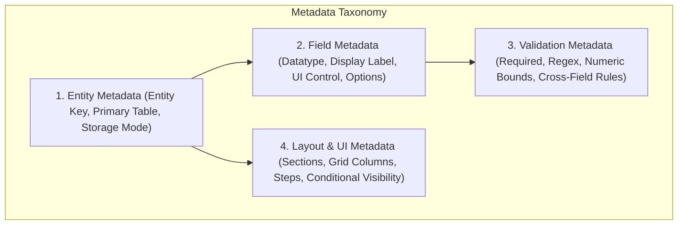
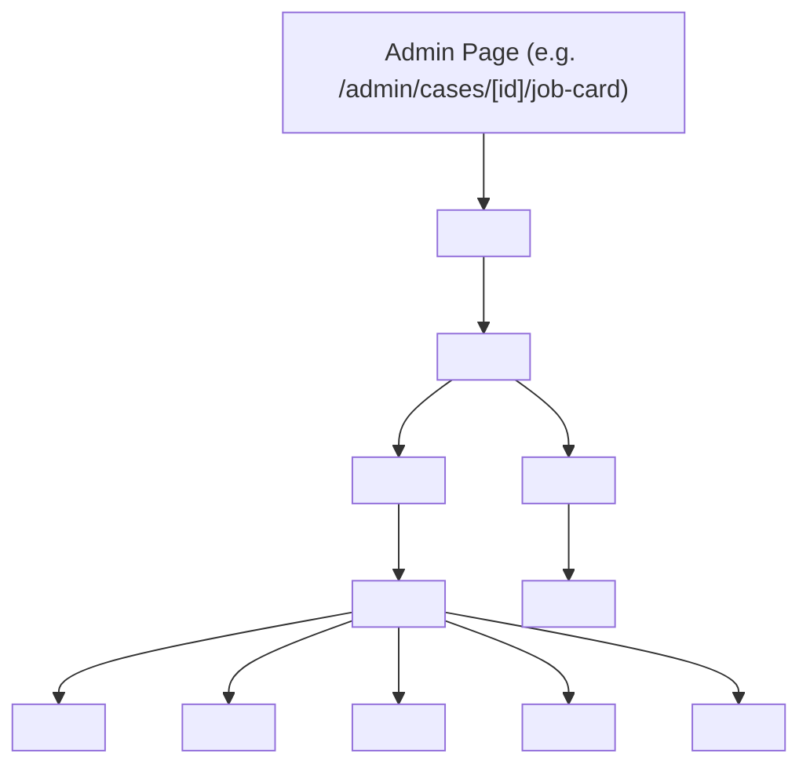

# Detailed Technical Design Specification (DTS)
## Step 2: Metadata-Driven Dynamic Engine, API Contracts & Security Implementation

**Document Reference**: EDAP-DTS-2026-V2.0  
**Project**: Enterprise Dynamic Application Platform (EDAP) / AKS Legal Ops  
**Author**: Lead Principal Enterprise Solution Architect (15+ YOE)  
**Parent Document**: [ENTERPRISE_SOLUTION_ARCHITECTURE_BLUEPRINT.md](file:///c:/aknewrepo/aks-properties-checklist/docs/ENTERPRISE_SOLUTION_ARCHITECTURE_BLUEPRINT.md)  
**Classification**: Engineering & Implementation Technical Specification  
**Version**: 2.0.0-DESIGN  
**Status**: DRAFT TECHNICAL DESIGN FOR APPROVAL  

---

## 1. Executive Summary & Purpose of Step 2

Following the formal approval of **Step 1 (Solution Architecture)**, this **Detailed Technical Design Specification (DTS)** establishes the exact contracts, algorithms, component trees, and database schemas required for **Step 3 (Module-by-Module Development)**.

The primary engineering goal of this specification is to operationalize the **Metadata-Driven Dynamic Architecture (MDDA)**. It defines:
1. **The Metadata Data Model**: The exact JSON schemas governing dynamic entities, configurable fields, layout grids, and validation rules.
2. **The Dynamic UI Component Tree**: The React component hierarchy responsible for parsing metadata and rendering type-safe, accessible forms and data grids.
3. **Formal OpenAPI 3.1.0 API Contracts**: Endpoints for metadata administration, legal case lifecycle, document uploads, and workflow state transitions.
4. **Fine-Grained Security & RBAC Implementation**: JWT claims, permission resolution algorithms, and cryptographically chained audit logging.
5. **Database Migration Scripts**: Idempotent SQL DDL for Cloudflare D1 to deploy metadata catalog tables and RBAC structures.

---

## 2. Metadata-Driven Dynamic Engine Specifications

### 2.1 The Metadata Taxonomy
The platform separates business definitions into four decoupled layers of metadata:



### 2.2 Field Type Registry
The Dynamic Form Engine supports the following standard field types out of the box:

| Field Type Key | UI Control Element | Value Stored | Configurable Parameters |
|:---|:---|:---|:---|
| `TEXT` | `<input type="text" />` | `string` | `placeholder`, `minLength`, `maxLength`, `regexPattern` |
| `TEXTAREA` | `<textarea />` | `string` | `rows`, `placeholder`, `maxLength` |
| `NUMBER` | `<input type="number" />` | `number` | `min`, `max`, `step`, `allowDecimal` |
| `CURRENCY_INR` | Input with `₹` prefix | `number` | `min`, `max`, `autoComputeFee` |
| `SELECT` | `<select>` single dropdown | `string` | `optionsSource` (`STATIC` \| `API_ENDPOINT`), `optionsList` |
| `MULTI_SELECT` | Tag-based select pill list | `string[]` | `maxSelected`, `optionsList` |
| `DATE` | `<input type="date" />` | `ISO Date string` | `minDate`, `maxDate` (e.g. `TODAY`) |
| `DATE_RANGE` | Dual inputs (From - To) | `{ from: string, to: string }` | `maxSpanYears` (e.g. 30+ years for EC) |
| `CHECKBOX` | Switch / Boolean toggle | `boolean` | `defaultChecked`, `alertOnFalse` |
| `RADIO_GROUP` | Radio group list | `string` | `optionsList`, `layout` (`HORIZONTAL` \| `VERTICAL`) |
| `FILE_UPLOAD` | Drag & Drop Document Box | `{ url, name, size, sha256 }` | `allowedMimeTypes`, `maxSizeBytes`, `r2BucketFolder` |

### 2.3 Master Entity Schema Specification (JSON Schema)
Below is the formal JSON Schema defining how an entity and its dynamic forms are persisted in `sys_entities.schema_definition_json`:

```json
{
  "$schema": "https://json-schema.org/draft/2020-12/schema",
  "title": "EDAP Entity Metadata Schema",
  "type": "object",
  "required": ["entityKey", "displayName", "storageTable", "sections", "fields"],
  "properties": {
    "entityKey": { "type": "string", "pattern": "^[a-z_]{3,32}$" },
    "displayName": { "type": "string" },
    "storageTable": { "type": "string" },
    "version": { "type": "integer", "minimum": 1 },
    "sections": {
      "type": "array",
      "items": {
        "type": "object",
        "required": ["id", "title", "columns", "fieldKeys"],
        "properties": {
          "id": { "type": "string" },
          "title": { "type": "string" },
          "description": { "type": "string" },
          "columns": { "type": "integer", "minimum": 1, "maximum": 4 },
          "fieldKeys": { "type": "array", "items": { "type": "string" } },
          "visibilityCondition": { "type": "string", "description": "Optional JS expression e.g. values.hasEncumbrance === true" }
        }
      }
    },
    "fields": {
      "type": "object",
      "additionalProperties": {
        "type": "object",
        "required": ["type", "label"],
        "properties": {
          "type": { "type": "string", "enum": ["TEXT", "TEXTAREA", "NUMBER", "CURRENCY_INR", "SELECT", "MULTI_SELECT", "DATE", "DATE_RANGE", "CHECKBOX", "RADIO_GROUP", "FILE_UPLOAD"] },
          "label": { "type": "string" },
          "placeholder": { "type": "string" },
          "defaultValue": {},
          "validation": {
            "type": "object",
            "properties": {
              "required": { "type": "boolean" },
              "min": { "type": "number" },
              "max": { "type": "number" },
              "pattern": { "type": "string" },
              "message": { "type": "string" }
            }
          },
          "options": {
            "type": "array",
            "items": {
              "type": "object",
              "required": ["value", "label"],
              "properties": {
                "value": { "type": "string" },
                "label": { "type": "string" }
              }
            }
          }
        }
      }
    }
  }
}
```

---

## 3. Component Design & Frontend Architecture

### 3.1 React Component Hierarchy for Dynamic Rendering
The frontend UI is built from atomic, reusable components organized into a clean recursive tree:



### 3.2 Dynamic Zod Schema Synthesizer
At runtime, the frontend takes the JSON metadata and compiles a native Zod schema. This guarantees client-side validation matches server-side verification:

```typescript
// lib/metadata/zodSynthesizer.ts
import { z, ZodTypeAny } from 'zod';
import { FieldMetadata, EntityMetadata } from './types';

export function synthesizeZodSchema(metadata: EntityMetadata): z.ZodObject<any> {
  const shape: Record<string, ZodTypeAny> = {};

  for (const [key, field] of Object.entries(metadata.fields)) {
    let schema: ZodTypeAny;

    switch (field.type) {
      case 'TEXT':
      case 'TEXTAREA': {
        let str = z.string();
        if (field.validation?.required) {
          str = str.min(1, field.validation.message || `${field.label} is required`);
        } else {
          str = str.optional() as any;
        }
        if (field.validation?.pattern) {
          str = str.regex(new RegExp(field.validation.pattern), field.validation.message || 'Invalid format');
        }
        schema = str;
        break;
      }
      case 'CURRENCY_INR':
      case 'NUMBER': {
        let num = z.coerce.number();
        if (field.validation?.required) {
          num = num.min(field.validation.min ?? 1, field.validation.message || `${field.label} must be greater than zero`);
        }
        schema = num;
        break;
      }
      case 'CHECKBOX': {
        schema = z.boolean().default(false);
        break;
      }
      default:
        schema = z.any();
    }

    shape[key] = schema;
  }

  return z.object(shape);
}
```

---

## 4. Formal REST API Specifications (OpenAPI 3.1.0)

### 4.1 OpenAPI 3.1.0 Specification Contract

```yaml
openapi: 3.1.0
info:
  title: AKS Enterprise Dynamic Legal Platform API
  description: High-performance, edge-first API for dynamic forms, legal case lifecycles, and title scrutiny.
  version: 2.0.0
servers:
  - url: https://aks-property-portal.pages.dev/api/v1
    description: Production Cloudflare Edge Network
  - url: http://localhost:3000/api/v1
    description: Local Development Server

paths:
  # ===========================================================================
  # 1. METADATA ENGINE ENDPOINTS
  # ===========================================================================
  /meta/entities/{entityKey}:
    get:
      summary: Get Compiled Entity Metadata & Layout Contract
      operationId: getEntityMetadata
      parameters:
        - name: entityKey
          in: path
          required: true
          schema: { type: string }
          example: case_ec_record
      responses:
        '200':
          description: Resolved Entity Metadata with UI layout and validation schema
          content:
            application/json:
              schema:
                $ref: '#/components/schemas/SuccessEnvelope'
        '404':
          description: Entity Key not found in metadata registry

    put:
      summary: Update or Extend Dynamic Entity Schema (Admin Only)
      operationId: updateEntityMetadata
      security:
        - BearerAuth: []
      parameters:
        - name: entityKey
          in: path
          required: true
          schema: { type: string }
      requestBody:
        required: true
        content:
          application/json:
            schema:
              $ref: '#/components/schemas/EntityMetadataDefinition'
      responses:
        '200':
          description: Metadata successfully updated and version incremented

  # ===========================================================================
  # 2. LEGAL CASES LIFECYCLE ENDPOINTS
  # ===========================================================================
  /cases:
    get:
      summary: List Legal Case Dockets with Multi-Column Filter & Sort
      operationId: listCases
      parameters:
        - name: page
          in: query
          schema: { type: integer, default: 1 }
        - name: limit
          in: query
          schema: { type: integer, default: 20 }
        - name: district
          in: query
          schema: { type: string }
        - name: stage
          in: query
          schema: { type: integer, minimum: 1, maximum: 8 }
        - name: search
          in: query
          schema: { type: string }
      responses:
        '200':
          description: Paginated case records
          content:
            application/json:
              schema:
                $ref: '#/components/schemas/PaginatedCaseEnvelope'

    post:
      summary: Create New Legal Docket Intake (Stage 1)
      operationId: createCaseDocket
      requestBody:
        required: true
        content:
          application/json:
            schema:
              $ref: '#/components/schemas/CaseCreatePayload'
      responses:
        '201':
          description: Case initialized successfully
          content:
            application/json:
              schema:
                $ref: '#/components/schemas/CaseCreatedEnvelope'
        '400':
          description: Form validation failed (Returns RFC 7807 field errors)
          content:
            application/json:
              schema:
                $ref: '#/components/schemas/ValidationErrorEnvelope'

  /cases/{caseId}/workflow:
    post:
      summary: Transition Case to Next Operational Stage
      operationId: advanceCaseWorkflow
      parameters:
        - name: caseId
          in: path
          required: true
          schema: { type: string }
      requestBody:
        required: true
        content:
          application/json:
            schema:
              type: object
              required: [targetStage, notes]
              properties:
                targetStage: { type: integer, minimum: 1, maximum: 8 }
                notes: { type: string }
      responses:
        '200':
          description: Stage transition approved and recorded in audit log
        '409':
          description: Guard condition violation (e.g. Stage 3 requires advance fee)

components:
  schemas:
    SuccessEnvelope:
      type: object
      required: [success, data, metadata]
      properties:
        success: { type: boolean, example: true }
        data: { type: object }
        metadata:
          type: object
          properties:
            timestamp: { type: string, format: date-time }
            executionTimeMs: { type: integer }

    ValidationErrorEnvelope:
      type: object
      required: [success, error, code, fieldErrors]
      properties:
        success: { type: boolean, example: false }
        error: { type: string, example: "Validation constraints violated" }
        code: { type: string, example: "VALIDATION_FAILED" }
        fieldErrors:
          type: object
          additionalProperties: { type: string }
          example:
            clientPhone: "Enter a valid 10-digit mobile number"
            surveyNumber: "Survey / Door number is required"

    CaseCreatePayload:
      type: object
      required: [client_name, client_phone, district, survey_number]
      properties:
        client_name: { type: string, minLength: 2, example: "K. Rangarajan" }
        client_phone: { type: string, pattern: "^[0-9]{10}$", example: "9842214321" }
        client_email: { type: string, format: email, nullable: true }
        district: { type: string, example: "Coimbatore" }
        property_address: { type: string }
        survey_number: { type: string, example: "S.F. 428/1A" }
        total_fee: { type: integer, default: 6500 }
        advance_amount: { type: integer, default: 5200 }
```

---

## 5. Security & RBAC Implementation Details

### 5.1 JSON Web Token (JWT) Specification
Authentication tokens are issued by the Edge API and stored exclusively in **HttpOnly, Secure, SameSite=Strict cookies**:

```json
// JWT Payload Claims
{
  "iss": "https://aks-property-portal.pages.dev",
  "sub": "usr_94820184",
  "name": "Advocate A.K. Saravanan",
  "email": "saravanan@akspropertychecklist.in",
  "roles": ["ADVOCATE_PARTNER", "LEGAL_SCRUTINIZER"],
  "permissions": [
    "case:read",
    "case:write",
    "case:stage_advance",
    "opinion:sign_off",
    "meta:configure"
  ],
  "iat": 1730304000,
  "exp": 1730304900
}
```

### 5.2 Cryptographic Tamper-Proof Audit Chaining
To guarantee legal non-repudiation, every audit log entry contains a cryptographic hash linking it to the prior log entry (Merkle Chain pattern):

$$\text{Current Hash} = \text{HMAC-SHA256}(\text{Secret}, \text{PrevHash} \parallel \text{Timestamp} \parallel \text{CaseId} \parallel \text{Action} \parallel \text{ActorId})$$

```typescript
// lib/security/auditSigner.ts
export async function generateAuditChecksum(
  prevHash: string,
  entry: { caseId: string; action: string; actor: string; timestamp: string }
): Promise<string> {
  const encoder = new TextEncoder();
  const data = encoder.encode(`${prevHash}:${entry.caseId}:${entry.action}:${entry.actor}:${entry.timestamp}`);
  const hashBuffer = await crypto.subtle.digest('SHA-256', data);
  return Array.from(new Uint8Array(hashBuffer))
    .map(b => b.toString(16).padStart(2, '0'))
    .join('');
}
```

---

## 6. Database Migration Plan (Cloudflare D1 SQL)

The following idempotent migration script creates the new metadata tables and RBAC structures without disturbing existing case dockets:

```sql
-- ============================================================================
-- MIGRATION: 0002_metadata_engine_and_rbac.sql
-- ============================================================================

-- 1. Metadata Schema Catalog
CREATE TABLE IF NOT EXISTS sys_modules (
    id TEXT PRIMARY KEY,
    module_key TEXT UNIQUE NOT NULL,
    display_name TEXT NOT NULL,
    icon_name TEXT NOT NULL DEFAULT 'Folder',
    display_order INTEGER NOT NULL DEFAULT 1,
    is_active BOOLEAN NOT NULL DEFAULT 1,
    created_at TIMESTAMP NOT NULL DEFAULT CURRENT_TIMESTAMP
);

CREATE TABLE IF NOT EXISTS sys_entities (
    id TEXT PRIMARY KEY,
    module_id TEXT NOT NULL REFERENCES sys_modules(id) ON DELETE CASCADE,
    entity_key TEXT UNIQUE NOT NULL,
    table_name TEXT NOT NULL,
    schema_definition_json TEXT NOT NULL,
    version INTEGER NOT NULL DEFAULT 1,
    created_at TIMESTAMP NOT NULL DEFAULT CURRENT_TIMESTAMP,
    updated_at TIMESTAMP NOT NULL DEFAULT CURRENT_TIMESTAMP
);

-- 2. Fine-Grained Permissions
CREATE TABLE IF NOT EXISTS sys_permissions (
    id TEXT PRIMARY KEY,
    permission_code TEXT UNIQUE NOT NULL,
    module_key TEXT NOT NULL,
    description TEXT,
    created_at TIMESTAMP NOT NULL DEFAULT CURRENT_TIMESTAMP
);

CREATE TABLE IF NOT EXISTS sys_role_permissions (
    role_id TEXT NOT NULL REFERENCES sys_roles(id) ON DELETE CASCADE,
    permission_id TEXT NOT NULL REFERENCES sys_permissions(id) ON DELETE CASCADE,
    PRIMARY KEY (role_id, permission_id)
);

-- 3. Pre-seed Default Dynamic Metadata (Case EC Record)
INSERT OR IGNORE INTO sys_modules (id, module_key, display_name, icon_name, display_order)
VALUES ('mod_legal_ops', 'legal_ops', 'Legal Due Diligence Operations', 'Scale', 1);

INSERT OR IGNORE INTO sys_entities (id, module_id, entity_key, table_name, schema_definition_json, version)
VALUES (
    'ent_ec_record',
    'mod_legal_ops',
    'case_ec_record',
    'case_ec_records',
    '{"entityKey":"case_ec_record","displayName":"Encumbrance Certificate Record","storageTable":"case_ec_records","sections":[{"id":"sec_reg","title":"Registration Details","columns":2,"fieldKeys":["period","sro","docNumber","natureOfDeed"]},{"id":"sec_parties","title":"Parties & Findings","columns":1,"fieldKeys":["parties","remarks"]}],"fields":{"period":{"type":"TEXT","label":"Search Period (Years)","validation":{"required":true}},"sro":{"type":"TEXT","label":"Sub-Registrar Office (SRO)","validation":{"required":true}},"docNumber":{"type":"TEXT","label":"Registered Doc No & Year","validation":{"required":true,"pattern":"^[0-9]{1,6}/[0-9]{4}$"}},"natureOfDeed":{"type":"SELECT","label":"Nature of Deed","options":[{"value":"Sale Deed","label":"Sale Deed"},{"value":"Settlement Deed","label":"Settlement Deed"},{"value":"Partition Deed","label":"Partition Deed"}]},"parties":{"type":"TEXT","label":"Parties (Seller to Buyer)","validation":{"required":true}},"remarks":{"type":"TEXTAREA","label":"Scrutiny Remarks"}}}',
    1
);
```

---

## 7. Next Step: Transition to Step 3 (Development)

With this **Detailed Technical Design Specification (Step 2)** established, the foundation is fully prepared for **Step 3 (Module-by-Module Development)**:
1. **Module 1**: Deploy D1 metadata tables using the migration script above.
2. **Module 2**: Implement the `<DynamicFormRenderer />` component and Zod synthesizer.
3. **Module 3**: Connect the Job Card EC modal and Parent Deed modal to the dynamic metadata engine.
4. **Module 4**: Implement the Tamper-Proof Audit Logger with cryptographic chaining.

*(Note: Per your standing instruction, zero changes have been committed or pushed to Git.)*

