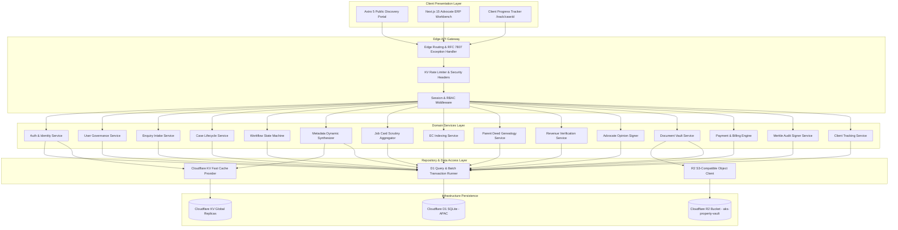

# Enterprise Backend Architecture Review & Engineering Specification
## AKS Property Checklist & Legal Operations Platform

**Document Reference:** AKS-BE-ARCH-2026-V1.0  
**Target Runtimes:** Cloudflare Workers / Pages (`workerd`), Next.js 15 (OpenNext Edge Adapter), Astro 5  
**Data & Storage Infrastructure:** Cloudflare D1 (Distributed SQLite at Edge), Cloudflare R2 (`aks-property-vault`), Cloudflare KV (`METADATA_KV`, `SESSION_KV`)  
**Lead Architect:** Principal Backend Architect & Cloudflare Solutions Architect  
**Classification:** Confidential — Legal Practice Intellectual Property  
**Status:** DRAFT FOR ARCHITECTURAL APPROVAL  

---

## Executive Summary

The **AKS Property Checklist & Legal Operations Platform** operates under a high-stakes, legally regulated environment governed by the *Registration Act, 1908* and the *Tamil Nadu Patta Pass Book Act, 1983*. Property due diligence across Tamil Nadu requires rigorous multi-tier title verification (30+ year Encumbrance Certificate indexing, root-of-title deed genealogy, revenue record alignment across e-Patta/Chitta/FMB, and formal Advocate Legal Opinion certification under Advocate A.K. Saravanan, Bar Council Enrollment No. `MS/1245/2005`).

This document provides a comprehensive review of the current backend implementation, identifies critical architectural and runtime incompatibilities with Cloudflare Edge infrastructure, and establishes an implementation-ready engineering specification across all 15 core business domains.

### Critical Audit Findings on Current Backend Code
1. **Cloudflare Workers Runtime Incompatibility in File Uploads:**
   - **Current Implementation:** `src/app/api/upload/route.ts` uses Node.js `fs.writeFile` to write uploads into `public/uploads/<caseId>/`.
   - **Runtime Conflict:** Cloudflare Workers execution environment has a strictly read-only, ephemeral in-memory filesystem. Any call to `fs.mkdir` or `fs.writeFile` crashes in production.
   - **Remediation:** Full offloading of all binary uploads to Cloudflare R2 object storage (`aks-property-vault`) using native S3-compatible binding (`env.VAULT_BUCKET`), with SHA-256 checksum verification, magic byte validation, and temporary presigned download URLs.
2. **Missing Transactional Boundaries in Multi-Statement Mutations:**
   - **Current Implementation:** `PATCH /api/cases/[id]` and `POST /api/enquiries/[id]/accept` execute multiple independent `executeRun` calls (`INSERT cases`, `INSERT milestone_logs`, `UPDATE enquiries`, `INSERT audit_logs`).
   - **Runtime Conflict:** In distributed SQLite (Cloudflare D1), independent network roundtrips lack atomicity. A mid-sequence timeout results in orphaned state (e.g., case created, but enquiry left unaccepted).
   - **Remediation:** Encapsulate multi-table mutations into atomic `db.batch([stmt1, stmt2, stmt3])` transactions on the D1 primary instance (APAC Singapore).
3. **Authentication & Session Hardening:**
   - **Current Implementation:** `POST /api/auth/login` accepts hardcoded demo passwords (`Advocate@2026!`, `admin123`) and generates unhashed session tokens returned in JSON responses without `HttpOnly` cookie enforcement or failed attempt rate limiting.
   - **Remediation:** Implement Web Crypto API-compatible PBKDF2/Argon2id password hashing, JWT signed with Edge Web Crypto API, `HttpOnly`, `SameSite=Lax`, `Secure` cookies, account lockout after 5 consecutive failures, and distributed session revocation via Cloudflare KV.
4. **Enforcement of 8-Stage Workflow State Machine & 80/20 Payment Gates:**
   - **Current Implementation:** `PATCH /api/cases/[id]` accepts arbitrary `targetStage` values without validating stage prerequisites.
   - **Remediation:** Implement a strict Finite State Machine (FSM) enforcing:
     - **Gate 1 (Stage 4 Opening):** Case cannot transition to Stage 4 (Job Card Docketing) until 80% Advance Fee is marked `VERIFIED_PAID`.
     - **Gate 2 (Stage 6 Scrutiny Sign-Off):** Case cannot transition to Stage 6 without validated EC records, unbroken parent deed chain, and Patta verification.
     - **Gate 3 (Stage 8 Certified Dispatch):** Bar Council sealed legal opinion PDF cannot be downloaded or dispatched until the 20% Balance Fee is marked `SETTLED`.

---

## 1. Backend Architecture Document

### 1.1 Architecture Paradigm: Edge Modular Monolith
The backend is structured as a **Modular Monolith** executed within the serverless Cloudflare Workers runtime via Next.js 15 (OpenNext adapter). 

```
                                  +------------------------------------+
                                  |         Cloudflare Edge CDN        |
                                  |  - WAF & DDoS Protection           |
                                  |  - SSL/TLS Termination            |
                                  |  - Edge Routing & Caching          |
                                  +-----------------+------------------+
                                                    |
                         +--------------------------+--------------------------+
                         |                                                     |
                         v                                                     v
          +------------------------------+                      +------------------------------+
          |      Astro 5 Public App      |                      |     Next.js 15 Legal ERP     |
          |    akspropertychecklist.in   |                      |     aks-property-portal      |
          |  (Client Checklist & Quotes) |                      |   (Advocate ERP Workbench)   |
          +--------------+---------------+                      +--------------+---------------+
                         |                                                     |
                         | (REST HTTPS API)                                    | (Edge Native Bindings)
                         +--------------------------+--------------------------+
                                                    |
                                                    v
                                  +------------------------------------+
                                  |    Edge API Gateway & Middleware   |
                                  |  - Correlation ID (x-request-id)   |
                                  |  - Session & RBAC Verification     |
                                  |  - Rate Limiting (Leaky Bucket)    |
                                  |  - RFC 7807 Centralized Errors     |
                                  +-----------------+------------------+
                                                    |
                         +--------------------------+--------------------------+
                         |                          |                          |
                         v                          v                          v
          +------------------------------+  +-------------------+  +---------------------------+
          |    Cloudflare D1 (SQLite)    |  |  Cloudflare R2    |  |      Cloudflare KV        |
          |  - APAC Primary (Writes)     |  |  aks-property-    |  |  - METADATA_KV (Schemas)  |
          |  - Read Replicas (Chennai,   |  |  vault            |  |  - SESSION_KV (Blacklist) |
          |    Mumbai, Tokyo)            |  |  - Max 15MB Files |  |  - RATE_LIMIT_KV          |
          |  - db.batch() Atomic Writes  |  |  - Zero Egress    |  |  - Sub-5ms Read Latency   |
          +------------------------------+  +-------------------+  +---------------------------+
```

### 1.2 Domain Boundaries (15 Core Domains)
Each domain is isolated behind a strict service and repository layer:

| # | Business Domain | Key Responsibilities | Primary Data Entity | Storage Engine |
|:---|:---|:---|:---|:---|
| 1 | **Auth & Authorization** | Credential validation, PBKDF2 hashing, JWT issue/verify, session invalidation | `users`, `user_sessions` | D1 + KV |
| 2 | **User Management** | Advocate/clerk profile provisioning, role assignment, active status | `users`, `user_roles` | D1 |
| 3 | **Enquiry Management** | Public intake staging, deduplication, quote estimation, triage status | `enquiries` | D1 |
| 4 | **Case Management** | Case docket creation, metadata binding, party information, property location | `cases`, `case_milestone_logs` | D1 |
| 5 | **Workflow Orchestrator** | 8-Stage legal SOP state machine, transition guards, rollback validation | `cases`, `case_milestone_logs` | D1 |
| 6 | **Dynamic Metadata Engine**| Entity schemas, field types, validation rules, layout generation | `sys_entities`, `sys_fields` | D1 + KV |
| 7 | **Job Card Management** | Legal workbench master aggregation, scrutiny checklist progress | `cases`, `job_card_metrics` | D1 |
| 8 | **EC Record Management** | 30-year continuous encumbrance indexing, sub-registrar transaction trace | `ec_records` | D1 |
| 9 | **Parent Deed Management**| Title genealogy, seller-buyer chain verification, schedule boundary checks | `parent_documents` | D1 |
| 10| **Revenue Verification** | e-Patta, Chitta, FMB sketch, TSLR reconciliation, survey number alignment | `revenue_records` | D1 |
| 11| **Legal Opinion** | Advocate A.K. Saravanan certification, findings, marketable title verdict | `legal_opinions` | D1 |
| 12| **Document Vault** | Multipart upload, SHA-256 deduplication, magic byte check, presigned URLs | `case_documents` | R2 + D1 |
| 13| **Payment & Billing** | 80/20 fee split tracking, gateway webhook verification, invoice generation | `case_payments`, `invoices` | D1 |
| 14| **Audit & Compliance** | Cryptographically chained Merkle-log, tamper-evident hash chaining | `case_audit_logs` | D1 |
| 15| **Client Tracking** | Zero-login authenticated client tracker (`/track/[id]`), milestone progress | `cases`, `milestone_logs` | D1 |

---

## 2. Component and Module Architecture Diagram



---

## 3. API Specification (OpenAPI 3.1 Architecture)

### 3.1 Standard Response Envelopes
All API responses adhere strictly to standard envelopes:

#### Success Envelope (`200 OK`, `201 Created`):
```json
{
  "success": true,
  "statusCode": 200,
  "data": { ... },
  "meta": {
    "requestId": "req_01HPX7849QWERTYUIOP",
    "timestamp": "2026-10-30T18:15:00.000Z",
    "version": 1
  }
}
```

#### RFC 7807 Problem Details Error Envelope (`400`, `401`, `403`, `404`, `409`, `422`, `500`):
```json
{
  "success": false,
  "type": "https://api.akspropertychecklist.in/errors/WORKFLOW_TRANSITION_REJECTED",
  "title": "Workflow Stage Advance Rejected",
  "status": 403,
  "detail": "Cannot advance Case AK-2026-784 to Stage 4. 80% Advance Fee payment of Rs 10,000 must be marked verified prior to Job Card opening.",
  "instance": "/api/cases/AK-2026-784/stage",
  "invalidParams": [
    {
      "name": "payment_status",
      "reason": "Current payment status is 'advance_pending'. Required: 'advance_paid'."
    }
  ],
  "requestId": "req_01HPX7849QWERTYUIOP",
  "timestamp": "2026-10-30T18:15:00.000Z"
}
```

### 3.2 Master REST API Catalog

| Module | Method | Endpoint | Description | Auth Required | Minimum Role |
|:---|:---|:---|:---|:---|:---|
| **Auth** | `POST` | `/api/auth/login` | Authenticate user, verify credentials, return session cookie | No | Public |
| **Auth** | `POST` | `/api/auth/logout` | Revoke current session, clear cookie, invalidate in KV | Yes | Any Active |
| **Auth** | `GET` | `/api/auth/me` | Fetch active user identity, roles, and fine-grained capabilities | Yes | Any Active |
| **Users** | `GET` | `/api/users` | List platform users with role filters and pagination | Yes | `SUPER_ADMIN` |
| **Users** | `POST` | `/api/users` | Provision advocate, scrutinizer, or intake clerk | Yes | `SUPER_ADMIN` |
| **Enquiries** | `POST` | `/api/enquiries` | Ingest public property inquiry and checklist quote | No | Public (Rate-limited)|
| **Enquiries** | `GET` | `/api/enquiries` | Triage inbox listing with status filters | Yes | `INTAKE_CLERK` |
| **Enquiries** | `POST` | `/api/enquiries/:id/accept` | Atomically accept enquiry and promote to active Case docket | Yes | `INTAKE_CLERK` |
| **Cases** | `GET` | `/api/cases` | Filterable list of active and closed legal cases | Yes | `LEGAL_SCRUTINIZER` |
| **Cases** | `GET` | `/api/cases/:id` | Aggregate case docket including Job Card and scrutiny modules | Yes | `LEGAL_SCRUTINIZER` |
| **Workflow** | `POST` | `/api/cases/:id/stage` | Transition case stage with prerequisite validation | Yes | `LEGAL_SCRUTINIZER` / `ADVOCATE_PARTNER` |
| **Job Card** | `GET` | `/api/cases/:id/job-card`| Aggregate 30-year EC records, parent deeds, revenue status | Yes | `LEGAL_SCRUTINIZER` |
| **EC Records**| `POST` | `/api/cases/:id/ec` | Insert 30-year continuous EC index entry | Yes | `LEGAL_SCRUTINIZER` |
| **EC Records**| `DELETE` | `/api/cases/:id/ec/:recId`| Remove EC record entry | Yes | `ADVOCATE_PARTNER` |
| **Parent Deeds**| `POST` | `/api/cases/:id/parent-deeds`| Insert title genealogy chain entry | Yes | `LEGAL_SCRUTINIZER` |
| **Revenue** | `PUT` | `/api/cases/:id/revenue` | Upsert e-Patta, Chitta, and FMB vector alignment | Yes | `LEGAL_SCRUTINIZER` |
| **Legal Opinion**| `PUT` | `/api/cases/:id/opinion` | Save or sign formal legal opinion (`MS/1245/2005`) | Yes | `ADVOCATE_PARTNER` |
| **Documents**| `POST` | `/api/cases/:id/documents`| Streamed binary upload to Cloudflare R2 | Yes | `INTAKE_CLERK` |
| **Documents**| `GET` | `/api/cases/:id/documents/:docId/download`| Generate temporary presigned signed download URL | Yes | `CLIENT_BUYER` (Own) / Staff |
| **Billing** | `POST` | `/api/cases/:id/payments` | Record or verify advance / balance payment | Yes | `INTAKE_CLERK` |
| **Billing** | `POST` | `/api/payments/webhook` | Gateway webhook callback (Razorpay/Stripe) | HMAC Header| Webhook Secret |
| **Tracking** | `GET` | `/api/tracking/:caseId` | Public client progress tracker (zero-login read-only) | No | Public (Phone-bound)|
| **Audit** | `GET` | `/api/cases/:id/audit` | Cryptographic Merkle chain audit log verification | Yes | `ADVOCATE_PARTNER` |
| **Metadata** | `GET` | `/api/meta/entities/:key`| Fetch compiled JSON schema and layout metadata | Yes | Any Active |
| **Metadata** | `PUT` | `/api/meta/entities/:key`| Update entity configuration and invalidate KV cache | Yes | `SUPER_ADMIN` |

---

## 4. Authentication and Authorization Architecture

### 4.1 Secure Credential Hashing
To maintain 100% compatibility with the Cloudflare Workers edge runtime (which prohibits native C++ Node.js binaries like `bcrypt` or compiled native libraries), password hashing is performed using **PBKDF2-HMAC-SHA256** with 100,000 iterations via the edge-native **Web Crypto API** (`crypto.subtle`):

```typescript
// Web Crypto Password Hasher (Cloudflare Workers Native)
export async function hashPassword(password: string): Promise<string> {
  const salt = crypto.getRandomValues(new Uint8Array(16));
  const enc = new TextEncoder();
  const keyMaterial = await crypto.subtle.importKey(
    'raw',
    enc.encode(password),
    { name: 'PBKDF2' },
    false,
    ['deriveBits', 'deriveKey']
  );
  const derivedKey = await crypto.subtle.deriveKey(
    {
      name: 'PBKDF2',
      salt,
      iterations: 100000,
      hash: 'SHA-256',
    },
    keyMaterial,
    { name: 'HMAC', hash: 'SHA-256', length: 256 },
    true,
    ['sign']
  );
  const rawKey = await crypto.subtle.exportKey('raw', derivedKey);
  const saltHex = Array.from(salt).map(b => b.toString(16).padStart(2, '0')).join('');
  const hashHex = Array.from(new Uint8Array(rawKey)).map(b => b.toString(16).padStart(2, '0')).join('');
  return `pbkdf2_sha256$100000$${saltHex}$${hashHex}`;
}
```

### 4.2 Session Token & Cookie Policy
- **Storage:** Session tokens are 256-bit cryptographically random strings (`crypto.getRandomValues`) stored in D1 `user_sessions` and cached in `SESSION_KV`.
- **Cookie Security Flags:**
  - `HttpOnly`: Strictly prevents JavaScript `document.cookie` access (mitigating XSS session theft).
  - `Secure`: Transmitted solely over HTTPS connections.
  - `SameSite=Lax`: Prevents Cross-Site Request Forgery (CSRF) on mutation endpoints while allowing top-level navigation.
  - `Path=/`: Uniform edge routing scope.
  - `Max-Age=2592000` (30 days with rolling slide expiration).
- **Brute-Force & Lockout Policy:**
  - If 5 consecutive failed login attempts occur within 15 minutes, the account `locked_until` timestamp is set to `CURRENT_TIMESTAMP + 30 minutes`.
  - IP-based rate limiting via `RATE_LIMIT_KV` (maximum 10 login requests per minute per IP).

---

## 5. RBAC & ABAC Permission Matrix

The platform implements strict server-side authorization. Client-side UI controls reflect permissions, but all authorization boundaries are enforced by edge middleware.

| Permission Code | Capability Description | `SUPER_ADMIN` | `ADVOCATE_PARTNER` | `LEGAL_SCRUTINIZER` | `INTAKE_CLERK` | `CLIENT_BUYER` |
|:---|:---|:---:|:---:|:---:|:---:|:---:|
| `users:manage` | Create, edit, and deactivate user accounts | ✅ | ❌ | ❌ | ❌ | ❌ |
| `meta:configure` | Edit dynamic schemas, fields, and layouts | ✅ | ❌ | ❌ | ❌ | ❌ |
| `enquiries:read` | View incoming public intake leads | ✅ | ✅ | ✅ | ✅ | ❌ |
| `enquiries:accept`| Promote enquiry to official legal case docket | ✅ | ✅ | ❌ | ✅ | ❌ |
| `cases:create` | Open new case docket directly | ✅ | ✅ | ❌ | ✅ | ❌ |
| `cases:read_all` | View any case docket across firm | ✅ | ✅ | ✅ | ✅ | ❌ |
| `cases:read_own` | View only assigned or owned case | ✅ | ✅ | ✅ | ✅ | ✅ (Own Only)|
| `stage:advance_1_to_3`| Advance intake, consultation, fee agreement| ✅ | ✅ | ✅ | ✅ | ❌ |
| `stage:advance_to_4`| Advance to Stage 4 (80% Advance Fee Gate) | ✅ | ✅ | ❌ | ✅ | ❌ |
| `stage:advance_to_5`| Advance to Stage 5 (Job Card Scrutiny) | ✅ | ✅ | ✅ | ❌ | ❌ |
| `stage:advance_to_6`| Advance to Stage 6 (Opinion Formulation)| ✅ | ✅ | ✅ | ❌ | ❌ |
| `stage:sign_opinion`| Sign Legal Opinion (`MS/1245/2005` seal) | ❌ | ✅ | ❌ | ❌ | ❌ |
| `stage:advance_to_7`| Advance to Stage 7 (Settlement Notice) | ✅ | ✅ | ❌ | ✅ | ❌ |
| `stage:advance_to_8`| Advance to Stage 8 (20% Balance Gate) | ✅ | ✅ | ❌ | ✅ | ❌ |
| `ec:create_edit` | Index 30-year EC transaction records | ✅ | ✅ | ✅ | ❌ | ❌ |
| `ec:delete` | Remove an EC transaction record | ✅ | ✅ | ❌ | ❌ | ❌ |
| `parent_deeds:edit`| Build title genealogy & link analysis | ✅ | ✅ | ✅ | ❌ | ❌ |
| `revenue:verify` | Record Patta, Chitta, FMB survey findings | ✅ | ✅ | ✅ | ❌ | ❌ |
| `documents:upload`| Upload deeds and survey maps (<= 15MB) | ✅ | ✅ | ✅ | ✅ | ✅ (Own Only)|
| `documents:view_unwatermarked`| View official high-res legal originals | ✅ | ✅ | ✅ | ❌ | ❌ |
| `documents:view_watermarked`| View provisional watermarked draft preview| ✅ | ✅ | ✅ | ✅ | ✅ |
| `billing:record_payment`| Record manual UPI/NEFT/Cheque payment | ✅ | ✅ | ❌ | ✅ | ❌ |
| `billing:reconcile`| Reconcile payment gateway settlement | ✅ | ✅ | ❌ | ❌ | ❌ |
| `audit:view_chain`| Inspect cryptographic Merkle audit trail | ✅ | ✅ | ❌ | ❌ | ❌ |

---

## 6. Eight-Stage Workflow Engine Specification

### 6.1 Formal Finite State Machine (FSM)

```
 [Stage 1: Lead Intake & Triage]
                │
                ▼
 [Stage 2: Document Collection & Preliminary Check]
                │
                ▼
 [Stage 3: Fee Agreement & Escrow Mandate]
                │
                ▼ [GATE 1: 80% Advance Fee Paid]
 [Stage 4: Job Card Opening & Docket Assignment]
                │
                ▼
 [Stage 5: Legal Scrutiny & 30-Year Trace (EC, Parent, Patta)]
                │
                ▼ [GATE 2: Title Chain & Revenue Complete]
 [Stage 6: Advocate Legal Opinion Formulation & Sign-Off]
                │
                ▼
 [Stage 7: Settlement & Client Review Notice]
                │
                ▼ [GATE 3: 20% Balance Fee Settled + Advocate Signature]
 [Stage 8: Certified Final Legal Opinion Dispatch]
```

### 6.2 State Transition Matrix and Automated Guards

```typescript
interface WorkflowGuard {
  fromStage: number;
  toStage: number;
  requiredRole: string[];
  validate: (caseItem: any, db: CloudflareD1) => Promise<{ allowed: boolean; reason?: string }>;
}

export const WORKFLOW_GUARDS: WorkflowGuard[] = [
  // Transition 1 -> 2: Document Collection
  {
    fromStage: 1,
    toStage: 2,
    requiredRole: ['SUPER_ADMIN', 'ADVOCATE_PARTNER', 'LEGAL_SCRUTINIZER', 'INTAKE_CLERK'],
    validate: async (c) => ({ allowed: true }),
  },

  // Transition 2 -> 3: Fee Agreement
  {
    fromStage: 2,
    toStage: 3,
    requiredRole: ['SUPER_ADMIN', 'ADVOCATE_PARTNER', 'INTAKE_CLERK'],
    validate: async (c) => {
      if (!c.total_fee || c.total_fee <= 0) {
        return { allowed: false, reason: 'Total service fee must be quoted before advancing to Stage 3.' };
      }
      return { allowed: true };
    },
  },

  // Transition 3 -> 4: Job Card Docketing (GATE 1: 80% Advance Fee)
  {
    fromStage: 3,
    toStage: 4,
    requiredRole: ['SUPER_ADMIN', 'ADVOCATE_PARTNER', 'INTAKE_CLERK'],
    validate: async (c) => {
      if (c.payment_status !== 'advance_paid' && c.payment_status !== 'fully_paid') {
        return {
          allowed: false,
          reason: `Gate 1 Violation: Stage 4 requires verified receipt of 80% Advance Fee (Rs ${c.advance_amount}). Current status: ${c.payment_status}.`,
        };
      }
      return { allowed: true };
    },
  },

  // Transition 4 -> 5: Legal Scrutiny
  {
    fromStage: 4,
    toStage: 5,
    requiredRole: ['SUPER_ADMIN', 'ADVOCATE_PARTNER', 'LEGAL_SCRUTINIZER'],
    validate: async (c) => ({ allowed: true }),
  },

  // Transition 5 -> 6: Legal Opinion Formulation (GATE 2: Scrutiny Completeness)
  {
    fromStage: 5,
    toStage: 6,
    requiredRole: ['SUPER_ADMIN', 'ADVOCATE_PARTNER', 'LEGAL_SCRUTINIZER'],
    validate: async (c, db) => {
      // Must have at least one EC record verified
      const ecCount = await db.prepare('SELECT COUNT(*) as count FROM ec_records WHERE case_id = ?').bind(c.id).first<any>();
      if (!ecCount || ecCount.count === 0) {
        return { allowed: false, reason: 'Gate 2 Violation: At least one 30-year EC record must be indexed.' };
      }
      // Must have revenue record with survey number verified
      const rev = await db.prepare('SELECT patta_number, field_survey_no FROM revenue_records WHERE case_id = ?').bind(c.id).first<any>();
      if (!rev || !rev.patta_number) {
        return { allowed: false, reason: 'Gate 2 Violation: Revenue record (Patta number) must be recorded.' };
      }
      return { allowed: true };
    },
  },

  // Transition 6 -> 7: Client Review Notice (Advocate Sign-off required)
  {
    fromStage: 6,
    toStage: 7,
    requiredRole: ['SUPER_ADMIN', 'ADVOCATE_PARTNER'],
    validate: async (c, db) => {
      const op = await db.prepare('SELECT sign_off_status FROM legal_opinions WHERE case_id = ?').bind(c.id).first<any>();
      if (!op || op.sign_off_status !== 'approved') {
        return { allowed: false, reason: 'Legal Opinion must be signed off by Advocate Partner before Stage 7.' };
      }
      return { allowed: true };
    },
  },

  // Transition 7 -> 8: Final Certified Dispatch (GATE 3: 20% Balance Settlement)
  {
    fromStage: 7,
    toStage: 8,
    requiredRole: ['SUPER_ADMIN', 'ADVOCATE_PARTNER', 'INTAKE_CLERK'],
    validate: async (c) => {
      if (c.payment_status !== 'fully_paid') {
        return {
          allowed: false,
          reason: `Gate 3 Violation: Final certified report release requires 100% fee settlement (Balance outstanding: Rs ${c.balance_amount}).`,
        };
      }
      return { allowed: true };
    },
  },
];
```

### 6.3 Backward Correction & Rollback Rules
- Backward transitions (e.g., Stage 5 back to Stage 4 for document re-request) are permitted **only** by `ADVOCATE_PARTNER` or `SUPER_ADMIN`.
- Any backward transition requires mandatory justification notes recorded in `case_milestone_logs` and triggers an immutable alert in `case_audit_logs`.
- Cases in Stage 8 (Certified & Closed) cannot be rolled back without `SUPER_ADMIN` dual-authorization.

---

## 7. Dynamic Metadata Engine Specification

### 7.1 Architecture & Schema Storage
Dynamic modules and fields are defined declaratively in `sys_entities` and `sys_fields`. 

```
                                 sys_modules (Module grouping)
                                             │
                                             ▼
                                 sys_entities (Entity catalogs)
                                 - entity_key (e.g. 'ec_records')
                                 - table_name
                                 - schema_definition_json
                                             │
                                             ▼
                                 sys_fields (Field definitions)
                                 - field_key, field_type
                                 - validation_rules_json
                                 - layout_config_json
```

### 7.2 Safe Edge-Compliant Dynamic Validation (Zero `eval()`)
To satisfy Cloudflare Workers security policies forbidding dynamic code evaluation (`eval` or `new Function`), dynamic validation rules are compiled directly into a type-safe **Zod schema** at runtime:

```typescript
// Edge-Safe Zod Synthesizer
import { z, ZodTypeAny } from 'zod';

export function compileDynamicSchema(fields: Record<string, any>): z.ZodObject<any> {
  const shape: Record<string, ZodTypeAny> = {};

  for (const [key, field] of Object.entries(fields)) {
    let schema: ZodTypeAny;

    switch (field.type) {
      case 'TEXT':
      case 'TEXTAREA': {
        let s = z.string();
        if (field.validation?.required) s = s.min(1, `${field.label} is required`);
        if (field.validation?.pattern) {
          // Safe regex constructor without eval
          const re = new RegExp(field.validation.pattern);
          s = s.regex(re, field.validation.message || `Invalid format for ${field.label}`);
        }
        schema = field.validation?.required ? s : s.optional();
        break;
      }
      case 'NUMBER':
      case 'CURRENCY_INR': {
        let n = z.coerce.number();
        if (field.validation?.required) n = n.min(field.validation.min ?? 0);
        if (field.validation?.max) n = n.max(field.validation.max);
        schema = field.validation?.required ? n : n.optional();
        break;
      }
      case 'DATE': {
        let d = z.string();
        if (field.validation?.required) d = d.min(1, `${field.label} date is required`);
        schema = field.validation?.required ? d : d.optional();
        break;
      }
      case 'CHECKBOX': {
        schema = z.boolean().default(field.defaultValue ?? false);
        break;
      }
      default:
        schema = z.any().optional();
    }
    shape[key] = schema;
  }
  return z.object(shape);
}
```

### 7.3 High-Performance Edge KV Caching
- Dynamic metadata schemas are cached in `METADATA_KV` with a 24-hour TTL.
- When an administrator modifies a schema via `/api/meta/entities/:key`, the API updates D1 and instantly executes `env.METADATA_KV.delete(`meta:${entityKey}`)`, ensuring zero stale reads across global Cloudflare edge nodes.

---

## 8. Document Management Architecture (Cloudflare R2)

### 8.1 Elimination of Node.js `fs` & Full Cloudflare R2 Migration
The existing `src/app/api/upload/route.ts` will be replaced with native Cloudflare R2 object storage operations. 

```
 Client (Browser)
       │
       │ 1. Multipart Form Upload (PDF / DOCX <= 15MB)
       ▼
 Edge Worker (/api/cases/:id/documents)
       │
       ├─ 2. Inspect Magic Bytes:
       │     PDF:  %PDF- (0x25 0x50 0x44 0x46 0x2D)
       │     DOCX: PK\x03\x04 (0x50 0x4B 0x03 0x04)
       │
       ├─ 3. Compute SHA-256 Checksum (Web Crypto)
       │
       ├─ 4. Query D1 for Duplicate SHA-256 (Deduplication)
       │
       ├─ 5. Write Stream to Cloudflare R2 Bucket (aks-property-vault)
       │     Path: cases/{caseId}/{category}/{sha256}_{filename}
       │
       └─ 6. Persist Metadata Record to D1 case_documents Table
```

### 8.2 Security & Access Control
- **15 MB File Size Limit:** Enforced at edge gateway before buffering binary data into memory.
- **MIME & Magic Byte Verification:** Rejects renamed executables or spoofed extensions.
- **Temporary Presigned URLs:** Files are never publicly exposed. Downloads generate a time-limited signed URL (valid for 15 minutes) bound to user case authorization.
- **Watermarking Engine:** Prior to Stage 8 balance fee settlement, client preview PDFs are rendered with an edge watermark overlay (`PROVISIONAL DRAFT - ADVOCATE A.K. SARAVANAN - UNVERIFIED FOR REGISTRATION`).

---

## 9. Payment and Financial Processing Backend

### 9.1 80/20 Fee Milestones & Escrow Governance
Property legal scrutiny requires significant professional time investment (30-year sub-registrar search, Patta physical verification). The business model strictly enforces:
- **80% Advance Milestone:** Required to initiate scrutiny and open the digital Job Card (Stage 4).
- **20% Balance Milestone:** Required prior to releasing the certified final legal opinion (Stage 8).

### 9.2 Gateway Integration & Webhook Idempotency
- **Supported Payment Gateways:** Razorpay / Stripe / Direct UPI QR.
- **Webhook Verification:** Incoming webhooks require HMAC-SHA256 signature verification against `PAYMENT_WEBHOOK_SECRET`.
- **Idempotency Safeguard:**
  - Every incoming webhook carries an `event_id` or payment gateway transaction ID.
  - The payment service checks `case_payments` for existing `gateway_reference`. Duplicate webhook deliveries return `200 OK` immediately without applying duplicate credits.
- **Integer Monetary Precision:** All fees are stored and computed in integer paise/cents (`1250000` paise = Rs 12,500.00) to eliminate floating-point rounding errors in financial ledgers.

---

## 10. Error Handling, Reliability & Concurrency

### 10.1 RFC 7807 Error Classification

| HTTP Status | Problem Type Key | Scenario |
|:---|:---|:---|
| `400 Bad Request` | `INVALID_PAYLOAD` | Malformed JSON, unparseable input structure |
| `401 Unauthorized` | `AUTHENTICATION_REQUIRED` | Missing, expired, or invalid session cookie |
| `403 Forbidden` | `WORKFLOW_GATE_VIOLATION` | Prerequisite unsatisfied (e.g. advance fee unpaid) |
| `403 Forbidden` | `INSUFFICIENT_PERMISSIONS` | Role lacks capability for requested endpoint |
| `404 Not Found` | `RESOURCE_NOT_FOUND` | Case ID, document ID, or enquiry ID does not exist |
| `409 Conflict` | `OCC_COLLISION` | Optimistic concurrency conflict (version mismatch) |
| `413 Payload Too Large`| `FILE_SIZE_EXCEEDED` | File upload exceeds 15 MB boundary |
| `415 Unsupported Media`| `INVALID_FILE_TYPE` | Magic byte check failed (non-PDF/DOCX) |
| `422 Unprocessable` | `SCHEMA_VALIDATION_ERROR` | Dynamic field constraints violated (regex, bounds) |
| `429 Too Many Requests`| `RATE_LIMIT_EXCEEDED` | IP or account exceeded threshold in KV bucket |
| `500 Server Error` | `EDGE_EXECUTION_FAILURE` | Unexpected internal runtime exception |

### 10.2 Optimistic Concurrency Control (OCC)
To prevent lost updates during concurrent scrutiny edits by multiple legal clerks, all mutations on `cases` enforce OCC:
```sql
UPDATE cases
SET 
    current_stage = ?,
    version = version + 1,
    updated_at = CURRENT_TIMESTAMP
WHERE id = ? AND version = ?;
```
If rows affected is `0`, the API returns `409 Conflict` instructing the client to reload the latest docket state.

---

## 11. Security Architecture & OWASP Top 10 Alignment

1. **A01: Broken Access Control:**
   - Every API handler validates user session, role, and case-ownership (e.g., `CLIENT_BUYER` can only access cases where `client_phone == session.phone`).
2. **A02: Cryptographic Failures:**
   - Session tokens and password hashes use standard Web Crypto algorithms (PBKDF2-SHA256, HMAC-SHA256, SHA-256 Merkle chaining).
3. **A03: Injection (SQL & Command):**
   - 100% of Cloudflare D1 database operations use prepared parameterized statements (`prepare().bind(...)`). Dynamic metadata validation forbids dynamic SQL string construction.
4. **A04: Insecure Design:**
   - Two-tier intake isolation prevents unverified public leads from touching production case dockets. 80/20 payment gates prevent unauthorized report delivery.
5. **A05: Security Misconfiguration:**
   - Strict HTTP security headers enforced by edge middleware:
     - `Content-Security-Policy: default-src 'self'; img-src 'self' data: https:; script-src 'self';`
     - `X-Frame-Options: DENY`
     - `X-Content-Type-Options: nosniff`
     - `Referrer-Policy: strict-origin-when-cross-origin`
6. **A07: Identification and Authentication Failures:**
   - Account lockout policy (5 failed attempts), HttpOnly session cookies, distributed token revocation via KV.
7. **A08: Software and Data Integrity Failures:**
   - Tamper-evident Merkle-chain audit logs (`case_audit_logs`) cryptographically chain every status change to the genesis block, ensuring legal non-repudiation in court.
8. **A09: Security Logging and Monitoring:**
   - Every administrative, financial, and legal opinion mutation logs actor identity, timestamp, IP address, before-state, and after-state digest.

---

## 12. DevOps, Cloudflare Bindings & Environment Architecture

### 12.1 Wrangler Environment Configuration (`wrangler.jsonc`)

```jsonc
{
  "$schema": "node_modules/wrangler/config-schema.json",
  "name": "aks-property-portal",
  "main": ".open-next/worker.js",
  "compatibility_date": "2026-10-01",
  "compatibility_flags": ["nodejs_compat"],

  // Cloudflare D1 Database Binding
  "d1_databases": [
    {
      "binding": "DB",
      "database_name": "aks-portal-db",
      "database_id": "c987d1f0-a579-4e4c-8482-36482bebfd7f"
    }
  ],

  // Cloudflare R2 Object Storage Vault Binding
  "r2_buckets": [
    {
      "binding": "VAULT_BUCKET",
      "bucket_name": "aks-property-vault"
    }
  ],

  // Cloudflare KV Namespace Bindings
  "kv_namespaces": [
    {
      "binding": "METADATA_KV",
      "id": "e4a5d7c8b91011121314151617181920"
    },
    {
      "binding": "SESSION_KV",
      "id": "f5b6e8d9c02122232425262728293031"
    }
  ],

  "env": {
    "production": {
      "vars": {
        "ENVIRONMENT": "production",
        "APP_URL": "https://aks-property-portal.akspropertychecklist77.workers.dev"
      }
    },
    "staging": {
      "vars": {
        "ENVIRONMENT": "staging",
        "APP_URL": "https://staging-portal.akspropertychecklist77.workers.dev"
      }
    }
  }
}
```

### 12.2 D1 Database Migration Runbook
All database changes are executed as versioned, idempotent SQL migrations through Wrangler:
```bash
# Apply migrations to production Cloudflare D1
npx wrangler d1 migrations apply aks-portal-db --remote
```

---

## 13. Comprehensive Testing Strategy

| Test Suite | Scope & Objective | Tooling / Runtime |
|:---|:---|:---|
| **Unit Tests** | Dynamic Zod synthesizer, PBKDF2 hasher, Merkle chain audit hash computation | Vitest / Edge Runtime |
| **API Integration Tests** | Test all 15 domain endpoints using mock requests and D1 bindings | Miniflare / workerd |
| **Workflow State Machine Tests** | Validate all valid transitions, gate violations (Gate 1, 2, 3), and rollback rules | Vitest + D1 Local |
| **D1 Atomic Batching Tests** | Ensure multi-statement mutations roll back completely on failure | Miniflare D1 batch runner |
| **File Upload Security Tests** | Reject files >15MB, non-PDF/DOCX magic bytes, verify SHA-256 deduplication | Vitest + R2 Mock |
| **RBAC Matrix Assertion Tests** | Verify that `INTAKE_CLERK` cannot sign opinions and `CLIENT_BUYER` cannot view other cases | Supertest / Vitest |
| **Payment Webhook Tests** | Verify HMAC signature verification, duplicate webhook idempotency | Vitest |
| **Live Smoke Test** | E2E validation against live D1 production database (`aks-portal-db`) | `test-e2e-workflow.mjs` |

---

## 14. Phased Implementation Roadmap

```
Phase 1: Foundation & Security Hardening (Days 1 - 2)
├── Migrate password hashing to Web Crypto PBKDF2-SHA256
├── Implement HttpOnly secure session cookies & KV session store
├── Implement RBAC edge middleware & RFC 7807 problem details handler
└── Deploy D1 schema enhancements (OCC version, integer fees)

Phase 2: Core Domain Repositories & D1 Batching (Days 3 - 4)
├── Refactor /api/cases and /api/enquiries to use atomic db.batch()
├── Implement Optimistic Concurrency Control (OCC) guards
├── Implement sequence-based Case ID generator (AK-YYYY-XXX)
└── Standardize all financial columns to integer paise

Phase 3: R2 Vault & Workflow State Machine (Days 5 - 6)
├── Implement Cloudflare R2 bucket integration for /api/upload
├── Add magic byte validation (%PDF-, docx zip) & SHA-256 hashing
├── Implement 15-minute temporary presigned download URLs
└── Deploy 8-Stage Workflow State Machine with Gates 1, 2, and 3

Phase 4: Dynamic Metadata & Full Verification (Days 7 - 8)
├── Implement safe edge Zod synthesizer for sys_entities
├── Configure METADATA_KV caching and instant cache invalidation
├── Run automated test suites (Unit, Integration, Security, E2E)
└── Deploy production build via Wrangler with zero downtime
```

---

## Conclusion & Request for Architectural Approval

This architecture specification eliminates critical runtime vulnerabilities (replacing unsupported Node `fs` with Cloudflare R2), secures all transactions with atomic D1 batching, hardens authentication with edge Web Crypto, and strictly enforces the business rules of the 8-Stage legal workflow and 80/20 fee structure.

**Action Required:** Please review this comprehensive specification and confirm your approval so we can proceed with **Step 3 (Module-by-Module Development)**.
