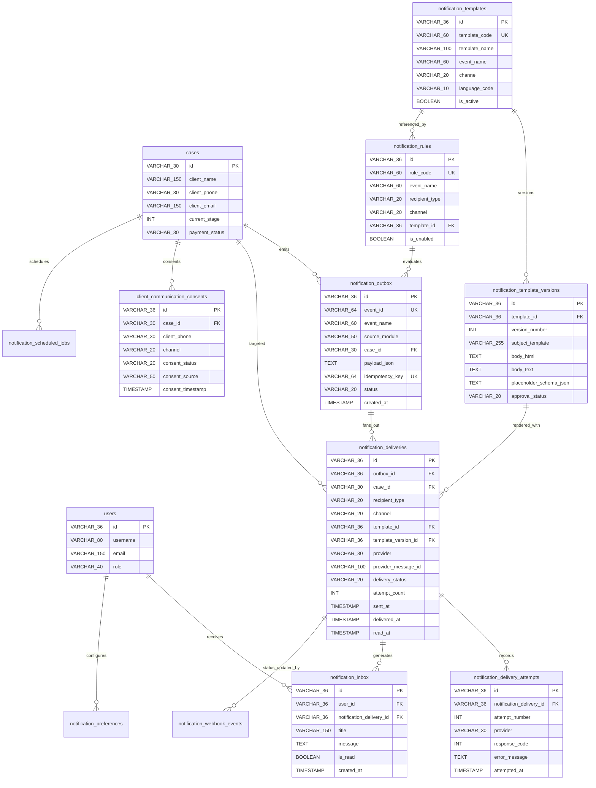
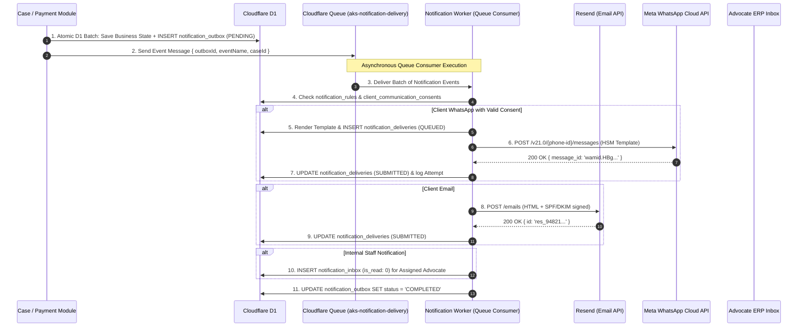
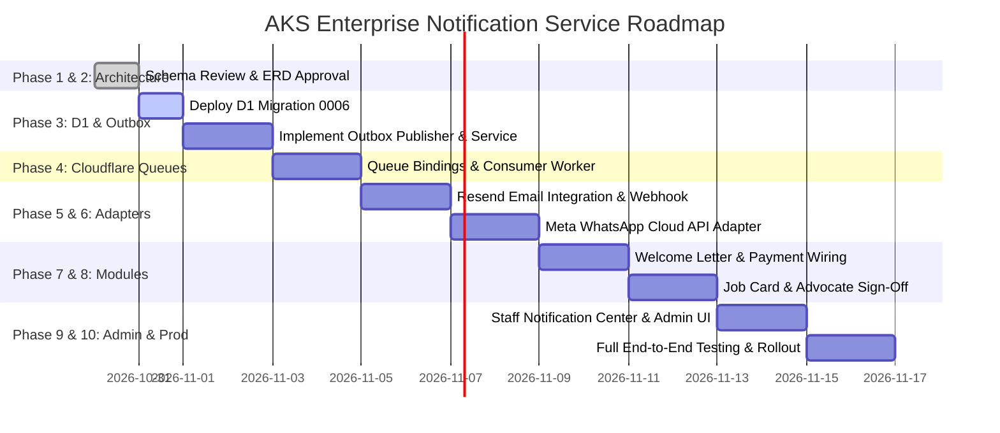

# AKS Legal Operations Platform – Enterprise Notification Service
## Complete Architecture, Database Design, Email & WhatsApp Integration Specification

**Author:** Principal Solution Architect, Senior Database Architect & Cloudflare Workers Specialist  
**Application:** AKS Legal Ops – Advocate ERP (`c:\aks-property-portal`)  
**Target Persistence:** Cloudflare D1 (APAC Edge SQLite), Cloudflare Queues, Cloudflare R2  
**Target Providers:** Resend (Email) & Meta WhatsApp Business Cloud API (WhatsApp)  
**Status:** Architecture Baseline Proposed for Review & Sign-Off (No migrations or code modifications executed)

---

## Executive Summary

This specification establishes a centralized, enterprise-grade, asynchronous **Notification Management Service** within the existing **AKS Legal Ops – Advocate ERP** platform. It provides a unified communication bus across all eight stages of the Tamil Nadu property title verification workflow—from initial public enquiry triage to 80% advance payment, 30-year EC indexing, advocate opinion certification, and courier dispatch.

### Core Architectural Principles
1. **Zero Impact on Existing Functionality**: Does not alter, rename, or drop any existing D1 tables, REST endpoints, or the 8-stage SOP state machine.
2. **Guaranteed Transactional Decoupling (Transactional Outbox Pattern)**: Business operations (such as approving a Welcome Letter or advancing a case milestone) never fail if an email or WhatsApp API provider is slow or down. Events are durably persisted to `notification_outbox` in the same Cloudflare D1 batch transaction as the business entity update.
3. **Dual-Queue Asynchronous Delivery**: Events in `notification_outbox` are published to Cloudflare Queues (`aks-notification-delivery`) and consumed by isolated Worker tasks that enforce client consent, render dynamic templates, apply rate limits, and invoke provider adapters.
4. **Cloudflare Edge Runtime Compatibility**: Zero native C++ Node.js dependencies. All HMAC webhook signatures, Merkle hash chains, and auth validations use standard Web Crypto (`crypto.subtle`).
5. **Strict Statutory & Regulatory Compliance**: Adheres to the Bar Council of Tamil Nadu & Puducherry professional communications standards, Meta WhatsApp Business Cloud API messaging policies (prior affirmative opt-in, non-preselected consent, 24-hour service windows), and Indian digital data protection standards (PII minimization, tokenized document links).

---

# PART 1: EXISTING APPLICATION & ARCHITECTURE AUDIT

## 1.1 Technology Stack & Runtime Audit
The existing production codebase lives in `c:\aks-property-portal` and is configured as follows:
- **Framework**: Next.js 15.1.0 (App Router) running on React 19.
- **Edge Deployment**: Cloudflare Workers using OpenNext (`@opennextjs/cloudflare` v1.20.14) with `nodejs_compat` enabled (`compatibility_date = "2024-09-23"`).
- **Database**: Cloudflare D1 SQL database (`aks-portal-db`, ID: `c987d1f0-a579-4e4c-8482-36482bebfd7f`) executing in the APAC region.
- **File & Document Storage**: Cloudflare R2 object storage for parent deeds, certified encumbrance certificates, e-Patta passbooks, and watermarked title opinion PDFs.
- **Client Public Portal**: Astro 5 static site with dynamic client case tracking (`/track/[caseId]`).

## 1.2 Existing Database Schema Inventory (Live D1 Audit)
A live inspection of SQLite master records in the production database reveals **19 existing user tables**:

| Table Name | Primary Key | Key Columns & Foreign Keys | Functional Scope in Legal Ops |
| :--- | :--- | :--- | :--- |
| `users` | `VARCHAR(36)` | `id`, `username`, `email`, `role`, `bar_council_reg_no`, `is_active` | Staff, Chief Counsel, Research, and Accounts user accounts |
| `user_sessions` | `VARCHAR(36)` | `id`, `user_id` $\to$ `users(id)`, `session_token`, `expires_at` | RBAC session management and JWT/token revocation |
| `enquiries` | `VARCHAR(36)` | `id`, `client_name`, `client_phone`, `client_email`, `status`, `converted_case_id` | Tier 1 public lead intake & triage buffer |
| `cases` | `VARCHAR(30)` | `id`, `source_enquiry_id` $\to$ `enquiries(id)`, `client_phone`, `current_stage`, `total_fee`, `payment_status` | Master case docket tracking the 8-stage legal verification SOP |
| `ec_records` | `VARCHAR(36)` | `id`, `case_id` $\to$ `cases(id)`, `doc_number`, `sro_name`, `search_period` | 30-year Encumbrance Certificate (EC) Form 15 registry |
| `parent_documents` | `VARCHAR(36)` | `id`, `case_id` $\to$ `cases(id)`, `doc_number`, `year`, `seller_name`, `buyer_name` | Prior title deed genealogy and devolution chain records |
| `revenue_records` | `VARCHAR(36)` | `id`, `case_id` $\to$ `cases(id)`, `patta_number`, `chitta_adangal_verified`, `fmb_sketch_verified` | Tamil Nadu Revenue records (e-Patta, Chitta, FMB sketch, TSLR) |
| `legal_opinions` | `VARCHAR(36)` | `id`, `case_id` $\to$ `cases(id)`, `advocate_name`, `bar_council_reg_no`, `sign_off_status` | Advocate A.K. Saravanan (`MS/1245/2005`) legal opinion & seal |
| `case_documents` | `VARCHAR(36)` | `id`, `case_id` $\to$ `cases(id)`, `storage_path`, `file_category`, `is_watermarked` | Evidentiary documents and watermarked client preview files in R2 |
| `payments` | `VARCHAR(36)` | `id`, `case_id` $\to$ `cases(id)`, `payment_stage`, `amount`, `transaction_ref` | 80% advance and 20% balance fee transaction ledger |
| `case_welcome_letters` | `VARCHAR(36)` | `id`, `case_id` $\to$ `cases(id)`, `letter_ref_no`, `approval_status`, `sent_status`, `sent_channel`, `dispatch_ref` | Stage 3 engagement letter, fee mandate & document requisition |
| `case_milestone_logs` | `VARCHAR(36)` | `id`, `case_id` $\to$ `cases(id)`, `from_stage`, `to_stage`, `triggered_by`, `logged_at` | Historical case workflow progression log |
| `case_audit_logs` | `TEXT` | `id`, `case_id` $\to$ `cases(id)`, `action`, `checksum_hash`, `previous_hash`, `timestamp` | Cryptographically chained Merkle audit trail (SHA-256) |
| `meta_entities` | `TEXT` | `id`, `entity_key`, `display_name`, `storage_table`, `version` | Metadata Engine: Entity registration |
| `meta_sections` | `TEXT` | `id`, `entity_id` $\to$ `meta_entities(id)`, `section_key`, `columns` | Metadata Engine: Layout sections |
| `meta_fields` | `TEXT` | `id`, `entity_id` $\to$ `meta_entities(id)`, `field_key`, `field_type`, `validation_regex` | Metadata Engine: Dynamic field schemas |
| `sys_modules` | `TEXT` | `id`, `module_key`, `display_name`, `icon_name` | System RBAC: Core module registry |
| `sys_permissions` | `TEXT` | `id`, `permission_code`, `module_key` | System RBAC: Granular operational permissions |
| `sys_role_permissions` | `(role_id, permission_id)` | Composite Primary Key | System RBAC: Role-to-permission mapping |

### Critical Architectural Finding on Identity
- In the existing application, **there is no separate standalone `clients` table**.
- Client identity is anchored directly to `cases.id` (`AK-2026-0042`) with denormalized contact details (`client_name`, `client_phone`, `client_email`) and `enquiries.id` (`ENQ-2026-101`).
- Therefore, the notification service must support foreign key references to `case_id VARCHAR(30)` and `enquiry_id VARCHAR(36)` rather than requiring an artificial client table that would fracture existing foreign key constraints.

---

# PART 2: DATABASE DESIGN & EXISTING-VERSUS-PROPOSED COMPARISON

## 2.1 Existing vs. Proposed Table Comparison

To prevent duplicate tables, every proposed entity is mapped against existing application capabilities:

| Proposed Notification Table | Existing Entity / Table | Architectural Relationship & Reusability | Business Justification |
| :--- | :--- | :--- | :--- |
| `notification_outbox` | None (previously in-memory / direct API calls) | **Brand New**. Captures business events transactionally alongside `cases`, `payments`, and `case_welcome_letters`. | **Mandatory**: Prevents lost notifications when background queues or provider APIs fail. |
| `notification_deliveries` | None (`case_welcome_letters.sent_status` was an isolated flag) | **Brand New**. References `cases(id)` and `notification_outbox(id)`. | **Mandatory**: Tracks multi-channel delivery states (SENT $\to$ DELIVERED $\to$ READ) per recipient. |
| `notification_delivery_attempts` | None | **Brand New**. References `notification_deliveries(id)`. | **Mandatory**: Immutable attempt history recording provider response codes, error types, and retry delays. |
| `notification_templates` | None | **Brand New**. Central template registry. | **Mandatory**: Governs email, WhatsApp, and in-app templates across English & Tamil. |
| `notification_template_versions` | None | **Brand New**. Version control for templates. | **Mandatory**: Ensures auditability; active legal cases always link to the exact template version used. |
| `notification_rules` | None (workflow state machine was hardcoded in TypeScript) | **Brand New**. Configuration engine mapping events $\to$ templates $\to$ recipients. | **Mandatory**: Allows admins to route events without hardcoding recipient emails/phones. |
| `notification_preferences` | None | **Brand New**. References `users(id)` and client phone/email. | **Mandatory**: Allows staff and clients to toggle channels (Email vs WhatsApp vs In-App). |
| `client_communication_consents` | None | **Brand New**. Tied to `client_phone` / `case_id`. | **Mandatory**: Statutory Meta WhatsApp compliance (prior affirmative consent & opt-out tracking). |
| `notification_webhook_events` | None | **Brand New**. Webhook log for Resend and Meta. | **Mandatory**: Idempotent webhook deduplication and replay attack prevention. |
| `notification_inbox` | None | **Brand New**. Internal notifications for staff tied to `users(id)`. | **Mandatory**: Replaces external WhatsApp spam for staff; surfaces overdue tasks inside the ERP UI. |
| `notification_scheduled_jobs` | None | **Brand New**. Scheduled reminder engine. | **Mandatory**: Auto-cancels advance/balance payment reminders upon task settlement. |
| `notification_provider_config` | Cloudflare Worker Secrets | **Omitted / Unnecessary**. Non-secret metadata can live in environment variables. | **Avoids Security Risk**: API keys, tokens, and secrets must never live in D1 SQL tables. |

---

## 2.2 Entity-Relationship Diagram (ERD)



---

## 2.3 SQLite-Compatible Cloudflare D1 DDL Specification

Below is the DDL design crafted specifically for Cloudflare D1 (SQLite engine with strict data types, composite indexes, and foreign key integrity).

```sql
-- =============================================================================
-- AKS LEGAL OPERATIONS PLATFORM - ENTERPRISE NOTIFICATION SERVICE SCHEMA
-- Migration: 0006_create_notification_service.sql
-- Target: Cloudflare D1 (APAC Edge SQLite)
-- =============================================================================

-- -----------------------------------------------------------------------------
-- 1. NOTIFICATION OUTBOX (Transactional Outbox Pattern)
-- -----------------------------------------------------------------------------
CREATE TABLE IF NOT EXISTS notification_outbox (
    id VARCHAR(36) PRIMARY KEY,
    event_id VARCHAR(64) UNIQUE NOT NULL,
    event_name VARCHAR(60) NOT NULL,
    source_module VARCHAR(50) NOT NULL,
    entity_type VARCHAR(50) NOT NULL,
    entity_id VARCHAR(50) NOT NULL,
    case_id VARCHAR(30) REFERENCES cases(id) ON DELETE CASCADE,
    docket_number VARCHAR(60),
    payload_json TEXT NOT NULL,
    correlation_id VARCHAR(64),
    idempotency_key VARCHAR(64) UNIQUE NOT NULL,
    status VARCHAR(20) DEFAULT 'PENDING' NOT NULL 
        CHECK(status IN ('PENDING', 'PROCESSING', 'PUBLISHED', 'COMPLETED', 'FAILED')),
    last_error TEXT,
    retry_count INT DEFAULT 0 NOT NULL,
    published_at TIMESTAMP,
    processed_at TIMESTAMP,
    created_at TIMESTAMP DEFAULT CURRENT_TIMESTAMP NOT NULL,
    updated_at TIMESTAMP DEFAULT CURRENT_TIMESTAMP NOT NULL
);

CREATE INDEX IF NOT EXISTS idx_outbox_status_created ON notification_outbox(status, created_at ASC);
CREATE INDEX IF NOT EXISTS idx_outbox_event_name ON notification_outbox(event_name);
CREATE INDEX IF NOT EXISTS idx_outbox_case_id ON notification_outbox(case_id);

-- -----------------------------------------------------------------------------
-- 2. NOTIFICATION TEMPLATES (Registry Header)
-- -----------------------------------------------------------------------------
CREATE TABLE IF NOT EXISTS notification_templates (
    id VARCHAR(36) PRIMARY KEY,
    template_code VARCHAR(60) UNIQUE NOT NULL,
    template_name VARCHAR(120) NOT NULL,
    event_name VARCHAR(60) NOT NULL,
    channel VARCHAR(20) NOT NULL CHECK(channel IN ('EMAIL', 'WHATSAPP', 'IN_APP')),
    language_code VARCHAR(10) DEFAULT 'en' NOT NULL, -- 'en', 'ta' (Tamil)
    provider_template_name VARCHAR(120),            -- WhatsApp HSM approved name
    provider_template_id VARCHAR(100),              -- Meta template ID
    category VARCHAR(40) DEFAULT 'TRANSACTIONAL' NOT NULL,
    description TEXT,
    active_version_id VARCHAR(36),
    status VARCHAR(20) DEFAULT 'ACTIVE' NOT NULL CHECK(status IN ('ACTIVE', 'DRAFT', 'ARCHIVED')),
    is_active BOOLEAN DEFAULT 1 NOT NULL,
    created_by VARCHAR(36) REFERENCES users(id),
    created_at TIMESTAMP DEFAULT CURRENT_TIMESTAMP NOT NULL,
    updated_at TIMESTAMP DEFAULT CURRENT_TIMESTAMP NOT NULL
);

CREATE INDEX IF NOT EXISTS idx_templates_event ON notification_templates(event_name, channel, language_code);
CREATE INDEX IF NOT EXISTS idx_templates_code ON notification_templates(template_code);

-- -----------------------------------------------------------------------------
-- 3. NOTIFICATION TEMPLATE VERSIONS (Immutable Version Control)
-- -----------------------------------------------------------------------------
CREATE TABLE IF NOT EXISTS notification_template_versions (
    id VARCHAR(36) PRIMARY KEY,
    template_id VARCHAR(36) NOT NULL REFERENCES notification_templates(id) ON DELETE CASCADE,
    version_number INT NOT NULL,
    subject_template VARCHAR(255),
    body_html TEXT,
    body_text TEXT,
    body_json TEXT,                                  -- Structured Meta WhatsApp payload
    placeholder_schema_json TEXT NOT NULL,          -- JSON Schema of required {{variables}}
    provider_approval_status VARCHAR(30) DEFAULT 'NOT_REQUIRED' NOT NULL 
        CHECK(provider_approval_status IN ('NOT_REQUIRED', 'PENDING', 'APPROVED', 'REJECTED')),
    approval_status VARCHAR(20) DEFAULT 'DRAFT' NOT NULL 
        CHECK(approval_status IN ('DRAFT', 'SUBMITTED', 'APPROVED', 'PUBLISHED', 'RETIRED')),
    approved_by VARCHAR(36) REFERENCES users(id),
    approved_at TIMESTAMP,
    created_by VARCHAR(36) REFERENCES users(id),
    created_at TIMESTAMP DEFAULT CURRENT_TIMESTAMP NOT NULL,
    UNIQUE(template_id, version_number)
);

CREATE INDEX IF NOT EXISTS idx_tmpl_vers_lookup ON notification_template_versions(template_id, version_number);

-- -----------------------------------------------------------------------------
-- 4. NOTIFICATION RULES (Event Routing Engine)
-- -----------------------------------------------------------------------------
CREATE TABLE IF NOT EXISTS notification_rules (
    id VARCHAR(36) PRIMARY KEY,
    rule_code VARCHAR(60) UNIQUE NOT NULL,
    event_name VARCHAR(60) NOT NULL,
    source_module VARCHAR(50) NOT NULL,
    recipient_type VARCHAR(30) NOT NULL 
        CHECK(recipient_type IN ('CLIENT', 'STAFF', 'ASSIGNED_ADVOCATE', 'CHIEF_COUNSEL', 'ACCOUNTS', 'SUPER_ADMIN')),
    recipient_resolution VARCHAR(50) NOT NULL,      -- 'CASE_CLIENT', 'CASE_ADVOCATE', 'MODULE_ROLE'
    channel VARCHAR(20) NOT NULL CHECK(channel IN ('EMAIL', 'WHATSAPP', 'IN_APP')),
    template_id VARCHAR(36) NOT NULL REFERENCES notification_templates(id),
    language_code VARCHAR(10) DEFAULT 'en' NOT NULL,
    priority VARCHAR(10) DEFAULT 'NORMAL' NOT NULL CHECK(priority IN ('LOW', 'NORMAL', 'HIGH', 'URGENT')),
    is_enabled BOOLEAN DEFAULT 1 NOT NULL,
    delay_minutes INT DEFAULT 0 NOT NULL,
    business_hours_only BOOLEAN DEFAULT 0 NOT NULL,
    max_reminders INT DEFAULT 1 NOT NULL,
    created_by VARCHAR(36) REFERENCES users(id),
    created_at TIMESTAMP DEFAULT CURRENT_TIMESTAMP NOT NULL,
    updated_at TIMESTAMP DEFAULT CURRENT_TIMESTAMP NOT NULL
);

CREATE INDEX IF NOT EXISTS idx_rules_event ON notification_rules(event_name, is_enabled);

-- -----------------------------------------------------------------------------
-- 5. NOTIFICATION DELIVERIES (Multi-Channel Delivery Records)
-- -----------------------------------------------------------------------------
CREATE TABLE IF NOT EXISTS notification_deliveries (
    id VARCHAR(36) PRIMARY KEY,
    outbox_id VARCHAR(36) NOT NULL REFERENCES notification_outbox(id) ON DELETE CASCADE,
    event_id VARCHAR(64) NOT NULL,
    case_id VARCHAR(30) REFERENCES cases(id) ON DELETE SET NULL,
    recipient_type VARCHAR(30) NOT NULL,
    recipient_id VARCHAR(36),                       -- users(id) if staff
    recipient_address VARCHAR(150) NOT NULL,        -- Masked phone (+91 98***12345) or email
    recipient_address_hash VARCHAR(64) NOT NULL,    -- SHA-256 for exact query lookup without unmasking
    channel VARCHAR(20) NOT NULL CHECK(channel IN ('EMAIL', 'WHATSAPP', 'IN_APP')),
    template_id VARCHAR(36) NOT NULL REFERENCES notification_templates(id),
    template_version_id VARCHAR(36) NOT NULL REFERENCES notification_template_versions(id),
    provider VARCHAR(30) NOT NULL CHECK(provider IN ('RESEND', 'META_WHATSAPP', 'INTERNAL')),
    provider_message_id VARCHAR(100),
    subject VARCHAR(255),
    delivery_status VARCHAR(20) DEFAULT 'PENDING' NOT NULL 
        CHECK(delivery_status IN ('PENDING', 'QUEUED', 'PROCESSING', 'SUBMITTED', 'SENT', 'DELIVERED', 'READ', 'FAILED', 'BOUNCED', 'REJECTED', 'CANCELLED', 'SUPPRESSED')),
    priority VARCHAR(10) DEFAULT 'NORMAL' NOT NULL,
    attempt_count INT DEFAULT 0 NOT NULL,
    scheduled_at TIMESTAMP,
    sent_at TIMESTAMP,
    delivered_at TIMESTAMP,
    read_at TIMESTAMP,
    failed_at TIMESTAMP,
    failure_code VARCHAR(50),
    failure_reason TEXT,
    created_at TIMESTAMP DEFAULT CURRENT_TIMESTAMP NOT NULL,
    updated_at TIMESTAMP DEFAULT CURRENT_TIMESTAMP NOT NULL,
    UNIQUE(outbox_id, recipient_address_hash, channel)
);

CREATE INDEX IF NOT EXISTS idx_deliv_status ON notification_deliveries(delivery_status, created_at DESC);
CREATE INDEX IF NOT EXISTS idx_deliv_case_id ON notification_deliveries(case_id);
CREATE INDEX IF NOT EXISTS idx_deliv_provider_msg ON notification_deliveries(provider, provider_message_id);

-- -----------------------------------------------------------------------------
-- 6. NOTIFICATION DELIVERY ATTEMPTS (Immutable Provider Log)
-- -----------------------------------------------------------------------------
CREATE TABLE IF NOT EXISTS notification_delivery_attempts (
    id VARCHAR(36) PRIMARY KEY,
    notification_delivery_id VARCHAR(36) NOT NULL REFERENCES notification_deliveries(id) ON DELETE CASCADE,
    attempt_number INT NOT NULL,
    provider VARCHAR(30) NOT NULL,
    request_reference VARCHAR(100),
    provider_message_id VARCHAR(100),
    attempt_status VARCHAR(20) NOT NULL CHECK(attempt_status IN ('SUCCESS', 'TRANSIENT_FAILURE', 'PERMANENT_FAILURE')),
    response_code INT,
    error_code VARCHAR(60),
    error_message TEXT,
    retry_after_seconds INT,
    attempted_at TIMESTAMP DEFAULT CURRENT_TIMESTAMP NOT NULL,
    completed_at TIMESTAMP
);

CREATE INDEX IF NOT EXISTS idx_attempts_delivery_id ON notification_delivery_attempts(notification_delivery_id, attempt_number);

-- -----------------------------------------------------------------------------
-- 7. CLIENT COMMUNICATION CONSENTS (WhatsApp & Legal Opt-In)
-- -----------------------------------------------------------------------------
CREATE TABLE IF NOT EXISTS client_communication_consents (
    id VARCHAR(36) PRIMARY KEY,
    case_id VARCHAR(30) REFERENCES cases(id) ON DELETE CASCADE,
    client_phone VARCHAR(30) NOT NULL,
    client_email VARCHAR(150),
    channel VARCHAR(20) NOT NULL CHECK(channel IN ('EMAIL', 'WHATSAPP')),
    consent_status VARCHAR(20) NOT NULL CHECK(consent_status IN ('OPTED_IN', 'OPTED_OUT', 'REVOKED')),
    consent_category VARCHAR(40) DEFAULT 'CASE_UPDATES' NOT NULL,
    consent_text_version VARCHAR(20) DEFAULT 'v1.0' NOT NULL,
    consent_source VARCHAR(50) NOT NULL,            -- 'PUBLIC_ENQUIRY_FORM', 'INTAKE_DESK', 'WHATSAPP_INBOUND'
    consent_timestamp TIMESTAMP DEFAULT CURRENT_TIMESTAMP NOT NULL,
    withdrawn_at TIMESTAMP,
    captured_by VARCHAR(36) REFERENCES users(id),
    evidence_reference VARCHAR(100),                -- e.g. IP address or intake record ID
    created_at TIMESTAMP DEFAULT CURRENT_TIMESTAMP NOT NULL
);

CREATE INDEX IF NOT EXISTS idx_consent_lookup ON client_communication_consents(client_phone, channel, consent_status);
CREATE INDEX IF NOT EXISTS idx_consent_case ON client_communication_consents(case_id);

-- -----------------------------------------------------------------------------
-- 8. NOTIFICATION PREFERENCES (User & Client Granular Controls)
-- -----------------------------------------------------------------------------
CREATE TABLE IF NOT EXISTS notification_preferences (
    id VARCHAR(36) PRIMARY KEY,
    user_id VARCHAR(36) REFERENCES users(id) ON DELETE CASCADE,
    case_id VARCHAR(30) REFERENCES cases(id) ON DELETE CASCADE,
    channel VARCHAR(20) NOT NULL CHECK(channel IN ('EMAIL', 'WHATSAPP', 'IN_APP')),
    event_category VARCHAR(40) NOT NULL,            -- 'MILESTONE_UPDATES', 'PAYMENT_ALERTS', 'DOCUMENT_REQUISITION'
    is_enabled BOOLEAN DEFAULT 1 NOT NULL,
    preferred_language VARCHAR(10) DEFAULT 'en' NOT NULL,
    created_at TIMESTAMP DEFAULT CURRENT_TIMESTAMP NOT NULL,
    updated_at TIMESTAMP DEFAULT CURRENT_TIMESTAMP NOT NULL
);

CREATE UNIQUE INDEX IF NOT EXISTS idx_pref_user_channel ON notification_preferences(user_id, channel, event_category) WHERE user_id IS NOT NULL;
CREATE UNIQUE INDEX IF NOT EXISTS idx_pref_case_channel ON notification_preferences(case_id, channel, event_category) WHERE case_id IS NOT NULL;

-- -----------------------------------------------------------------------------
-- 9. NOTIFICATION WEBHOOK EVENTS (Deduplication & Replay Protection)
-- -----------------------------------------------------------------------------
CREATE TABLE IF NOT EXISTS notification_webhook_events (
    id VARCHAR(36) PRIMARY KEY,
    provider VARCHAR(30) NOT NULL CHECK(provider IN ('RESEND', 'META_WHATSAPP')),
    provider_event_id VARCHAR(100),
    provider_message_id VARCHAR(100),
    event_type VARCHAR(50) NOT NULL,
    payload_hash VARCHAR(64) NOT NULL,              -- SHA-256 hash of raw webhook payload
    received_at TIMESTAMP DEFAULT CURRENT_TIMESTAMP NOT NULL,
    processed_at TIMESTAMP,
    processing_status VARCHAR(20) DEFAULT 'PENDING' NOT NULL 
        CHECK(processing_status IN ('PENDING', 'PROCESSED', 'DUPLICATE', 'FAILED', 'IGNORED')),
    processing_error TEXT,
    UNIQUE(provider, provider_event_id)
);

CREATE INDEX IF NOT EXISTS idx_webhook_dedup ON notification_webhook_events(provider, provider_message_id, event_type);

-- -----------------------------------------------------------------------------
-- 10. NOTIFICATION INBOX (Staff In-App Notifications)
-- -----------------------------------------------------------------------------
CREATE TABLE IF NOT EXISTS notification_inbox (
    id VARCHAR(36) PRIMARY KEY,
    user_id VARCHAR(36) NOT NULL REFERENCES users(id) ON DELETE CASCADE,
    notification_delivery_id VARCHAR(36) REFERENCES notification_deliveries(id) ON DELETE SET NULL,
    event_name VARCHAR(60) NOT NULL,
    title VARCHAR(150) NOT NULL,
    message TEXT NOT NULL,
    related_entity_type VARCHAR(50) NOT NULL,       -- 'CASE', 'PAYMENT', 'DOCUMENT', 'WELCOME_LETTER'
    related_entity_id VARCHAR(50) NOT NULL,
    action_url VARCHAR(255),                        -- e.g. '/admin/cases/AK-2026-0042/job-card'
    is_read BOOLEAN DEFAULT 0 NOT NULL,
    read_at TIMESTAMP,
    created_at TIMESTAMP DEFAULT CURRENT_TIMESTAMP NOT NULL
);

CREATE INDEX IF NOT EXISTS idx_inbox_user_read ON notification_inbox(user_id, is_read, created_at DESC);

-- -----------------------------------------------------------------------------
-- 11. NOTIFICATION SCHEDULED JOBS (Reminders & Escrow Escalation)
-- -----------------------------------------------------------------------------
CREATE TABLE IF NOT EXISTS notification_scheduled_jobs (
    id VARCHAR(36) PRIMARY KEY,
    job_type VARCHAR(40) NOT NULL,                  -- 'ADVANCE_PAYMENT_REMINDER', 'DISCOVERY_CALL_REMINDER'
    event_name VARCHAR(60) NOT NULL,
    case_id VARCHAR(30) NOT NULL REFERENCES cases(id) ON DELETE CASCADE,
    recipient_reference VARCHAR(150) NOT NULL,
    scheduled_at TIMESTAMP NOT NULL,
    status VARCHAR(20) DEFAULT 'SCHEDULED' NOT NULL 
        CHECK(status IN ('SCHEDULED', 'EXECUTED', 'CANCELLED', 'SUPPRESSED')),
    execution_count INT DEFAULT 0 NOT NULL,
    max_execution_count INT DEFAULT 3 NOT NULL,
    last_executed_at TIMESTAMP,
    next_execution_at TIMESTAMP,
    cancellation_reason VARCHAR(100),
    created_at TIMESTAMP DEFAULT CURRENT_TIMESTAMP NOT NULL,
    updated_at TIMESTAMP DEFAULT CURRENT_TIMESTAMP NOT NULL
);

CREATE INDEX IF NOT EXISTS idx_sched_next ON notification_scheduled_jobs(status, next_execution_at ASC);
CREATE INDEX IF NOT EXISTS idx_sched_case ON notification_scheduled_jobs(case_id);
```

---

# PART 3: ARCHITECTURE & CLOUDFLARE EDGE DISPATCH PIPELINE

## 3.1 Asynchronous Delivery Pipeline (Worker + Cloudflare Queues)



## 3.2 Cloudflare `wrangler.toml` Bindings Addition
To support queues and secrets, the following block will be appended to `wrangler.toml` upon approval:

```toml
# Cloudflare Queues for Notification Dispatch
[[queues.producers]]
binding = "NOTIFICATION_QUEUE"
queue = "aks-notification-delivery"

[[queues.consumers]]
queue = "aks-notification-delivery"
max_batch_size = 10
max_batch_timeout = 5
max_retries = 3
dead_letter_queue = "aks-notification-dlq"
```

---

# PART 4: EVENT CATALOGUE & RECIPIENT ROUTING SPECIFICATION

| Event Name | Source Business Module | Trigger Condition | Recipient & Channel Route | Priority | Template Code |
| :--- | :--- | :--- | :--- | :--- | :--- |
| `ENQUIRY_RECEIVED` | Enquiries & Triage | Lead submitted on public checklist | **Client**: WhatsApp + Email ACK<br>**Intake Staff**: In-App notification | Normal | `ENQ_ACK_CLIENT_V1` |
| `WELCOME_LETTER_APPROVED` | Stage 3 Welcome Letter | Adv. Saravanan approves letterhead | **Client**: Email with official letterhead PDF<br>**Client**: WhatsApp with secure preview link | High | `WL_APPROVED_CLIENT_V1` |
| `WELCOME_LETTER_SENT` | Stage 3 Welcome Letter | Marked as dispatched to client | **Accounts Staff**: In-App 80% Advance Escrow Alert | Normal | `INTERNAL_WL_DISPATCHED` |
| `ADVANCE_PAYMENT_REQUESTED` | Billing & Escrow | Stage 3 Gate 4 payment mandate | **Client**: Email + WhatsApp with UPI payment link | High | `PAY_ADVANCE_REQ_V1` |
| `ADVANCE_PAYMENT_RECEIVED` | Billing & Escrow | Verified 80% payment receipt | **Client**: Email Tax Invoice + WhatsApp ACK<br>**Scrutiny Staff**: In-App (Gate 4 Unlocked) | Urgent | `PAY_ADVANCE_RCVD_V1` |
| `JOB_CARD_OPENED` | Stage 4 Job Card | Gate 4 clear; scrutiny starts | **Client**: WhatsApp status update<br>**Legal Staff**: In-App assignment | Normal | `JC_OPENED_CLIENT_V1` |
| `DOCUMENT_REQUIRED` | Stage 4 Job Card | Missing parent deed / Patta identified | **Client**: WhatsApp document checklist dropzone link | Urgent | `DOC_REQUISITION_CLIENT_V1` |
| `LEGAL_OPINION_READY` | Stage 6 Opinion Sign-Off | Adv. Saravanan signs opinion | **Chief Counsel**: In-App sealed approval log<br>**Client**: Watermarked preview notification | High | `OPINION_CERTIFIED_CLIENT_V1` |
| `BALANCE_PAYMENT_REQUESTED`| Stage 7 Preview & Balance | Stage 7 preview issued to client | **Client**: Email + WhatsApp for 20% balance (Gate 8) | High | `PAY_BALANCE_REQ_V1` |
| `FINAL_REPORT_DISPATCHED` | Stage 8 Final Dispatch | Physical courier AWB logged | **Client**: WhatsApp + Email courier tracking link | Normal | `DISPATCH_COURIER_CLIENT_V1` |

---

# PART 5: PROVIDER INTEGRATION DESIGN

## 5.1 Resend Email Integration
- **Endpoint**: `https://api.resend.com/emails`
- **Domain Authentication**:
  - Sender: `Advocate A.K. Saravanan <orders@akspropertychecklist.in>`
  - Reply-To: `chambers@akspropertychecklist.in`
  - Required DNS Records: SPF (`v=spf1 include:resend.com ~all`), DKIM (`resend._domainkey`), DMARC (`v=DMARC1; p=quarantine`).
- **Idempotency**: Utilizes `Idempotency-Key` header with `outbox_id`.
- **Security**: Resend API key stored in Cloudflare Worker Secret `RESEND_API_KEY`.
- **Webhook Endpoint**: `POST /api/webhooks/resend` (Validates Svix HMAC signature header `svix-signature` using `RESEND_WEBHOOK_SECRET`).

## 5.2 Meta WhatsApp Business Cloud API Integration
- **Endpoint**: `https://graph.facebook.com/v21.0/{PHONE_NUMBER_ID}/messages`
- **Statutory Opt-In Enforcement**:
  - The notification service queries `client_communication_consents` before initiating any message.
  - If `consent_status != 'OPTED_IN'`, WhatsApp delivery is immediately suppressed with failure reason `WHATSAPP_CONSENT_MISSING`, and falls back to Email.
- **Approved Templates**:
  - `aks_welcome_letter_v1` (Transactional template with parameters: `{{client_name}}`, `{{docket_number}}`, `{{survey_no}}`, `{{advance_amount}}`, `{{portal_url}}`).
  - Languages supported: English (`en`) and Tamil (`ta`).
- **Security**:
  - Access Token: `WHATSAPP_SYSTEM_USER_TOKEN` in Cloudflare Worker Secrets.
  - Webhook Endpoint: `GET /api/webhooks/whatsapp` (Hub challenge verification) and `POST /api/webhooks/whatsapp` (Signature check `X-Hub-Signature-256` using `WHATSAPP_APP_SECRET`).
  - Sensitive Property Document Safeguard: **Never transmits raw deed attachments over WhatsApp**. Messages supply a signed, time-limited, tokenized link to the client tracking portal (`/track/[caseId]?token=...`).

---

# PART 6: REST API CONTRACTS & OPENAPI SPECIFICATION

The notification subsystem exposes the following authenticated endpoints under `/api/notifications`:

```
POST   /api/notifications/events              - Publish business event into transactional outbox
GET    /api/notifications/deliveries          - Query delivery log & audit status (filters: caseId, status)
GET    /api/notifications/deliveries/{id}     - Retrieve detailed delivery attempt history
POST   /api/notifications/deliveries/{id}/retry - Manually trigger retry of a failed delivery
GET    /api/notifications/inbox               - Retrieve staff in-app notification inbox (with unread count)
PATCH  /api/notifications/inbox/{id}/read     - Mark internal notification as read
POST   /api/notifications/inbox/read-all      - Mark all internal notifications as read
GET    /api/notifications/templates           - List notification templates & active versions
POST   /api/notifications/templates           - Create draft template
GET    /api/notifications/rules               - List event routing rules
GET    /api/notifications/consents            - Query client communication consent status
POST   /api/notifications/consents            - Record client opt-in / opt-out
POST   /api/webhooks/resend                   - Provider webhook for email status updates
GET    /api/webhooks/whatsapp                 - Meta webhook hub challenge validation
POST   /api/webhooks/whatsapp                 - Meta webhook delivery & read receipt processing
```

---

# PART 7: PHASED IMPLEMENTATION PLAN & RISK MITIGATION



### Rollback Strategy
1. The migration creates 11 completely isolated tables with the prefix `notification_` or specific consent/job tables (`client_communication_consents`, `notification_scheduled_jobs`).
2. Existing tables (`cases`, `users`, `payments`, `case_welcome_letters`) are untouched; no columns are altered.
3. In the event of a rollback, `DROP TABLE` can safely remove the 11 notification tables with zero data loss or downtime to existing legal operations.

---

## Required User Action & Review

Please review this architectural and database specification. Upon your approval, we will proceed with:
1. **Phase 2 Implementation**: Preparing the exact migration script `scripts/migrate-notification-service.mjs`.
2. **Phase 3 Implementation**: Building `src/lib/services/notificationOutboxService.ts` and repository bindings.

