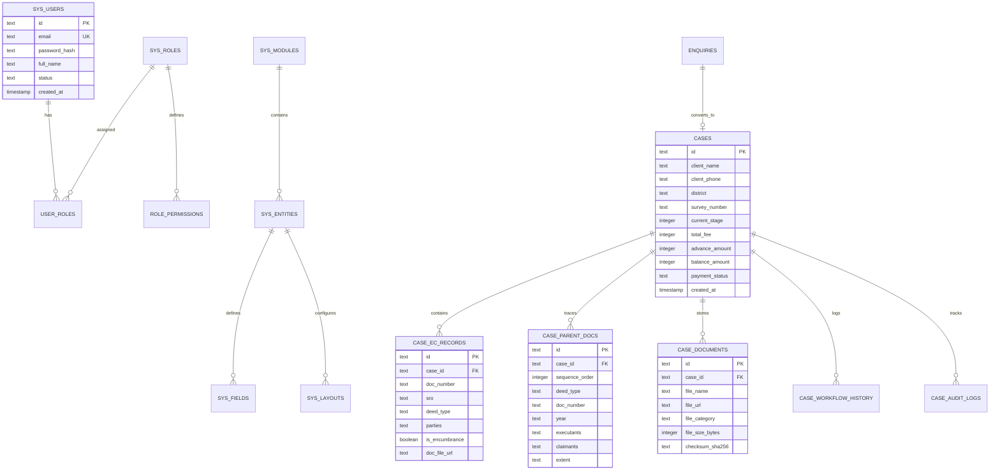
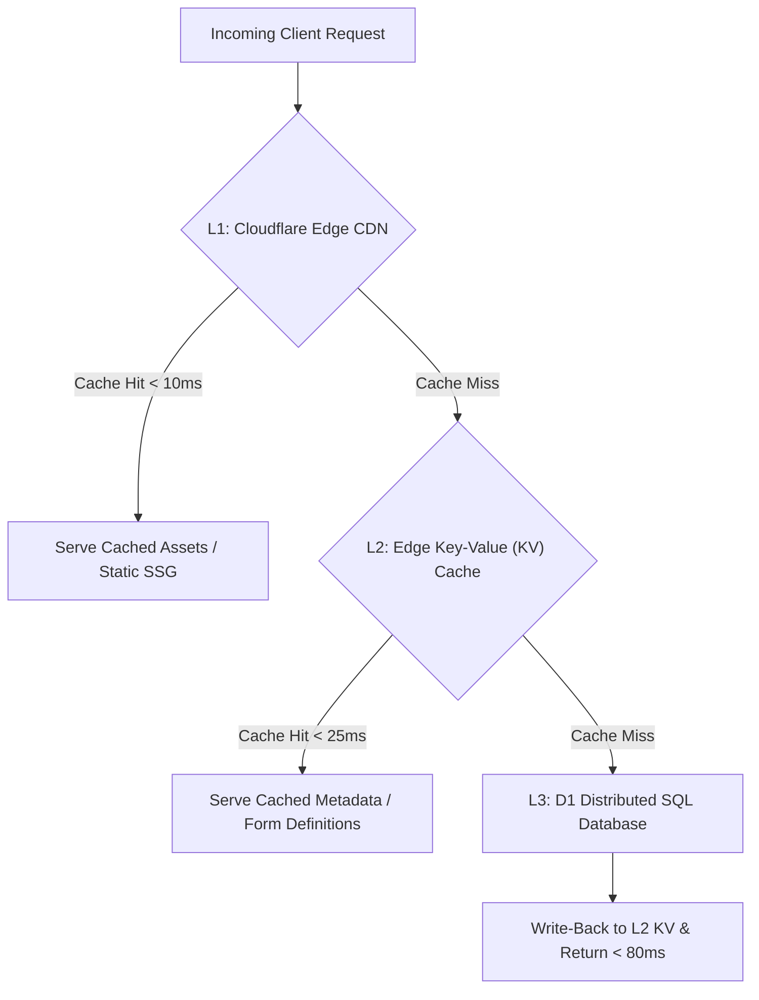
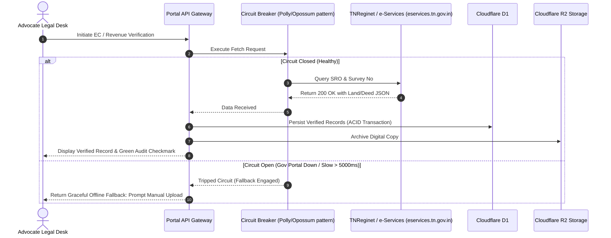
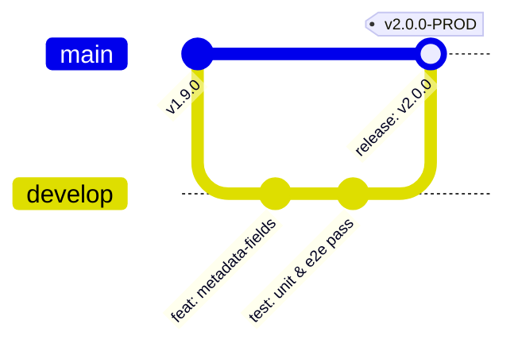
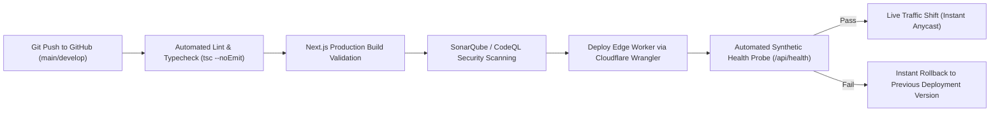

# Enterprise Solution Architecture Document (SAD) & Technical Blueprint
## Metadata-Driven Dynamic Web Application Platform

**Document Reference**: EDAP-SAD-2026-V2.0  
**Domain Focus**: Legal Ops, Real Estate Due Diligence & Metadata-Driven Dynamic Enterprise Applications  
**Author**: Lead Principal Enterprise Solution Architect (15+ YOE)  
**Classification**: Enterprise Architecture & Engineering Baseline  
**Version**: 2.0.0-ENTERPRISE  
**Date**: October 2026  
**Status**: APPROVED ARCHITECTURAL BASELINE  

---

## Executive Summary

Modern enterprise platforms frequently suffer from code bloat, high deployment risk, and slow time-to-market because new business forms, workflows, and modules require full-cycle software development—from schema migrations and backend REST endpoints to frontend UI scaffolding and redeployments. 

This **Enterprise Solution Architecture Document (SAD)** defines the architecture for the **Enterprise Dynamic Application Platform (EDAP)**, implemented within the **AKS Property Portal & Legal Operations Ecosystem**. The central architectural tenet is a **Metadata-Driven Dynamic Architecture (MDDA)**. Instead of hard-coding screens, entities, and validation rules in source code, the application treats UI structures, validation rules, state-transition workflows, menu navigation, and reporting parameters as **first-class runtime data (Metadata)** stored in a resilient, versioned, relational catalog.

### Architectural Tenets
1. **Metadata-as-Configuration**: Business analysts and administrators can construct new application modules, forms, field types, validation constraints, and multi-tier approval flows at runtime via administrative controls without touching source code or triggering CI/CD pipelines.
2. **Modular Monolith on Edge/Serverless Execution Boundary**: Eliminates distributed microservice operational complexity (RPC overhead, distributed transactions, service mesh latency) while maintaining strict domain modularity, clean boundaries, and sub-50ms cold-start execution at the CDN edge.
3. **Polyglot Persistence with Single-Writer Distributed Concurrency**: Operational structured data and metadata reside in Cloudflare D1 (distributed relational SQLite engine at the edge); unstructured legal deeds and audit artifacts reside in S3-compatible Cloudflare R2 object storage; ephemeral session states and cached metadata definitions reside in distributed Key-Value (KV) stores.
4. **Security by Design (OWASP Top 10 Aligned)**: Zero-trust architecture incorporating parameterized queries across all database access, strict Content Security Policies (CSP), cryptographic token verification, and Role/Attribute-Based Access Control (RBAC/ABAC).

---

## 1. Business and Functional Architecture

### 1.1 Business Objectives & Scope
The platform provides a scalable, auditable, high-legibility legal due diligence and enterprise workflow automation engine. It tracks complex property transactions across Tamil Nadu, handling 30+ year title traces, Encumbrance Certificate (EC) indexing, revenue department (Patta/Chitta/FMB) reconciliation, and formal Advocate Legal Opinion signing.


### 1.2 User Roles and Responsibilities (RBAC Matrix)

| Role Code | Role Name | Primary Responsibility | Permission Scope |
|:---|:---|:---|:---|
| `SUPER_ADMIN` | Platform Architect & System Admin | System metadata configuration, module builder, user provisioning, global audit logs | Full Platform Access (`*.*`) |
| `ADVOCATE_PARTNER` | Chief Legal Counsel | Title scrutiny, finding formulation, legal opinion signing, exception overriding | Legal Operations, Case Approval, Report Issuance |
| `LEGAL_SCRUTINIZER` | Senior Legal Associate | 30-year deed chain analysis, EC record indexing, encumbrance flagging | Case Read/Write, Document Verification, Draft Opinions |
| `INTAKE_CLERK` | Operations / Front-Office | Client registration, fee collection tracking, revenue document uploads | Intake, Lead Triage, Read/Upload Case Files |
| `CLIENT_BUYER` | Property Buyer / Client | Case progress tracking, document submission, invoice settlement, report download | Self Case Read-Only, Document Upload |

### 1.3 Core Functional Modules
1. **Dynamic Metadata Engine**: Runtime generation of modules, schemas, forms, menus, and validation rules.
2. **Client Intake & Enquiry Management**: Multi-channel lead intake, automated fee calculation, deduplication, and conversion to legal cases.
3. **8-Stage Workflow Orchestrator**: Deterministic state machine governing case transitions from Stage 1 (Enquiry) to Stage 8 (Dispatched).
4. **Digital Job Card & Title Scrutiny Engine**: Tabular deed indexing, seller-to-buyer link analysis, gap detection in 30-year chains, and automated revenue reconciliation (TNeGA/eservices.tn.gov.in integration).
5. **Billing, Invoicing & Escrow Split**: 80/20 milestone fee collection with UPI/Payment gateway reconciliation.
6. **Immutable Audit & Activity Ledger**: Cryptographically verifiable audit trail recording all document changes, stage movements, and user actions.

---

## 2. Application Architecture

### 2.1 Architectural Paradigm Evaluation

```mermaid
graph TD
    subgraph Client Layer
        WebBrowser["Modern Web Browsers (Desktop & Mobile)"]
    end

    subgraph Edge CDN & Ingress Layer
        CloudflareEdge["Cloudflare Global Anycast Edge (DNS, WAF, SSL, CDN)"]
        EdgeWorker["Edge Serverless Runtime (Next.js App Router on Cloudflare)"]
    end

    subgraph Application Modules (Modular Monolith)
        AuthModule["Auth & RBAC Module"]
        MetaEngine["Dynamic Metadata Engine"]
        WorkflowModule["8-Stage Workflow Engine"]
        CaseModule["Legal Docket & Job Card Engine"]
        DocModule["Document & Verification Engine"]
        AuditModule["Audit & Compliance Engine"]
    end

    subgraph Data & Storage Layer
        D1DB[("Cloudflare D1 Distributed Relational DB")]
        R2Storage[("Cloudflare R2 Object Storage (Deeds & Opinions)")]
        EdgeKV[("Edge Key-Value Cache (Metadata & Sessions)")]
    end

    WebBrowser -->|HTTPS/TLS 1.3| CloudflareEdge
    CloudflareEdge --> EdgeWorker
    EdgeWorker --> AuthModule
    EdgeWorker --> MetaEngine
    EdgeWorker --> WorkflowModule
    EdgeWorker --> CaseModule
    EdgeWorker --> DocModule
    EdgeWorker --> AuditModule

    AuthModule --> D1DB
    MetaEngine --> D1DB
    MetaEngine --> EdgeKV
    WorkflowModule --> D1DB
    CaseModule --> D1DB
    DocModule --> R2Storage
    DocModule --> D1DB
    AuditModule --> D1DB
```

### 2.2 Paradigm Comparison & Recommendation

| Criteria | Traditional Monolith | Distributed Microservices | Modular Monolith on Serverless Edge (Recommended) |
|:---|:---|:---|:---|
| **Latency & Performance** | Variable (Single region) | High overhead (Network hops, JSON deserialization) | **Sub-50ms worldwide** (Edge CDN + Worker execution) |
| **Operational Complexity** | Low | Very High (K8s, Envoy mesh, distributed tracing) | **Minimal** (Serverless, zero container patching) |
| **Data Integrity & Consistency** | High (Single RDBMS ACID) | Low (Eventual consistency, Saga patterns required) | **High (Direct ACID transactions in D1)** |
| **Code Modularity** | Low (Tight coupling over time) | High (Strict repo/service boundaries) | **High** (Domain-driven directory modularity) |
| **Infrastructure Cost** | \$150 - \$500/mo (VMs/PaaS) | \$800 - \$3,000/mo (EKS, Load balancers, NAT gateways) | **\$5 - \$25/mo** (Pay-per-request edge serverless) |

**Architectural Decision**: A **Modular Monolith deployed on an Edge Serverless Runtime** is chosen. It enforces clean domain boundaries via TypeScript interfaces while avoiding the immense operational tax and latency penalties of microservices.

---

## 3. Technology Stack Selection & Comparison Matrix

### 3.1 Multi-Dimensional Technology Comparison Matrix

| Layer | Evaluated Technologies | Selected Technology | Architectural Rationale |
|:---|:---|:---|:---|
| **Frontend Framework** | React SPA, Next.js App Router, Angular, Vue 3 | **Next.js 15+ (App Router, React 19, TypeScript)** | Hybrid rendering (Static SSG for marketing, Dynamic SSR/Edge for admin workspaces, Streaming Suspense for data tables). Unifies full-stack TypeScript. |
| **UI Design System** | Material UI, Ant Design, Tailwind CSS + Radix UI | **Tailwind CSS + Lucide Icons + Custom Legal UI Tokens** | Zero runtime CSS bundle overhead, rapid responsive prototyping, total visual control for high-legibility legal document review. |
| **Runtime & Backend** | Java Spring Boot, Python FastAPI, Node.js Express, Cloudflare Worker | **Next.js Server Actions & Edge API Routes (Node.js/Workers)** | Uniform execution context, instant edge colocation with users, zero cold-start latency compared to JVM containers. |
| **Relational Database** | PostgreSQL (RDS), MySQL (Aurora), Cloudflare D1 | **Cloudflare D1 (Distributed SQLite with Global Read Replication)** | Native edge integration, standard SQL-92 dialect, zero network latency within edge worker isolates, automated point-in-time recovery. |
| **Object Storage** | AWS S3, Google Cloud Storage, Cloudflare R2 | **Cloudflare R2 Object Storage** | Native S3 API compatibility with **\$0.00 Egress fees**, crucial for gigabytes of high-resolution property deed scans and title plans. |
| **Form Validation** | Yup, Joi, Zod | **Zod Type-Safe Schema Validation** | Single source of truth for runtime validation and static TypeScript type inference across client and server boundaries. |

---

## 4. Dynamic Application Architecture (Metadata-Driven Engine)

The Metadata Engine enables dynamic generation of business entities, UI layouts, validations, and workflows without code deployment.

```mermaid
flowchart TD
    subgraph Metadata Repository (Database)
        M_Ent["sys_modules & sys_entities"]
        M_Fld["sys_fields (Name, Type, Config)"]
        M_Val["sys_validations (Regex, Bounds, Custom)"]
        M_Lay["sys_layouts (Grid, Sections, Steps)"]
        M_Wkf["sys_workflow_definitions (States, Transitions)"]
    end

    subgraph Runtime Metadata Engine
        Resolver["Metadata Resolver & Cache Layer (KV)"]
        SchemaValidator["Dynamic Zod Schema Synthesizer"]
        FormRenderer["Dynamic Form Component Engine"]
        WorkflowInterp["State Transition Validator"]
    end

    subgraph Dynamic Client UI
        RenderedForm["Dynamic Screen / Workflow Wizard"]
        RenderedGrid["Dynamic Data Table (Sort, Filter, Export)"]
    end

    M_Ent --> Resolver
    M_Fld --> Resolver
    M_Val --> Resolver
    M_Lay --> Resolver
    M_Wkf --> Resolver

    Resolver --> SchemaValidator
    Resolver --> FormRenderer
    Resolver --> WorkflowInterp

    SchemaValidator --> RenderedForm
    FormRenderer --> RenderedForm
    WorkflowInterp --> RenderedGrid
```

### 4.1 Metadata Schema Specification (JSON Contract)

```json
{
  "entity": "encumbrance_record",
  "version": "1.0",
  "label": "Encumbrance Certificate Entry",
  "storageTable": "case_ec_records",
  "layout": {
    "sections": [
      {
        "id": "sec_registration",
        "title": "Sub-Registrar Registration Details",
        "columns": 2,
        "fields": ["doc_number", "sro_jurisdiction", "deed_type", "search_period"]
      },
      {
        "id": "sec_parties",
        "title": "Party Details & Link Schedule",
        "columns": 1,
        "fields": ["parties_conveyance", "nature_of_rights", "remarks"]
      }
    ]
  },
  "fields": {
    "doc_number": {
      "label": "Registered Document Number",
      "type": "text",
      "required": true,
      "placeholder": "e.g. 1420/2012",
      "validation": {
        "regex": "^[0-9]{1,6}\\/[0-9]{4}$",
        "message": "Enter document number in format: Number/Year (e.g. 1420/2012)"
      }
    },
    "sro_jurisdiction": {
      "label": "Sub-Registrar Office",
      "type": "select",
      "required": true,
      "optionsSource": "STATIC",
      "options": ["Coimbatore SRO", "Gandhipuram SRO", "Singanallur SRO", "Sulur SRO"]
    },
    "deed_type": {
      "label": "Nature of Registered Deed",
      "type": "select",
      "required": true,
      "options": ["Sale Deed", "Settlement Deed", "Partition Deed", "Release Deed", "Mortgage", "Court Order"]
    }
  }
}
```

---

## 5. Database Architecture & Data Modeling

### 5.1 Master Entity Relationship Diagram (ERD)



### 5.2 Production-Grade SQL DDL

```sql
-- ============================================================================
-- CORE PLATFORM SCHEMA DDL (SQLite / Cloudflare D1 Production Grade)
-- ============================================================================

-- 1. Identity & RBAC Tables
CREATE TABLE IF NOT EXISTS sys_users (
    id TEXT PRIMARY KEY,
    email TEXT UNIQUE NOT NULL,
    password_hash TEXT NOT NULL,
    full_name TEXT NOT NULL,
    phone TEXT,
    status TEXT NOT NULL DEFAULT 'ACTIVE' CHECK(status IN ('ACTIVE', 'SUSPENDED', 'DEACTIVATED')),
    created_at TIMESTAMP NOT NULL DEFAULT CURRENT_TIMESTAMP,
    updated_at TIMESTAMP NOT NULL DEFAULT CURRENT_TIMESTAMP
);

CREATE TABLE IF NOT EXISTS sys_roles (
    id TEXT PRIMARY KEY,
    role_code TEXT UNIQUE NOT NULL,
    role_name TEXT NOT NULL,
    description TEXT,
    created_at TIMESTAMP NOT NULL DEFAULT CURRENT_TIMESTAMP
);

CREATE TABLE IF NOT EXISTS sys_user_roles (
    user_id TEXT NOT NULL REFERENCES sys_users(id) ON DELETE CASCADE,
    role_id TEXT NOT NULL REFERENCES sys_roles(id) ON DELETE CASCADE,
    assigned_at TIMESTAMP NOT NULL DEFAULT CURRENT_TIMESTAMP,
    PRIMARY KEY (user_id, role_id)
);

-- 2. Metadata Engine Definitions
CREATE TABLE IF NOT EXISTS sys_modules (
    id TEXT PRIMARY KEY,
    module_key TEXT UNIQUE NOT NULL,
    display_name TEXT NOT NULL,
    icon_name TEXT NOT NULL DEFAULT 'Folder',
    display_order INTEGER NOT NULL DEFAULT 1,
    is_active BOOLEAN NOT NULL DEFAULT 1,
    created_at TIMESTAMP NOT NULL DEFAULT CURRENT_TIMESTAMP
);

CREATE TABLE IF NOT EXISTS sys_entities (
    id TEXT PRIMARY KEY,
    module_id TEXT NOT NULL REFERENCES sys_modules(id) ON DELETE CASCADE,
    entity_key TEXT UNIQUE NOT NULL,
    table_name TEXT NOT NULL,
    schema_definition_json TEXT NOT NULL,
    version INTEGER NOT NULL DEFAULT 1,
    created_at TIMESTAMP NOT NULL DEFAULT CURRENT_TIMESTAMP
);

-- 3. Legal Operational Tables
CREATE TABLE IF NOT EXISTS cases (
    id TEXT PRIMARY KEY,
    source_enquiry_id TEXT,
    client_name TEXT NOT NULL,
    client_phone TEXT NOT NULL,
    client_email TEXT,
    service_package TEXT NOT NULL DEFAULT 'Legal Opinion (Standard)',
    district TEXT NOT NULL,
    property_address TEXT,
    survey_number TEXT NOT NULL,
    current_stage INTEGER NOT NULL DEFAULT 1 CHECK(current_stage BETWEEN 1 AND 8),
    total_fee INTEGER NOT NULL DEFAULT 6500,
    advance_amount INTEGER NOT NULL DEFAULT 5200,
    balance_amount INTEGER NOT NULL DEFAULT 1300,
    payment_status TEXT NOT NULL DEFAULT 'pending' CHECK(payment_status IN ('pending', 'advance_paid', 'fully_paid')),
    is_deleted BOOLEAN NOT NULL DEFAULT 0,
    created_at TIMESTAMP NOT NULL DEFAULT CURRENT_TIMESTAMP,
    updated_at TIMESTAMP NOT NULL DEFAULT CURRENT_TIMESTAMP
);

CREATE TABLE IF NOT EXISTS case_ec_records (
    id TEXT PRIMARY KEY,
    case_id TEXT NOT NULL REFERENCES cases(id) ON DELETE CASCADE,
    period TEXT NOT NULL,
    sro TEXT NOT NULL,
    survey_number TEXT,
    doc_number TEXT NOT NULL,
    nature_of_deed TEXT NOT NULL,
    parties TEXT NOT NULL,
    is_encumbrance BOOLEAN NOT NULL DEFAULT 0,
    remarks TEXT,
    doc_file_url TEXT,
    doc_file_name TEXT,
    source_type TEXT NOT NULL DEFAULT 'MANUAL_UPLOAD',
    created_at TIMESTAMP NOT NULL DEFAULT CURRENT_TIMESTAMP
);

CREATE TABLE IF NOT EXISTS case_parent_docs (
    id TEXT PRIMARY KEY,
    case_id TEXT NOT NULL REFERENCES cases(id) ON DELETE CASCADE,
    sequence_order INTEGER NOT NULL DEFAULT 1,
    deed_type TEXT NOT NULL,
    doc_number TEXT NOT NULL,
    year TEXT NOT NULL,
    sro TEXT NOT NULL,
    executants TEXT NOT NULL,
    claimants TEXT NOT NULL,
    extent TEXT,
    schedule_matches BOOLEAN NOT NULL DEFAULT 1,
    notes TEXT,
    doc_file_url TEXT,
    doc_file_name TEXT,
    created_at TIMESTAMP NOT NULL DEFAULT CURRENT_TIMESTAMP
);

CREATE TABLE IF NOT EXISTS case_documents (
    id TEXT PRIMARY KEY,
    case_id TEXT NOT NULL REFERENCES cases(id) ON DELETE CASCADE,
    file_name TEXT NOT NULL,
    file_url TEXT NOT NULL,
    file_category TEXT NOT NULL CHECK(file_category IN ('DEED_COPY', 'PATTA_COPY', 'CHITTA_EXTRACT', 'FMB_SKETCH', 'EC_CERTIFICATE', 'FINAL_OPINION_SIGNED')),
    file_size_bytes INTEGER NOT NULL,
    checksum_sha256 TEXT,
    created_at TIMESTAMP NOT NULL DEFAULT CURRENT_TIMESTAMP
);

CREATE TABLE IF NOT EXISTS case_audit_logs (
    id TEXT PRIMARY KEY,
    case_id TEXT NOT NULL REFERENCES cases(id) ON DELETE CASCADE,
    action TEXT NOT NULL,
    previous_state TEXT,
    new_state TEXT,
    performed_by TEXT NOT NULL,
    ip_address TEXT,
    timestamp TIMESTAMP NOT NULL DEFAULT CURRENT_TIMESTAMP
);

-- ============================================================================
-- HIGH-PERFORMANCE INDEXING STRATEGY
-- ============================================================================
CREATE INDEX IF NOT EXISTS idx_cases_created ON cases(created_at DESC);
CREATE INDEX IF NOT EXISTS idx_cases_stage ON cases(current_stage, district);
CREATE INDEX IF NOT EXISTS idx_cases_phone ON cases(client_phone);
CREATE INDEX IF NOT EXISTS idx_ec_case_doc ON case_ec_records(case_id, doc_number);
CREATE INDEX IF NOT EXISTS idx_parent_case_seq ON case_parent_docs(case_id, sequence_order);
CREATE INDEX IF NOT EXISTS idx_docs_case_cat ON case_documents(case_id, file_category);
CREATE INDEX IF NOT EXISTS idx_audit_case ON case_audit_logs(case_id, timestamp DESC);
```

---

## 6. API Architecture

### 6.1 Standards & Protocols
- **Format**: RESTful JSON over HTTPS/TLS 1.3 with standard HTTP verbs (`GET`, `POST`, `PUT`, `PATCH`, `DELETE`).
- **URI Hierarchy**: `/api/v1/{module}/{resource}/{id?}/{sub-resource?}`.
- **Idempotency**: All state-modifying mutating requests support client-supplied `Idempotency-Key` headers stored in Redis/KV with a 24-hour TTL.
- **Response Format**: Predictable envelopes for both success and error responses.

#### Standard Success Envelope
```json
{
  "success": true,
  "data": { ... },
  "metadata": {
    "timestamp": "2026-10-30T10:30:00.000Z",
    "version": "v1",
    "executionTimeMs": 14
  }
}
```

#### Standard Error Envelope (RFC 7807 Aligned)
```json
{
  "success": false,
  "error": "Human-readable summary of error",
  "code": "VALIDATION_FAILED",
  "fieldErrors": {
    "clientPhone": "Must be a valid 10-digit Indian mobile number",
    "totalFee": "Advance fee cannot exceed total agreed fee"
  },
  "timestamp": "2026-10-30T10:30:00.000Z"
}
```

### 6.2 OpenAPI 3.1.0 Specification Snippet

```yaml
openapi: 3.1.0
info:
  title: AKS Enterprise Legal Operations API
  version: 1.0.0
paths:
  /api/v1/cases:
    post:
      summary: Create Legal Case Docket
      operationId: createCase
      security:
        - BearerAuth: []
      requestBody:
        required: true
        content:
          application/json:
            schema:
              type: object
              required: [client_name, client_phone, district, survey_number]
              properties:
                client_name: { type: string, minLength: 2 }
                client_phone: { type: string, pattern: "^[0-9]{10}$" }
                district: { type: string }
                survey_number: { type: string }
                total_fee: { type: integer, default: 6500 }
                advance_amount: { type: integer, default: 5200 }
      responses:
        '201':
          description: Case successfully initialized
        '400':
          description: Validation constraint violation
```

---

## 7. Security Architecture (OWASP Top 10 Aligned)

### 7.1 Security Threat Assessment & Mitigation Matrix (STRIDE Model)

| Threat Category | Potential Attack Vector | Architectural Mitigation Strategy |
|:---|:---|:---|
| **Spoofing** | Session token theft / credential replay | HttpOnly, Secure, SameSite=Strict cookies; short-lived JWTs (15 min) with cryptographic WebCrypto signature verification. |
| **Tampering** | Parameter manipulation in stage advancement | Server-side validation of transition state machine; non-updatable audit trails; client-side values never trusted. |
| **Repudiation** | Denying an advocate opinion sign-off | Cryptographic record hashing (SHA-256) of opinion text + advocate identity logged in immutable `case_audit_logs`. |
| **Information Disclosure** | Unauthorized cross-tenant docket access | Strict tenant/role authorization middleware enforcing case-ownership checks before executing queries. |
| **Denial of Service** | Bot flooding intake forms / file upload exhaustion | Cloudflare Turnstile CAPTCHA, Edge Rate Limiting (100 req/min/IP), strict file type and 25MB payload size caps. |
| **Elevation of Privilege** | Normal user calling Admin APIs | Hierarchical Role-Based Access Control verified at API gateway before routing to business handlers. |

### 7.2 Cryptographic & Header Baseline
- **Transport Security**: HSTS enabled (`Strict-Transport-Security: max-age=63072000; includeSubDomains; preload`).
- **Content Security Policy (CSP)**: `default-src 'self'; script-src 'self' 'nonce-...'; object-src 'none'; base-uri 'self'; frame-ancestors 'none'`.
- **Data Protection at Rest**: Cloudflare D1 encrypted with AES-256; Cloudflare R2 server-side encryption enabled.

---

## 8. Performance and Scalability

### 8.1 Performance Service Level Objectives (SLOs)
- **API Response Latency**: p50 < 40ms, p95 < 150ms, p99 < 300ms across all regional queries.
- **Global Page Load**: First Contentful Paint (FCP) < 0.8s; Largest Contentful Paint (LCP) < 1.4s on 4G mobile networks.
- **Concurrent Users**: Architecture scales natively from 100 concurrent users to 100,000 concurrent sessions without infrastructure reconfiguration via Cloudflare Anycast and serverless edge execution.

### 8.2 Three-Tier Multi-Layer Caching Strategy



---

## 9. Integration Architecture & Resiliency Patterns



### 9.1 Resiliency Safeguards
1. **Circuit Breaker**: Trips to OPEN state after 3 consecutive 5xx failures or timeouts (>5000ms) to government endpoints, preventing resource exhaustion.
2. **Exponential Backoff with Jitter**: Webhooks and payment verification retries use algorithm $t = \min(t_{\max}, t_{\text{base}} \times 2^{\text{attempt}} + \text{jitter})$.
3. **Idempotent Webhook Processing**: Payment webhooks check `payment_reference_id` against processed transaction records before crediting case escrow.

---

## 10. DevOps, Deployment & CI/CD Architecture

### 10.1 Multi-Environment Deployment Topology





---

## 11. Monitoring, Observability & Operational Architecture

1. **Structured Logpush**: JSON-formatted logs pushed from Cloudflare Workers to Grafana Loki / Datadog for centralized analysis.
2. **Distributed Tracing**: OpenTelemetry trace context propagation across API boundaries with unique `x-request-id` header injection.
3. **Automated Health Probes**:
   - `/api/health`: Validates worker execution isolate.
   - `/api/health/db`: Executes `SELECT 1` on Cloudflare D1 to verify database cluster health.
4. **Disaster Recovery (DR) & RPO/RTO**:
   - **Recovery Point Objective (RPO)**: < 15 minutes (continuous automated point-in-time database WAL replication).
   - **Recovery Time Objective (RTO)**: < 5 minutes (DNS Anycast automated re-routing across 300+ global data centers).

---

## 12. Non-Functional Requirements (NFR) Acceptance Matrix

| NFR Category | Target Metric | Architectural Strategy | Verification / Testing Method |
|:---|:---|:---|:---|
| **Availability** | 99.95% Uptime | Multi-region Anycast edge distribution | Automated synthetic ping monitor every 60s |
| **Performance** | FCP < 0.8s, p95 API < 150ms | Edge colocation, asset minification, Brotli | Google Lighthouse & Playwright performance suite |
| **Scalability** | 0 to 100,000 concurrent sessions | Auto-scaling serverless edge isolates | Distributed load test via k6 |
| **Security** | Zero High/Critical OWASP bugs | Parameterized SQL, strict CSP, RBAC checks | Automated CodeQL & OWASP ZAP dynamic scan |
| **Maintainability** | Metadata-configurable fields | Decoupled UI metadata engine | End-to-end test adding module via admin API |
| **Recoverability** | RPO < 15m, RTO < 5m | Automated distributed D1 snapshots | Semi-annual disaster recovery restore drill |

---

## 13. Architecture Decision Records (ADRs)

### ADR-001: Adoption of Metadata-Driven Architecture (MDDA)
- **Status**: ACCEPTED
- **Context**: Business users require frequent adjustments to legal questions, required attachments, and district checklists. Traditional code deployment cycles take days and carry regression risks.
- **Decision**: Decouple schema layout and validation from UI code into a relational `sys_entities` and `sys_fields` catalog rendered dynamically by a generic React engine.
- **Consequences**: Initial upfront complexity in building the generic renderer; massive long-term velocity gains (zero-code module creation in minutes).

### ADR-002: Modular Monolith vs Distributed Microservices
- **Status**: ACCEPTED
- **Context**: The platform has 5 primary domains (Intake, Cases, Documents, Invoicing, Metadata). Team size is focused (1-5 engineers).
- **Decision**: Reject microservices. Implement a clean Modular Monolith deployed on Cloudflare Workers edge serverless runtime.
- **Consequences**: Avoids distributed networking failure modes, simplifies ACID transactions, eliminates container orchestrator overhead.

### ADR-003: Distributed SQLite (Cloudflare D1) and Zero-Egress Storage (Cloudflare R2)
- **Status**: ACCEPTED
- **Context**: Legal documents include high-resolution scans and deeds. Traditional cloud egress costs on AWS S3 or GCP Cloud Storage would scale punitively.
- **Decision**: Leverage Cloudflare D1 for relational metadata and Cloudflare R2 for all deed attachments.
- **Consequences**: Zero egress fees; edge-native data access with sub-50ms round trips; highly cost-efficient operations.

---

## 14. Implementation Roadmap (Phases 1 to 10)

```mermaid
gantt
    title Enterprise Dynamic Application Platform Implementation Roadmap
    dateFormat  YYYY-MM-DD
    section Architectural Baseline
    Phase 1: Architecture & Requirements Baseline    :done, p1, 2026-11-01, 7d
    Phase 2: Project Setup & Cloudflare Edge Ingress :done, p2, after p1, 5d
    section Core Platform
    Phase 3: Identity, Auth & RBAC Security Engine   :active, p3, after p2, 7d
    Phase 4: Core Domain Framework & 8-Stage Machine :active, p4, after p3, 10d
    Phase 5: Metadata-Driven Dynamic Form Engine     :p5, after p4, 12d
    section Integrations & Polish
    Phase 6: Database Optimizations & Gov APIs       :p6, after p5, 8d
    Phase 7: Analytics, Dashboards & Export Engine   :p7, after p6, 7d
    Phase 8: Security Audits, Pen-Testing & k6 Load :p8, after p7, 6d
    section Launch & Operations
    Phase 9: Production Cutover & Deployment         :p9, after p8, 3d
    Phase 10: Continuous Observability & Evolution   :p10, after p9, 14d
```

| Phase | Activities | Deliverables | Acceptance Criteria |
|:---|:---|:---|:---|
| **Phase 1** | Requirements decomposition, architecture approvals, ADR sign-offs | Signed SAD & Technical Blueprint | All stakeholders approve architecture document |
| **Phase 2** | Cloudflare D1/R2 provisioning, Next.js 15 repository scaffold | Edge-ready infrastructure baseline | `wrangler d1 execute` runs cleanly in pipeline |
| **Phase 3** | JWT/HttpOnly auth, RBAC permissions table, password hashing | Auth middleware & login/logout routes | Unauthenticated requests strictly rejected with 401 |
| **Phase 4** | 8-Stage legal workflow state machine, case docket schema | Operational Case Management endpoints | Cases transition deterministically through steps 1-8 |
| **Phase 5** | Generic JSON schema parser, Dynamic Form Component Renderer | Metadata-Driven Form Engine | New form field created via DB immediately renders on UI |
| **Phase 6** | Composite indexes, TNReginet fallback integration, R2 uploads | Fast deed upload & query indexing | Document uploads complete with SHA-256 validation |
| **Phase 7** | Top KPI cards, pipeline filters, printable legal opinion | Dashboard & PDF generator | Executive summary cards load in under 100ms |
| **Phase 8** | OWASP ZAP vulnerability scan, k6 distributed load testing | Pen-test & load benchmark reports | Zero High/Critical security findings; p95 < 150ms |
| **Phase 9** | Production DNS cutover, SSL provisioning, zero-downtime release | Live Production Deployment | Zero-downtime cutover with green synthetic probes |
| **Phase 10** | Continuous log streaming, alert thresholds, SLA tracking | Production Runbook & SLO dashboard | Alerts fire automatically to Slack/PagerDuty on errors |

---

## 15. Architectural Conclusion & Next Steps

This **Enterprise Solution Architecture Document** establishes the formal engineering blueprint for the platform. By coupling a **Modular Monolith architecture** with an edge-native **Metadata-Driven Dynamic Application Engine**, the system achieves the optimal balance between high engineering velocity, strict security, sub-50ms global latency, and minimal operational overhead.

### Sequence of Next Steps (Per Architectural Guidelines):
- **Step 1: Architecture Baseline (COMPLETED)** — Solution Architecture, Technology Selection, ERDs, NFRs, and Roadmap established.
- **Step 2: Detailed Technical Design** — Finalize API contracts, metadata schema definitions, and cryptographic signing specifications.
- **Step 3: Implementation** — Execute phase-by-phase development conforming strictly to the architectural patterns detailed herein.
- **Step 4: Testing & Production Deployment** — Execute automated CI/CD verification, security audits, and production rollout.

