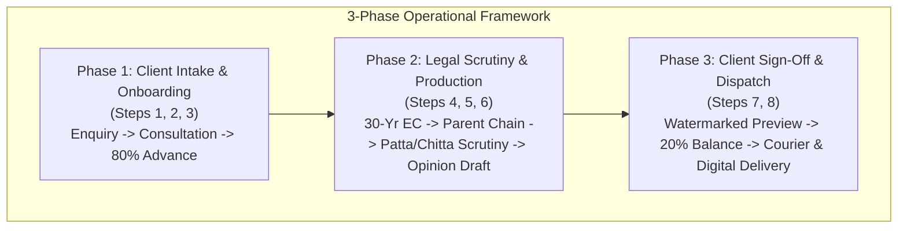
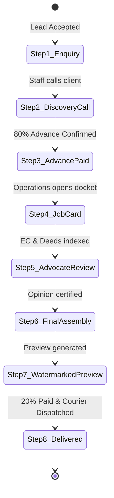
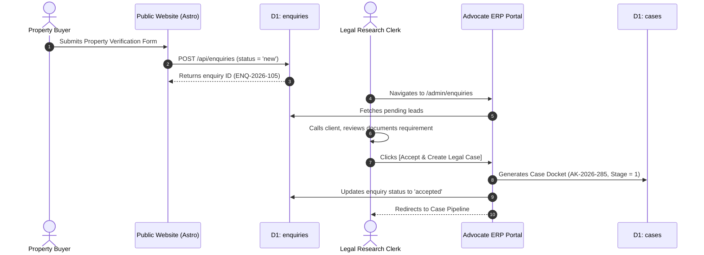
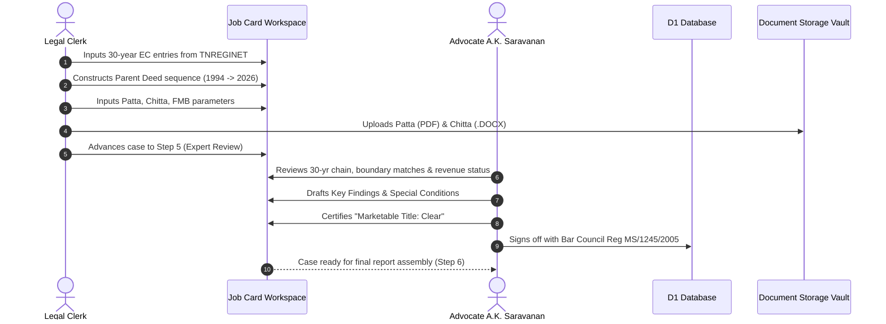

# Functional Requirements Document (FRD)
## Software Requirements Specification (SRS)
### AKS Property Checklist & Legal Operations Platform

**Document Version:** 1.0.0  
**Standard Compliance:** IEEE 830-1998 / ISO/IEC/IEEE 29148:2018  
**Status:** Approved / Active Baseline  
**Classification:** Confidential — Legal Practice Intellectual Property  
**Governing Advocate:** Advocate A.K. Saravanan (M.E. Energy, LLB), Bar Council Reg: MS/1245/2005  
**Date of Release:** October 2026  

---

## 1. Introduction, Business Context & Objectives

### 1.1 Business Context & The Problem
In Tamil Nadu, real property operates under a **presumptive title system** governed by the *Transfer of Property Act, 1882*, the *Registration Act, 1908*, and the *Tamil Nadu Patta Pass Book Act, 1983*. Unlike Torrens title systems where the state guarantees title, in India:
- A registered sale deed does not guarantee clear ownership if earlier link deeds possess legal defects, forged powers of attorney, partition disputes, or undisclosed mortgages.
- A revenue Patta proves possession and land revenue liability, but does not confer title in the absence of valid registered parent documents.
- Discrepancies between **Registration Department records (TNREGINET)** and **Revenue Department records (Tamil Nilam / AnyTamilNadu e-Services)** are the leading source of real estate fraud and long-pending litigations.

### 1.2 Purpose of the System
The platform standardizes and digitalizes Advocate A.K. Saravanan's proprietary **8-Stage Title Verification Standard Operating Procedure (SOP)**:
1. Educate buyers and sellers on statutory pitfalls through public checklists and buffer zone parameters.
2. Provide a two-tier intake pipeline separating public leads from official court dockets.
3. Equip legal practitioners with an ergonomic, zero-confusion workspace for conducting 30-year EC indexing, parent document genealogical flow analysis, and Patta/Chitta/FMB revenue reconciliation.
4. Manage multi-format document assets (PDFs and Microsoft Word `.docx` drafting files) up to 15 MB.
5. Provide complete financial governance (80% advance / 20% balance fee structure) and zero-login live status tracking for property buyers worldwide.



---

## 2. Stakeholders & User Personas

| Persona | Role | Key Responsibilities & Needs | System Touchpoints |
| :--- | :--- | :--- | :--- |
| **Buyer / Client** | Consumer / Investor | Property purchaser, builder, or NRI investor requiring reassurance that title is clear and marketable. | Public Website, Checklists, `/track/[caseId]` |
| **Chief Legal Advisor** | Advocate A.K. Saravanan | Senior advocate with 20+ years of Bar standing. Scrutinizes root of title, reviews parent deed continuity, flags encumbrances, and certifies opinion. | Admin Portal, Job Card Scrutiny, Sign-off Engine |
| **Legal Research Staff** | Associate / Clerk | Downloads and indexes 30-year ECs from TNREGINET, checks e-Patta and Chitta, verifies FMB boundaries, and uploads Word `.docx` drafts. | Admin Pipeline, Job Card, Uploads Vault |
| **Accounts Manager** | Billing Desk | Verifies 80% advance payment before scrutiny begins, reconciles 20% balance payment before releasing sealed reports. | Admin Pipeline, Billing Ledger |

---

## 3. Detailed Functional Modules & Requirements

### Module 1: Public Engagement, Buffer Checklists & Lead Intake (`FR-MOD-01`)
*System Target: `aks-properties-checklist` (`akspropertychecklist.in`)*

- **FR-01.1 (Service Portfolios):** The system shall present 6 dedicated legal service flows with statutory guidelines:
  1. Agricultural Land Title Verification (Ceiling Act, e-Patta, Natham checks).
  2. DTCP & CMDA Approved Layout Title Clearance.
  3. Residential Flat & Villa Scrutiny (UDS calculation, building plan approval).
  4. Commercial Due Diligence & Industrial Land Acquisition.
  5. Ancestral Property & Legal Heirship Title Genealogy.
  6. Non-Traceable Land Search & Missing Parent Deed Reconstruction.
- **FR-01.2 (Buffer Zone Calculator):** The system shall display statutory buffer zone constraints:
  - ASI Protected Monument: 100m Prohibited Zone + 200m Regulated Zone.
  - Water Body / River / Channel (PWD): 15m to 50m green buffer zone.
  - High Tension (HT) Power Lines: 7m to 25m safety clearance.
  - Railway Boundary: 30m no-objection corridor.
- **FR-01.3 (Interactive Property Checklist):** The system shall provide an interactive 40-point verification checklist allowing users to self-assess property documentation readiness.
- **FR-01.4 (Lead Capture Form):** The system shall collect prospective buyer details (Name, WhatsApp Phone, Email, District, Survey Number, Message) and stream the record directly into the `enquiries` table of the ERP system via REST API.

---

### Module 2: Staged Lead Ingestion & 2-Tier Conversion (`FR-MOD-02`)
*System Target: `aks-property-portal` (`/admin/enquiries`)*

- **FR-02.1 (Two-Tier Buffer Isolation):** Public leads shall enter the `enquiries` table in a `new` status. Leads shall **not** be assigned an active docket ID until verified to prevent junk submissions from polluting active legal records.
- **FR-02.2 (Enquiry Inbox):** The system shall provide a triage desk displaying lead source, client contact, district, service package, and creation date.
- **FR-02.3 (Status Triage):** Staff shall filter and update leads across statuses: `new`, `contacted`, `accepted`, `rejected`, `spam`.
- **FR-02.4 (1-Click Case Promotion):** Upon advocate approval, clicking **`[Accept & Create Legal Case]`** shall:
  1. Atomically generate a unique legal docket ID (format: `AK-YYYY-XXX`).
  2. Populate the `cases` table with client profile, property location, and fee structure (default ₹6,500 total, ₹5,200 advance, ₹1,300 balance).
  3. Set initial stage to **Step 1: Enquiry Received**.
  4. Link the enquiry via `source_enquiry_id` and update enquiry status to `accepted`.

---

### Module 3: 8-Stage SOP Legal Workflow Pipeline (`FR-MOD-03`)
*System Target: `aks-property-portal` (`/admin/pipeline`)*



- **FR-03.1 (The 8 Standard Milestones):**
  - **Step 1 — Enquiry Received:** Matter logged; initial property details cataloged.
  - **Step 2 — Discovery & Requirement Call:** Staff interviews client, clarifies boundaries, requests parent deeds copy.
  - **Step 3 — Welcome Letter & 80% Advance:** Advance payment confirmed; formal engagement terms issued.
  - **Step 4 — Job Card: Document & EC Indexing:** 30-year sub-registrar EC records and parent deeds indexed.
  - **Step 5 — Expert Verification (Advocate Review):** Advocate A.K. Saravanan scrutinizes title continuity and encumbrances.
  - **Step 6 — Final Report & Annexures Assembly:** Formal legal opinion compiled with Annexure I (Property Index) and Annexure II (Document Flow).
  - **Step 7 — Watermarked Preview & Balance Payment:** Low-resolution watermarked draft sent for review; 20% balance requested.
  - **Step 8 — Final Dispatch (Digital + Courier):** Clean certified copy dispatched via WhatsApp/Email and hard copy sent via Registered Post/Courier.
- **FR-03.2 (Zero-Dead-End Guarantee):** If a user selects a filter or search resulting in 0 cases, the UI shall:
  - Display an empathetic, reassuring message explaining that no files currently wait at that step.
  - Display the caseload distribution across other active phases.
  - Provide a prominent 1-click button to reset filters (`[Show All Active Matters]`).
- **FR-03.3 (Stage Advancement Safeguards):** Clerks can advance cases with single-click actions. A case can be moved backward 1 step if administrative corrections are required.

---

### Module 4: Digital Job Card & Scrutiny Engine (`FR-MOD-04`)
*System Target: `aks-property-portal` (`/admin/cases/[id]/job-card`)*

The Job Card acts as the advocate's legal workbench, divided into four specialized legal scrutiny modules:

#### Module 4A: 30-Year Encumbrance Certificate (EC) Matrix
- **FR-04.1 (Continuous Search Period):** The system shall record search periods spanning minimum 30 years (e.g. 1994 to 2026).
- **FR-04.2 (EC Entry Schema):** For each entry in Book 1 volume, record:
  - SRO Name (e.g. Gandhipuram SRO, Periamet SRO).
  - Registered Document Number & Year.
  - Nature of Deed (Sale, Mortgage, Lease, Release, Partition, Gift).
  - Parties: Executant (Seller/Mortgagor) to Claimant (Purchaser/Mortgagee).
  - Encumbrance Flag (Yes/No) with adverse remarks.
  - Attached deed copy (PDF/Word).

#### Module 4B: Parent Documents & Chain of Title Flow
- **FR-04.3 (Genealogical Continuity):** Track historical title flow across generations:
  - Sequence order (Root deed $\rightarrow$ Intermediate deeds $\rightarrow$ Current deed).
  - Deed Type & Registration Date.
  - Extent of land transferred (Sq.Ft, Cents, Acres).
  - Schedule of Property match flag (verifies if boundaries North/South/East/West match parent deed).
  - Gap Analysis Notes (records missing link documents or court decrees).

#### Module 4C: Revenue Records Scrutiny
- **FR-04.4 (Four-Pillar Revenue Verification):**
  1. **Patta Verification:** Patta Number, Type (Individual/Joint), Patta Holder Name, and attached PDF/DOCX.
  2. **Chitta / Adangal Register (சிட்டா):** Wet/Dry classification, owner name verification, cultivation notes, and attached DOCX/PDF.
  3. **Field Measurement Book (FMB Sketch):** Survey number, subdivision, physical measurement match flag, and attached drawing.
  4. **Town Survey Land Register (TSLR):** Municipal extract for urban corporation areas (Chennai, Coimbatore).
  5. **Guideline Value Extraction:** Record government fair value per Sq.Ft / Acre.

#### Module 4D: Legal Opinion Drafting & Advocate Sign-off
- **FR-04.5 (Certification Attributes):**
  - Marketable Title Status: `Clear` | `Conditional` | `Defective` | `Pending Verification`.
  - Encumbrance Status: `Nil Encumbrance` | `Mortgaged` | `Litigation / Court Order`.
  - Revenue Compliance: `Full Patta Available` | `Subdivision Required` | `Patta Transfer Pending`.
  - Key Legal Findings (bullet points).
  - Special Conditions & Pre-Registration Requirements.
  - Advocate Sign-off: Advocate name (`Advocate A.K. Saravanan`), Bar Council Reg No (`MS/1245/2005`), and digital sign-off timestamp.

---

### Module 5: Document Management Vault (`FR-MOD-05`)
*System Target: `aks-property-portal` (`/api/upload`)*

- **FR-05.1 (Multi-Format Support):** The system shall accept:
  - PDF Documents (`application/pdf`)
  - Microsoft Word Documents (`.docx`, `.doc` / `application/msword`, `application/vnd.openxmlformats...`)
  - High-Resolution Scans (`image/jpeg`, `image/png`)
- **FR-05.2 (File Size Enforcement):** The system shall allow document files up to **15 MB** per upload.
- **FR-05.3 (File Categorization):** Uploads shall be categorized under: `Deed`, `Patta`, `Chitta`, `FMB`, `EC`, `ID Proof`, `Legal Opinion`.
- **FR-05.4 (Format Indicator Badges):** The UI shall render distinct color badges:
  - `[DOCX]` in blue for Word documents.
  - `[PDF]` in red for Adobe Acrobat documents.
  - `[IMG]` in emerald for photographic scans.

---

### Module 6: Billing & Fee Milestone Accounting (`FR-MOD-06`)
*System Target: `aks-property-portal` (`/admin/pipeline`, `/admin/cases/[id]`)*

- **FR-06.1 (Statutory 80/20 Fee Milestones):**
  - **Total Agreed Fee:** Default ₹6,500 (Customizable per matter complexity).
  - **Phase 1 Advance (80%):** ₹5,200 collected at Step 3 before initiating title extraction.
  - **Phase 3 Balance (20%):** ₹1,300 collected at Step 7 before delivering the final unwatermarked opinion.
- **FR-06.2 (Review & Consultation Discounts):** Ability to apply promotional discounts or adjust balance amounts for repeat corporate clients.
- **FR-06.3 (Audit Trail):** Every payment shall record transaction reference, payment mode (UPI, NEFT, Cash), verified by, and timestamp.

---

### Module 7: Public Client Live Case Tracking (`FR-MOD-07`)
*System Target: `aks-property-portal` (`/track/[caseId]`)*

- **FR-07.1 (Zero-Login Public Access):** Clients track their property verification using their Case ID (e.g. `/track/AK-2026-001`) without remembering passwords.
- **FR-07.2 (Client-Friendly Milestone Display):** Milestones shall display humanized consumer descriptions (e.g. *"Our legal team is extracting 30+ years of sub-registrar records"*).
- **FR-07.3 (Provisional Preview Gate):** At Step 7, clients can download the watermarked preview.
- **FR-07.4 (Courier Tracking Integration):** At Step 8, the page displays the physical Courier AWB number and tracking link for hard copy delivery.

---

## 4. Business Rules & Validation Logic

| Rule ID | Rule Name | Description & Enforcement Trigger |
| :--- | :--- | :--- |
| **BR-001** | **30-Year Chain Rule** | No title opinion shall be certified as "Clear" unless Encumbrance Certificates cover a minimum continuous period of 30 years without unregistered gaps. |
| **BR-002** | **Patta-Deed Alignment** | Current vendor's name in the latest registered sale deed must match the registered Patta Holder name in Tamil Nilam revenue records, or a Mutation condition must be imposed. |
| **BR-003** | **Advance Fee Gate** | A case cannot be moved beyond Step 3 (Welcome & Advance) unless 80% advance payment status is confirmed by staff. |
| **BR-004** | **Advocate Sign-Off Gate** | Step 6 (Final Report Compilation) cannot be completed without affirmative sign-off from an `ADVOCATE_ADMIN` role user. |
| **BR-005** | **Preview Watermark Policy** | Any document downloaded at Step 7 must contain an indelible diagonal watermark preventing its misuse for property registration before full payment. |
| **BR-006** | **Dispatch Gate** | A case cannot be moved to Step 8 (Delivered) until the 20% balance payment is marked as `fully_paid`. |
| **BR-007** | **Zero Dead-End Rule** | UI components must never render an empty void when filters match zero cases; they must offer immediate fallback navigation. |

---

## 5. End-to-End User Workflows

### 5.1 Lead Intake to Case Creation Workflow



---

### 5.2 Legal Scrutiny & Advocate Sign-off Workflow



---

## 6. Functional Traceability Matrix

| Business Objective | Requirement ID | Module | Implementation Target | Verification Method |
| :--- | :--- | :--- | :--- | :--- |
| Standardize 30-Year Scrutiny | FR-04.1, FR-04.2 | Module 4A | `admin/cases/[id]/job-card` | Advocate manual audit & review |
| Protect Legal Practice from Bad Leads | FR-02.1, FR-02.4 | Module 2 | `admin/enquiries` | Lead triage test |
| Zero Practice Stoppage / Confusion | FR-03.2, BR-007 | Module 3 | `admin/pipeline` | UI filter boundary test |
| Support Word & PDF Deeds | FR-05.1, FR-05.2 | Module 5 | `api/upload` | File upload test (15MB DOCX/PDF) |
| Ensure Revenue Alignment | FR-04.4, BR-002 | Module 4C | `admin/cases/[id]/job-card` | Revenue reconciliation review |
| Guarantee Fee Collections | FR-06.1, BR-003, BR-006 | Module 6 | `admin/pipeline` | Fee gate progression test |
| Transparent Client Tracking | FR-07.1, FR-07.4 | Module 7 | `track/[caseId]` | Client URL live tracking test |

---

## 7. Operational Sign-Off & Approvals

```
========================================================================================
LEGAL SCRUTINY SPECIFICATION APPROVED BY:
Advocate A.K. Saravanan, M.E. (Energy), LLB
Chief Legal Advisor | Bar Council of Tamil Nadu Reg: MS/1245/2005
Offices: Coimbatore & Chennai, Tamil Nadu

TECHNICAL SYSTEMS ARCHITECTURE APPROVED BY:
Principal Solutions Architect, Cloud & Edge Engineering Team
========================================================================================
```

