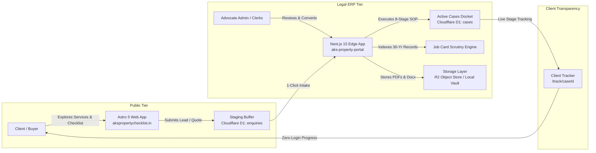
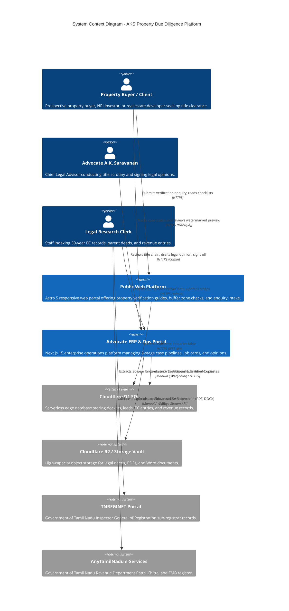
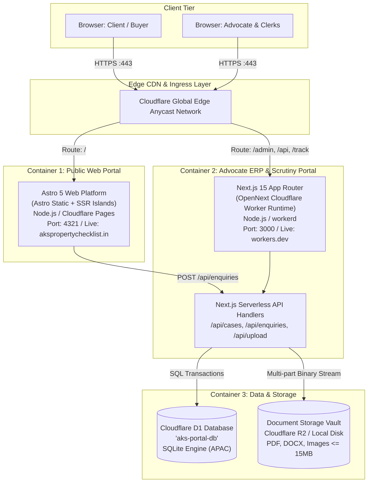
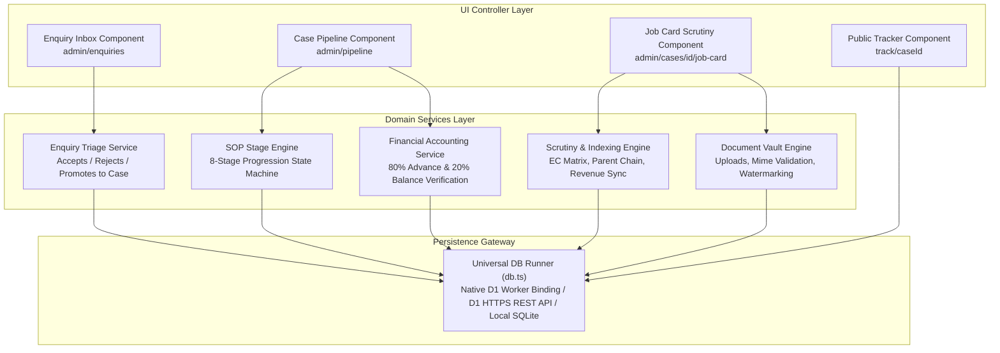
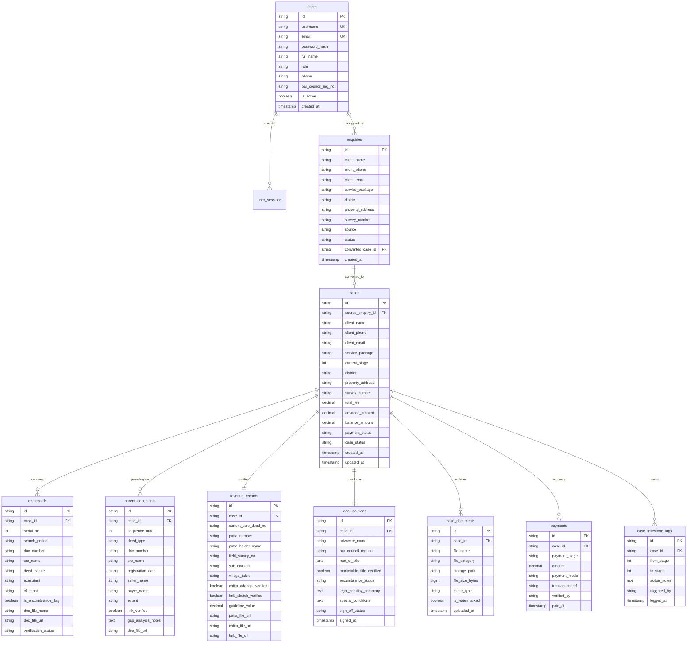
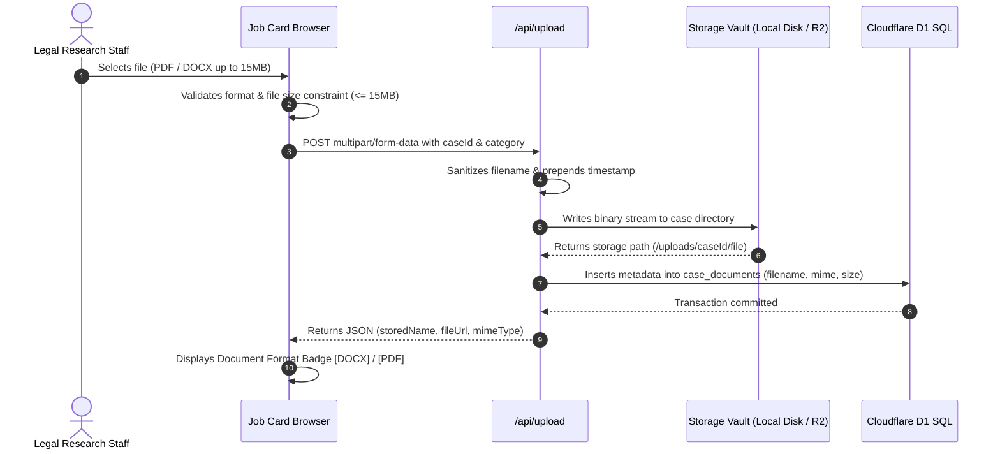

# Technical Architecture Document (TAD)
## AKS Property Checklist & Legal Operations Platform

**Document Version:** 1.0.0  
**Status:** Approved / Active Baseline  
**Classification:** Confidential — Legal Practice Intellectual Property  
**Target Systems:**
1. **Public Discovery & Lead Intake Portal:** `aks-properties-checklist` (`akspropertychecklist.in`)
2. **Advocate ERP & Legal Scrutiny Hub:** `aks-property-portal` (`aks-property-portal.akspropertychecklist77.workers.dev`)  
**Lead Architect:** Engineering Team in collaboration with Advocate A.K. Saravanan (M.E., LLB)  
**Date of Release:** October 2026  

---

## 1. Executive Summary & Architectural Goals

The **AKS Property Checklist & Legal Operations Platform** is a cloud-native, edge-first legal technology ecosystem purpose-built for property due diligence and title verification across Tamil Nadu, India. 

Real estate transactions in Tamil Nadu operate under a dual-authority regulatory regime:
1. **The Registration Department (TNREGINET):** Governs deeds, registered encumbrances, and transactions under the *Registration Act, 1908*.
2. **The Revenue Department (Tamil Nilam / e-Services):** Governs ownership records, Patta, Chitta, Town Survey Land Register (TSLR), and Field Measurement Book (FMB) sketches under the *Tamil Nadu Patta Pass Book Act, 1983*.

Due to the lack of title guarantee in India (presumptive titling), verifying real property demands a rigorous multi-tier audit covering 30+ years of sub-registrar transactions, root of title genealogy, physical boundary alignment, and revenue compliance.

The platform provides an end-to-end digital lifecycle:
- **Client Acquisition & Assessment:** High-speed client-facing web application delivering interactive checklist audits, quote calculations, and automated lead staging.
- **Advocate Operations Management:** Serverless Enterprise Resource Planning (ERP) platform implementing an 8-Stage Standard Operating Procedure (SOP), digital Job Cards, 30-year EC matrixing, multi-format document management (PDF & Word `.docx`), automated stage tracking, and client self-service docket inspection.



---

## 2. Architecture Principles & Core Patterns

1. **Edge-First Computation (Zero Cold-Starts):**
   - Public front-end and ERP application run globally on Cloudflare's Edge Network (`workerd` runtime) with execution latencies under 50ms across Asia-Pacific (APAC).
2. **Two-Tier Staging Pattern (Intake Isolation):**
   - Unverified leads from public forms arrive in an isolated `enquiries` staging buffer. Only after human assessment and advocate validation are records converted into official docket entries (`cases` table) with a unique reference number (`AK-YYYY-XXX`).
3. **Polyglot Storage Separation:**
   - **Structured Metadata & State:** Stored in Cloudflare D1 distributed SQLite database with strict ACID compliance.
   - **Unstructured Heavy Binaries (up to 15 MB):** Document scans, registered sale deeds, Patta, Chitta, and `.docx` legal opinions are stored in Cloudflare R2 / Local Disk Vaults, leaving relational tables lightweight.
4. **Zero-Dead-End UX Architecture:**
   - Human-centered ergonomics: Filtering, searching, or selecting milestones never strands legal practitioners on an empty void. Empty states always supply context, caseload distribution, and 1-click reset paths.
5. **Duality of Execution (Cloud Edge vs. Local Box):**
   - The platform supports seamless offline/local development where the local Node.js server (`localhost:3000`) communicates directly with the live Cloudflare D1 database via authenticated HTTPS REST APIs, bypassing local database sync drift.

---

## 3. C4 Architectural Viewpoints

### 3.1 C4 Level 1: System Context Diagram



---

### 3.2 C4 Level 2: Container Architecture



---

### 3.3 C4 Level 3: Component Architecture (Advocate ERP Engine)



---

## 4. Data Architecture & Relational Schema

The data model is engineered in ANSI-SQL and optimized for SQLite under Cloudflare D1. It enforces strict relational integrity with foreign keys, cascading deletions, and comprehensive indexes.

### 4.1 Entity Relationship Diagram (ERD)



---

## 5. Integration & API Specifications

The platform provides a unified RESTful interface designed for edge execution with full CORS and JSON support.

### 5.1 Endpoints Matrix

| HTTP Method | Route | Description | Auth Required | Runtime / Target |
| :--- | :--- | :--- | :--- | :--- |
| **POST** | `/api/auth/login` | Authenticates advocate/clerk and generates session token | Public | Edge Worker |
| **GET** | `/api/cases` | Retrieves list of active dockets with filtering | Yes (Session/Cookie) | D1 SQL Edge |
| **POST** | `/api/cases` | Creates new legal case docket directly | Yes (Advocate/Staff) | D1 SQL Edge |
| **GET** | `/api/cases/[id]` | Fetches full case details, ECs, parent deeds, revenue | Public (via token) / Admin | D1 SQL Edge |
| **PATCH**| `/api/cases/[id]` | Advances or rolls back 8-stage SOP milestone | Yes (Advocate/Staff) | D1 SQL Edge |
| **POST** | `/api/cases/[id]/job-card` | Appends individual EC or Parent Deed record | Yes (Advocate/Staff) | D1 SQL Edge |
| **PUT**  | `/api/cases/[id]/job-card` | Upserts Revenue Records (Patta, Chitta, FMB) & Opinion | Yes (Advocate/Staff) | D1 SQL Edge |
| **GET**  | `/api/enquiries` | Lists incoming leads submitted from public website | Yes (Advocate/Staff) | D1 SQL Edge |
| **POST** | `/api/enquiries` | Ingestion endpoint for public web checklist form | Public (CORS Enabled) | D1 SQL Edge |
| **POST** | `/api/enquiries/[id]/accept`| Converts staging enquiry into active Case Docket | Yes (Advocate/Staff) | D1 Transaction |
| **POST** | `/api/upload` | Multipart file upload handler for PDF & Word docs | Yes (Advocate/Staff) | Disk Vault / R2 |
| **GET**  | `/track/[caseId]` | Client self-service live verification status | Public | Edge SSR Page |

---

## 6. Document & Binary File Architecture

Real-world legal diligence requires handling multiple proprietary document formats:
- **PDF Documents (`application/pdf`):** Standard for e-Pattas, certified copies of registered deeds, and Encumbrance Certificates.
- **Word Documents (`.docx`, `.doc`):** The universal drafting format used by legal typists and advocates in Madras High Court and district bar associations for drafting title scrutiny reports, annexures, and formal opinions.
- **Image Scans (`image/jpeg`, `image/png`):** High-resolution photographs of Field Measurement Book (FMB) sketches and ancient settlement registers.

### 6.1 Upload Pipeline & Storage Routing



---

## 7. Security, Compliance & Data Governance

1. **Role-Based Access Control (RBAC):**
   - `ADVOCATE_ADMIN`: Advocate A.K. Saravanan. Full rights to assign cases, sign opinions, delete records, adjust agreed fees, and override title clearance.
   - `RESEARCH_STAFF`: Legal clerks and typists. Restricted to indexing EC records, inputting parent deed parameters, uploading revenue files, and drafting findings.
   - `CLIENT / PUBLIC`: Read-only zero-login access strictly scoped to `/track/[caseId]` for their specific case ID.
2. **Document Watermarking & Preview Security:**
   - Previews issued at **Step 7 (Watermarked Preview)** are dynamically stamped with diagonal watermarks: *"CONFIDENTIAL PROVISIONAL PREVIEW — FOR VERIFICATION ONLY — NOT VALID FOR REGISTRATION"*. High-resolution clean legal opinions are only released at **Step 8** upon receipt of the 20% balance payment.
3. **Bar Council of India Ethical Adherence:**
   - In compliance with *Rule 36, Section IV of the Bar Council of India Rules*, the platform does not engage in touting or solicitation. The public web portal provides objective consumer educational checklists, statutory buffer zone parameters, and a voluntary consultation intake gateway.
4. **Credential Isolation & Push Protection:**
   - Cloudflare API tokens and environment secrets are managed via `.env.local` and Cloudflare Secret Management. GitHub Secret Scanning and Push Protection guard against credential exposure.

---

## 8. Deployment & Infrastructure Architecture

```mermaid
graph LR
    subgraph Development Environment
        DevBox["Developer Local Box<br/>Node.js v24.20 / Windows<br/>C:\aks-property-portal"]
        LocalDisk["Local Uploads Vault<br/>public/uploads/"]
    end

    subgraph GitHub Source Control
        GitRepo["GitHub Repository<br/>branch: main<br/>Push Protection Active"]
    end

    subgraph Production Cloudflare Edge
        WorkerBuild["OpenNext Compiler<br/>opennextjs-cloudflare"]
        ProdWorker["Cloudflare Worker<br/>aks-property-portal.workers.dev<br/>Memory: 128MB / Time: 50ms"]
        ProdD1["Cloudflare D1<br/>aks-portal-db<br/>Region: APAC (Singapore)"]
        ProdAssets["Cloudflare Static Assets<br/>Binding: env.ASSETS"]
    end

    DevBox -->|Reads & Writes| LocalDisk
    DevBox -->|Direct HTTPS REST Queries| ProdD1
    DevBox -->|git push (Approved)| GitRepo
    GitRepo -->|Trigger Deploy| WorkerBuild
    WorkerBuild --> ProdWorker
    ProdWorker --> ProdD1
    ProdWorker --> ProdAssets
```

### 8.1 Production Environment Manifest

| Resource Component | Identifier / Binding | Hosting Environment | Region |
| :--- | :--- | :--- | :--- |
| **Web Framework** | Next.js 15.5.28 (App Router) | Cloudflare Workers (`workerd`) | Global Edge |
| **Build Wrapper** | `@opennextjs/cloudflare` v1.20 | OpenNext Serverless Pipeline | Local / CI |
| **Relational Database** | `env.DB` (`aks-portal-db`) | Cloudflare D1 Distributed SQLite | Asia-Pacific (APAC) |
| **Database UUID** | `c987d1f0-a579-4e4c-8482-36482bebfd7f` | Cloudflare Serverless Engine | APAC / Singapore Colo |
| **Static Assets CDN** | `env.ASSETS` | Cloudflare Global CDN | Edge (300+ Cities) |
| **Account Reference** | `c4806076a4b169eb610eb15cc0fbaee4` | Cloudflare Enterprise Account | Global |

---

## 9. Non-Functional Requirements (NFRs) & Quality Attributes

| Attribute | Specification | Implementation Strategy |
| :--- | :--- | :--- |
| **Edge Response Latency** | $< 80\text{ ms}$ for 95th percentile | OpenNext server-side rendering directly in V8 isolates on edge nodes. |
| **Database Query Speed** | $< 15\text{ ms}$ for relational lookups | Distributed D1 SQLite with composite indexes on `case_id`, `client_phone`, `current_stage`. |
| **File Processing Limit** | Up to $15\text{ MB}$ per file | Streaming multi-part payload parser handling PDF, DOCX, and high-res imagery. |
| **Availability (SLA)** | $99.9\%$ monthly uptime | Multi-zone Cloudflare Edge infrastructure with automated health monitoring. |
| **Recovery Point (RPO)** | $< 15\text{ minutes}$ | Automated point-in-time recovery via Cloudflare D1 continuous replication. |
| **Recovery Time (RTO)** | $< 1\text{ hour}$ | Declarative IaC (`wrangler.toml`) + Liquibase ANSI-SQL schema migrations. |

---

## 10. Technology Stack Summary

```
========================================================================================
APPLICATION LAYER:        Next.js 15 (React 19, TypeScript 5.7, Tailwind CSS 3.4)
PUBLIC WEB LAYER:         Astro 5 (Static Site Generation, Tailwind CSS, Island Arch)
RUNTIME ENVIRONMENT:      Cloudflare Workers (workerd / V8 Engine)
COMPILATION FRAMEWORK:    OpenNext (@opennextjs/cloudflare v1.20)
RELATIONAL DATABASE:      Cloudflare D1 (Serverless Distributed SQLite Engine)
BINARY DOCUMENT STORAGE:  Cloudflare R2 Object Store / Local Multi-Part Disk Vault
VERSION CONTROL:          Git (GitHub Private Repository with Push Protection)
OPERATING SYSTEM DEV:     Windows PowerShell (Node.js v24.20 LTS)
========================================================================================
```

